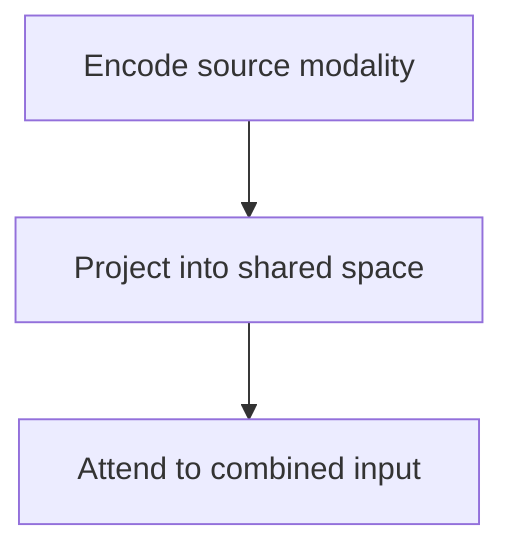

Multimodal models process more than tokens of text: images, audio, video, and
combinations. The architectural idea is simple — map every modality into the same
representation space — and the engineering consequences are substantial.

> [!WHY] A document feature sends every page as a full image even when the
> text layer is sufficient. The request becomes slower and more expensive
> while question accuracy stays limited by which pages were selected.

> [!GOALS]
>
> - Explain cross-modal attention
> - Choose a document representation
> - Design a video evaluation

## The architecture

```text
  IMAGE ──▶ vision encoder ──▶ patch embeddings ──┐
                                                   │
  AUDIO ──▶ audio encoder  ──▶ frame embeddings ──┼──▶ LANGUAGE
                                                   │    MODEL
  TEXT  ──▶ tokenizer      ──▶ token embeddings  ──┘
                                                        │
                                                        ▼
                                                     output
```

```text
  the key idea: every modality becomes a sequence of vectors
  in the SAME space, and the language model attends over all
  of them together.

  → cross-modal reasoning falls out of ordinary attention
```

```text
  how they are combined

  EARLY FUSION      project into the token space and
                    concatenate
                    → simple, and the dominant approach
  CROSS-ATTENTION   the language model attends to encoder
                    outputs via dedicated layers (Flamingo)
                    → fewer tokens consumed
  UNIFIED           one model trained natively on all
                    modalities from the start
                    → the frontier direction
```



## Images are expensive in tokens

```text
  an image is split into patches; each patch is a token.

    a 1024×1024 image at 14×14 patches
      = 73 × 73 = 5,329 patches

  → high-resolution images consume thousands of tokens
```

```text
  the practical consequences

  □  resolution is a COST decision — most models downscale
     or tile
  □  fine detail (small text, dense charts) is often lost at
     the resolution the model actually sees
  □  several images multiply the cost quickly
  □  a document page as an image costs far more than the same
     page as text
```

**Send text as text.** Passing a PDF page as an image when the text is extractable
costs an order of magnitude more tokens and loses accuracy. Use OCR or a text
layer where one exists, and reserve image input for genuinely visual content —
layout, charts, photographs, handwriting.

## Where vision models are strong and weak

```text
  RELIABLE                          UNRELIABLE
  ────────                          ──────────
  describing a scene                counting objects precisely
  reading clear text (OCR)          exact spatial relationships
  classifying content               fine detail at low resolution
  answering about obvious           reading dense tables
    content                         precise measurement
  chart interpretation (roughly)    anything needing pixel accuracy
```

Counting is the canonical weakness and worth knowing: models routinely miscount
objects beyond a handful. If a count matters, a detection model is the right tool
and the language model is not.

## Audio

```text
  SPEECH TO TEXT     transcription; mature and reliable
  AUDIO UNDERSTANDING
                     the model reasons over audio directly —
                     tone, speaker, non-speech sound
  TEXT TO SPEECH     synthesis
  SPEECH TO SPEECH   end-to-end conversation with no text
                     intermediate
                     → lower latency, preserves prosody
```

```text
  the engineering differences

  □  STREAMING is usually required — you cannot wait for a
     complete utterance
  □  latency budgets are tight; conversational turn-taking
     needs sub-second response
  □  audio is large: minutes of audio is a lot of data
  □  end-to-end speech avoids the transcription→text→synthesis
     round trip and its cumulative errors
```

## Video

```text
  video = many frames + audio

    1 minute at 30 fps = 1,800 frames
    at even 100 tokens per frame = 180,000 tokens
```

```text
  so every practical system SUBSAMPLES:

  □  1 frame per second, or fewer
  □  keyframes at scene changes
  □  a lower resolution than for still images
  □  audio transcript alongside sparse frames
     ← often the most cost-effective approach
```

Video understanding is the modality where cost most constrains what is possible,
and the transcript-plus-sparse-frames approach captures most of the value for a
fraction of the tokens.

## Generation

```text
  IMAGE      diffusion models, increasingly integrated with
             language models for instruction following
  AUDIO      speech synthesis, music
  VIDEO      generation; expensive and improving fast
```

```text
  the engineering concerns for generated media

  □  latency measured in SECONDS, not milliseconds
  □  content safety filtering on output is mandatory
  □  PROVENANCE — watermarking and C2PA-style metadata
  □  storage and CDN delivery for generated assets
  □  the cost per generation is high enough that caching
     identical requests matters
```

## Practical guidance

```text
  □  use TEXT where text exists — image input for genuinely
     visual content
  □  choose resolution deliberately; higher is not free
  □  for documents, try OCR plus text first
  □  for video, transcript plus sparse frames
  □  evaluate on YOUR images — benchmark performance does not
     transfer to your document layouts
  □  handle refusals: vision models refuse on faces, people
     and sensitive content more than text models do
  □  images are personal data — the privacy topic applies
```

That last point is easy to overlook: an image sent to a model may contain faces,
documents, screens with credentials and location information the sender did not
consider. The data-minimisation obligation applies to what is in the image, not
just to what the request is about.

> [!PITFALL] Validate fine-detail and counting cases on representative
> media. General description accuracy can hide those failures.

> [!INTERVIEW] Explain which information requires visual inputs and how
> the rest can be sent more efficiently.

> [!CHECK] Why can equivalent text be cheaper than a full-page image?
>
> The image is represented by many visual tokens, even when the relevant
> content is a short passage.

> [!CHECK] What can make a video input too large?
>
> Supplying every frame adds many visual tokens across the timeline.

> [!CHECK] Which audio property shapes a natural conversation?
>
> Streaming latency and the time before the first usable reply matter to
> turn-taking.

## What to take away

1. Every modality is projected into a shared vector space and attended over
   together, so cross-modal reasoning falls out of ordinary attention.
2. Images cost thousands of tokens; send text as text and reserve image input for
   genuinely visual content.
3. Vision models are reliable for description and classification and unreliable for
   counting, precise spatial relationships and fine detail.
4. Audio requires streaming and tight latency; end-to-end speech avoids the
   cumulative errors of transcribe-then-synthesise.
5. Video must be subsampled, and transcript plus sparse frames is usually the
   cost-effective approach.
6. Evaluate on your own images, expect more refusals than with text, and remember
   an image may contain personal data the sender did not consider.

Next: safety and the guardrails around all of this.

## Exercises

> [!EXERCISE recall] How can a model relate text in a question to an image
> region?
>
> **Solution:** The encoders project inputs into a shared representation,
> so attention can combine information from visual and textual positions.

> [!EXERCISE apply] A contract review depends mostly on selectable text
> plus a handful of charts whose layout matters. What input would you
> send?
>
> **Solution:** Use text for searchable passages and selected image
> regions for charts or layout-dependent questions. Evaluate the mixed
> strategy on original documents. Sending every page as an image raises
> token cost and may bury relevant detail.

> [!EXERCISE stretch] Users ask both what was said and what happened
> visually at a short moment. How would you design the input and test the
> result?
>
> **Solution:** Supply timestamped transcript and representative frames,
> then assess whether the frame sampling covers events users ask about.
> Include cases where visual evidence changes the answer. Transcript-only
> evaluation misses those failures.
