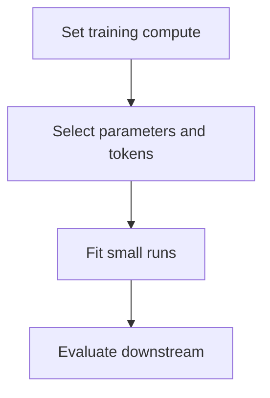

Scaling laws are the most practically useful empirical result in modern ML: loss
falls as a *predictable power law* in model size, data and compute. That
predictability is what turns a training run from a gamble into a plan.

> [!WHY] A training proposal assigns most of the compute to parameter
> count and leaves few tokens per parameter. A rough compute estimate can
> reveal an allocation mismatch before the large run commits its budget.

> [!GOALS]
>
> - Explain allocation under fixed compute
> - Compute a training comparison
> - Choose evidence for a new workload

## The relationship

```text
  loss ≈ a power law in each of

    N  parameters
    D  training tokens
    C  compute  (C ≈ 6 N D for a transformer)
```

```text
  loss
    │╲
    │ ╲___
    │      ╲____
    │            ╲______
    │                    ╲________
    └────────────────────────────────▶ log(compute)

  a STRAIGHT LINE on a log-log plot, over many orders of
  magnitude.
```

The practical consequence: **you can train small models, fit the curve, and
predict the loss of a model 100× larger before spending the money.** Frontier labs
do exactly this — a scaling study of small runs determines the configuration of
the large one.

## Chinchilla: the allocation question

Given a fixed compute budget, how do you split it between model size and data?

```text
  the pre-2022 assumption:  make the model as big as possible

  Chinchilla (Hoffmann et al., 2022) showed this was wrong:

    for COMPUTE-OPTIMAL training,
    parameters and tokens should scale ROUGHLY EQUALLY

    ≈ 20 tokens per parameter
```

```text
  the demonstration

    Gopher       280B parameters, 300B tokens
    Chinchilla    70B parameters, 1.4T tokens

    same compute. Chinchilla WINS on nearly every benchmark
    with a QUARTER of the parameters.
```

```text
  compute-optimal sizing at 20 tokens/parameter

    7B    →  140B tokens
    70B   →  1.4T tokens
    400B  →  8T tokens
```



## Why nobody trains compute-optimal any more

The Chinchilla result optimises *training* compute. It ignores inference — and for
a model that will serve billions of requests, inference dominates total cost.

```text
  TRAINING-OPTIMAL          INFERENCE-OPTIMAL

  minimise the cost of      minimise the cost over the model's
  producing the model       SERVING LIFETIME

  → 20 tokens/parameter     → a SMALLER model, trained on FAR
                              MORE tokens than compute-optimal
                            → more expensive to train, much
                              cheaper to serve, forever
```

```text
  modern practice

    Llama 3 8B trained on 15T tokens
    = ~1,875 tokens per parameter
    = ~94× past compute-optimal

  deliberately "over-trained" — worse per training FLOP,
  and far better per inference FLOP.
```

**This is the single most important practical correction to the scaling-law
literature.** The right question is not "what is the best model for this training
budget" but "what is the best model for this training budget *plus* the inference
budget over its lifetime" — and for anything widely deployed, that pushes strongly
toward smaller models trained longer.

## Diminishing returns and the data wall

```text
  loss falls as a power law, which means:

    each 10× of compute buys a FIXED reduction in loss
    → the 10× after that buys the same fixed reduction
    → and the absolute gains get smaller and smaller
```

```text
  and there is a supply constraint

    high-quality text on the public internet is finite —
    estimates put it in the low tens of trillions of tokens.

  → the "data wall": models are approaching the point where
    the constraint is available quality data, not compute
```

The responses being pursued:

```text
  SYNTHETIC DATA      generate training data with models
                      → risk: model collapse if trained
                        naively on its own output
                      → works when filtered and grounded
  MULTIMODAL          video and audio are vastly more
                      abundant than text
  MULTIPLE EPOCHS     repeating data works better than
                      previously assumed, up to ~4 epochs
  QUALITY OVER
  QUANTITY            heavier filtering, curation
  TEST-TIME COMPUTE   spend compute at inference instead of
                      training — the reasoning topic
```

That last is the significant shift: if training data is the constraint, spending
more compute *per query* rather than per model is an alternative axis, and it is
where much recent progress has come from.

## Emergence, and the argument about it

```text
  some capabilities appear to jump discontinuously with scale:

  capability
     │              ┌────────
     │              │
     │              │
     │ ─────────────┘
     └────────────────────────▶ scale
```

The counter-argument (Schaeffer et al.) is that many apparent emergences are
artifacts of *discontinuous metrics*: exact-match accuracy is 0 until the model
gets the whole answer right, so a smooth improvement in per-token probability
looks like a sudden jump. Measured with a continuous metric, the curve is smooth.

**The practical reading: be sceptical of sharp emergence claims, and check the
metric.** Some capabilities do appear to have genuine phase transitions; many
reported ones are measurement artifacts.

## Using scaling laws practically

```text
  □  RUN A SCALING STUDY before a large run — several small
     models, fit the curve, extrapolate
  □  it predicts LOSS reliably; it predicts DOWNSTREAM
     capability much less reliably
  □  the constants are specific to your architecture, data
     and tokenizer — published constants do not transfer
  □  budget for INFERENCE, not just training
  □  if data-limited rather than compute-limited, the
     allocation changes entirely
```

```text
  and the arithmetic worth memorising

    C ≈ 6 × N × D           training FLOPs
    C ≈ 2 × N per token     inference FLOPs

  → training a model costs ~6ND
  → serving it costs 2N per token, forever
```

That second line is why inference-optimal sizing matters: the training cost is
paid once and the inference cost is paid per token for the life of the product.

> [!PITFALL] Scaling curves for loss give weaker evidence about a specific
> downstream capability.

> [!INTERVIEW] State the assumed token-to-parameter ratio and separate
> training compute from lifetime serving cost.

> [!CHECK] Why fit a scaling curve from smaller runs?
>
> It can guide a larger training allocation with evidence gathered at
> lower cost.

> [!CHECK] Why can repeated data become a limiting factor?
>
> High-quality distinct data is finite and repeated training can yield
> diminishing returns.

> [!CHECK] Why might an inference-heavy system choose a smaller model
> despite a larger training budget?
>
> The cost of serving each request can dominate lifetime cost, changing
> the preferred training allocation.

## What to take away

1. Loss follows a predictable power law in parameters, data and compute, which lets
   you extrapolate a large run's result from small ones.
2. Chinchilla established ~20 tokens per parameter as compute-optimal for
   *training*, overturning the "bigger is better" assumption.
3. Nobody trains compute-optimal any more, because inference dominates lifetime
   cost — modern models are deliberately over-trained by 50–100×.
4. Power-law returns mean each 10× of compute buys a fixed, shrinking absolute
   gain.
5. High-quality text is finite; synthetic data, multimodal data, repeated epochs and
   test-time compute are the responses to the data wall.
6. Scaling laws predict loss well and downstream capability poorly, and their
   constants do not transfer between setups.

Next: adapting a pretrained model to a task.

## Exercises

> [!EXERCISE recall] What trade happens when parameter count increases but
> compute remains fixed?
>
> **Solution:** The training-compute approximation couples model size and
> token count. Increasing one leaves less budget for the other.

> [!EXERCISE apply] Compare a 2B-parameter model trained on 40B tokens
> with a 4B-parameter model trained on 20B tokens. Use the chapter's
> training compute estimate and compare their tokens per parameter.
>
> **Solution:** Training compute C ≈ 6 × N × D. First C ≈ 6 × 2B × 40B =
> 480 × 10¹⁸ FLOPs. Second C ≈ 6 × 4B × 20B = 480 × 10¹⁸ FLOPs. Tokens per
> parameter = D ÷ N. The ratios are 40 ÷ 2 = 20 and 20 ÷ 4 = 5, so the
> first follows the chapter's approximate 20-token reference.

> [!EXERCISE stretch] Two recipes predict similar training loss, but one
> must serve a latency-sensitive product. Which decision evidence should
> you gather?
>
> **Solution:** Compare representative downstream quality and serving cost
> and latency at the expected volume. The training loss curve alone does
> not establish the product trade.
