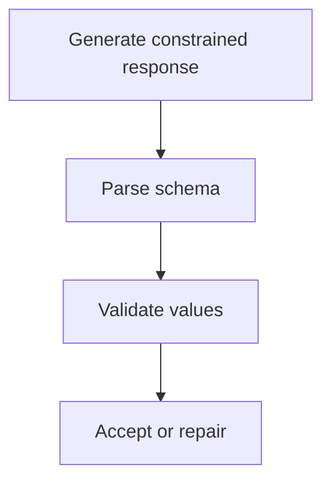

Software needs structured data; models produce text. The gap between them is the
most common source of brittleness in LLM applications, and it is fully solvable —
by constraining the decoder rather than by asking politely.

> [!WHY] An extraction endpoint emits valid JSON with an incorrect total
> and a plausible document ID. Parsing succeeds and lets the wrong record
> enter the next stage unless semantic validation runs separately.

> [!GOALS]
>
> - Explain syntax versus value validity
> - Design validation for constrained extraction
> - Choose where to constrain outputs

## The three approaches

```text
  1. ASK NICELY          "respond in JSON"
     ✗  fails a few percent of the time — a preamble, a
        markdown fence, a trailing comment, a truncated object
     ✗  and the failure rate is exactly high enough to be
        painful and low enough to escape testing

  2. FUNCTION / TOOL
     CALLING             a schema the provider enforces
     ✓  reliable in practice
     ✓  the model is trained for it

  3. CONSTRAINED
     DECODING            mask illegal tokens at each step
     ✓  output is GUARANTEED to parse
     ✓  works with any model you control the decoder for
```

**Constrained decoding is the only one with a guarantee**, and the mechanism is
the logit masking from the tokenization topic:

```text
  at each decoding step:
    1. a state machine (from the grammar or JSON schema)
       computes which tokens are LEGAL next
    2. every other token's logit is set to −infinity
    3. sample from what remains

  → invalid output is not unlikely. it is IMPOSSIBLE.
```

```text
  generating {"age": ...

    after `{"age": ` the grammar permits a digit or a minus
    sign.
    the token `"` has probability −inf.
    → the model CANNOT emit a string where a number belongs
```

The cost is a small amount of per-step work to compute the legal set, which
libraries (Outlines, XGrammar, llama.cpp's GBNF) make efficient by precompiling
the grammar into an automaton.

## Schema design for models

```text
  □  FLAT beats deeply nested
  □  ENUMS beat free strings — and they constrain the decoder
  □  DESCRIBE every field; the description is a prompt
  □  REQUIRED fields explicitly marked
  □  avoid unions and polymorphism where possible
  □  give the model somewhere to put uncertainty
```

```text
  {
    "category": {"enum": ["billing","technical","account","other"],
                 "description": "The primary topic. Use 'other'
                                 only if none apply."},
    "confidence": {"enum": ["high","medium","low"]},
    "reasoning": {"type": "string",
                  "description": "One sentence explaining the
                                  choice."},
    "needs_human": {"type": "boolean"}
  }
```

Two design points in that example:

**Put reasoning BEFORE the answer** in the field order. The model generates
left to right, so a `reasoning` field emitted first is chain of thought that
conditions the answer. Placed after, it is a post-hoc rationalisation that cannot
influence anything.

**Give it an escape hatch.** `needs_human` and a `low` confidence value mean the
model does not have to guess. Without them, a forced choice on an ambiguous input
produces a confident wrong label.

## Failure modes that remain

Constrained decoding guarantees _syntax_, not _semantics_:

```text
  ✓  guaranteed valid JSON matching the schema
  ✗  the values may still be wrong, invented, or nonsensical

  a date field will contain a valid date. it may be the
  wrong date.
```

```text
  and the specific hazards

  TRUNCATION        hitting the token limit mid-object
                    → with constrained decoding you get a
                      valid prefix, not a valid object
                    → set generous limits; detect and retry

  OVER-CONSTRAINT   a rigid schema forces the model into a
                    category that does not fit
                    → include "other" and an uncertainty field

  DEGRADED QUALITY  heavy constraints can hurt reasoning,
                    because the model cannot express itself
                    freely
                    → let it reason in a free-text field
                      first, then constrain the answer
```

That last trade is real and worth stating: **constraining too early costs
quality.** The pattern that works is a two-part output — an unconstrained thinking
field, then the constrained result.

## Validation and repair

```text
  even with constraints, validate:

  1. SCHEMA        (guaranteed if constrained; check anyway)
  2. SEMANTIC      is the date plausible? does the id exist?
                   is the total the sum of the line items?
  3. BUSINESS      does this violate a rule?
```

```text
  the repair loop

    parse → fails?
      → send the ERROR back to the model and ask for a fix
      → cap at 2–3 attempts
      → then fall back: a default, a human, or an error

  and INSTRUMENT it — a rising repair rate is a signal that
  the prompt, schema or model changed.
```



## Choosing an approach

```text
  a hosted API with native structured output
    → use it; it is reliable and requires no infrastructure

  a self-hosted model
    → constrained decoding. it is a serving-layer flag in
      vLLM, TGI and llama.cpp.

  a provider without either
    → ask nicely, validate hard, and repair
    → and treat the failure rate as a known cost

  complex nested output
    → decompose into several simpler calls; models are more
      reliable on small schemas
```

## Beyond JSON

```text
  the same mechanism constrains anything expressible as a
  grammar:

    SQL          only valid queries against a known schema
    code         syntactically valid in a target language
    regex        matching a pattern
    DSLs         a domain-specific command language
    citations    only ids that exist in the provided context
```

The last is a genuinely useful application: constraining citation tokens to the
set of document ids actually in the context makes a fabricated citation
_impossible_, rather than merely unlikely. That converts a whole class of
hallucination into a structural impossibility, which is the strongest kind of fix
available.

> [!PITFALL] A valid prefix can still be incomplete when a generation
> stops early.

> [!INTERVIEW] Explain which guarantees come from the decoder and which
> must come from application checks.

> [!CHECK] How does a grammar constrain decoding?
>
> The decoder masks tokens that would violate the current grammar state.

> [!CHECK] Why include an explicit unknown value?
>
> It gives a schema-valid representation for insufficient information.

> [!CHECK] Why inspect termination state?
>
> Token limits may stop generation before the intended record is complete.

## What to take away

1. Asking for JSON fails at a rate high enough to hurt and low enough to escape
   testing; constrained decoding makes invalid output impossible.
2. The mechanism is logit masking against a grammar automaton — a decoding-time
   guarantee, not a prompting technique.
3. Put a reasoning field _before_ the answer so it functions as chain of thought
   rather than rationalisation, and include an uncertainty escape hatch.
4. Constraints guarantee syntax, not semantics — validate values, and watch for
   truncation producing a valid prefix.
5. Constraining too early costs quality; let the model reason freely first, then
   constrain the answer.
6. Grammar constraints apply to SQL, code and citations — restricting citations to
   ids present in the context makes fabricated citations impossible.

Next: the protocols that connect models to real systems.

## Exercises

> [!EXERCISE recall] Why can a schema-valid result still need business
> validation?
>
> **Solution:** It can obey required types while using the wrong amount,
> identity or allowed relationship.

> [!EXERCISE apply] A receipt parser must return known line item
> identifiers and a valid total. Outputs parse but sometimes refer to
> absent items. Which checks belong in the pipeline?
>
> **Solution:** Restrict identifiers to allowed values where possible,
> then verify the extracted identifiers and total against the receipt
> before consumption. Parsing alone validates format and cannot establish
> the source values.

> [!EXERCISE stretch] For a complex classification task, the final result
> is a small enum and some ambiguous cases are unsupported. The team sees
> quality drop when constraining the entire generation. What would you
> try?
>
> **Solution:** Compare a staged approach that applies the schema to the
> final answer, includes an unknown enum value and validates it. Keeping a
> grammar over the entire generation can impede useful intermediate work
> without improving the final outcome.
