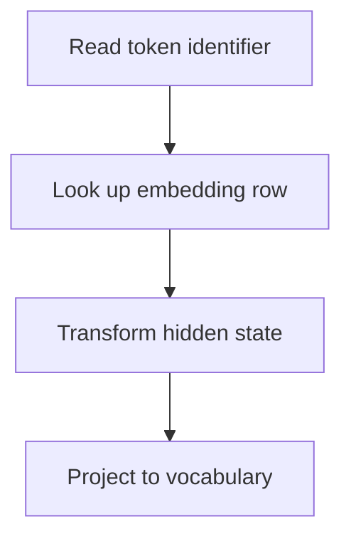

Between the tokenizer and the transformer stack sits the embedding layer, and
between the stack and the output sits its mirror. For smaller models these two
matrices are a large fraction of the parameters, and several important design
decisions live here.

> [!WHY] A serving benchmark estimates activation memory and omits the
> embedding table. The model misses a memory target before processing its
> first prompt because vocabulary rows carry a real fixed cost.

> [!GOALS]
>
> - Explain the vocabulary-size trade
> - Compute embedding storage
> - Choose a repetitive-output decoding policy

## The embedding matrix

```text
  token id 1,234  →  row 1,234 of a [vocab_size × d_model] matrix
                  →  a vector of d_model floats

  vocab 128,000 × d_model 4,096 × 2 bytes = ~1 GB

  for a 7B model that is ~15% of all parameters, spent
  entirely on a lookup table.
```

The output side mirrors it:

```text
  final hidden state [d_model]  ──▶  [d_model × vocab] matrix
                                ──▶  logits over the vocabulary
                                ──▶  softmax  ──▶  probabilities
```

**Weight tying** shares one matrix between input and output:

```text
  ✓ saves ~15% of parameters in a small model
  ✓ often improves quality on small models
  ✗ the two roles are not identical; large models usually
    keep them separate
```



## Vocabulary size is a trade

```text
  LARGER VOCABULARY                  SMALLER VOCABULARY
  ─────────────────                  ──────────────────
  shorter sequences (cheaper         longer sequences
    attention, more content per      smaller embedding matrix
    context window)                  each token is seen more
  better coverage of other             often in training
    languages                        better for small models
  a much larger embedding matrix
  rare tokens are undertrained
```

```text
  typical sizes have GROWN

    GPT-2       50,257
    LLaMA 1     32,000
    LLaMA 3    128,256
    recent      128k–256k

  the driver: multilingual coverage, and the fact that
  longer contexts make sequence length more expensive than
  vocabulary size.
```

## The softmax bottleneck

```text
  computing logits over a 128k vocabulary, for every position:

    [seq_len × d_model] × [d_model × 128,000]

  for a long sequence this is one of the largest matmuls
  in the forward pass, and the softmax over 128k entries is
  memory-heavy.
```

```text
  the mitigations

  during TRAINING     compute the loss in chunks over the
                      vocabulary rather than materialising
                      all logits at once
                      → a large activation-memory saving

  during INFERENCE    you only need logits for the LAST
                      position when generating
                      → never compute them for the whole
                        sequence during decode
```

The second is a correctness-of-implementation point: a naive generation loop that
computes logits for every position wastes most of its work, and this is a common
inefficiency in hand-rolled inference code.

## Sampling from the distribution

The output is a probability distribution; turning it into a token is a separate
decision with real consequences.

```text
  GREEDY          always the highest-probability token
                  → deterministic, repetitive, often degenerate
                    loops on longer outputs

  TEMPERATURE     divide logits by T before softmax
                  T < 1  sharper, more deterministic
                  T = 1  the model's own distribution
                  T > 1  flatter, more random
                  T = 0  equivalent to greedy

  TOP-K           sample from the k most likely
                  → a fixed cut, regardless of how peaked the
                    distribution is

  TOP-P (nucleus) sample from the smallest set whose
                  probability sums to p
                  → ADAPTIVE: narrow where the model is
                    confident, wide where it is not
                  → the usual default

  MIN-P           keep tokens above p × max_probability
                  → similar adaptivity, often better at high
                    temperature
```

```text
  the practical defaults

    factual / extraction / code   T=0 or very low, top-p 1
    conversation                  T≈0.7, top-p≈0.9
    creative                      T≈1.0, top-p≈0.95
```

**Repetition penalties** deserve a caution: penalising already-generated tokens
reduces loops, and it also degrades text that legitimately repeats — code with
repeated identifiers, lists, structured output. Apply them narrowly or not at all
for structured tasks.

## Determinism

```text
  T=0 is NOT fully deterministic in practice:

    □  floating-point reduction order varies with batch
       composition
    □  ties between near-equal logits break differently
    □  different hardware produces different last bits

  → the same request can produce different output at
    temperature 0, and it surprises people.
```

For reproducibility, pin the seed *and* accept that exact reproduction across
hardware or batch conditions is not guaranteed — the same conclusion as the GPU
topic, arriving here.

## Logit processing

The layer where constrained generation happens:

```text
  logits ──▶ [ processors ] ──▶ sampling

  BIAS         add a constant to specific tokens (forbid or
               encourage a word)
  MASKING      set forbidden tokens to −inf
               → the mechanism behind grammar-constrained
                 and JSON-schema-constrained decoding
  STOP
  SEQUENCES    halt when a string is produced
```

Masking is the important one: by computing which tokens are *legal* at each step
according to a grammar, and setting everything else to −infinity, output can be
guaranteed to parse. This is the foundation of the structured-output topic, and it
is a decoding-time mechanism rather than a prompting technique.

> [!CHECK] What does weight tying share?
>
> The input embedding and output projection use the same weight matrix.

> [!CHECK] Why compute only last-position logits during cached generation?
>
> The next token uses the last position's vocabulary distribution. Prior
> positions do not need a full vocabulary projection again.

## What to take away

1. The embedding and output matrices are a large fraction of a small model's
   parameters; weight tying shares them, which helps small models more than large.
2. Vocabulary size trades sequence length against matrix size, and sizes have grown
   to 128k+ for multilingual coverage.
3. During generation, compute logits only for the last position — a naive loop
   wastes most of its work.
4. Top-p is adaptive where top-k is not, and is the usual default; use T=0 for
   extraction and code.
5. Repetition penalties damage legitimately repetitive output like code and lists.
6. Temperature 0 is not truly deterministic, and logit masking is the mechanism
   behind guaranteed-parseable structured output.

That completes tokenization. Next in the track: the modern transformer
architecture these tokens flow through.

## Exercises

> [!EXERCISE recall] Why can adding vocabulary entries shorten sequences
> and still raise model memory?
>
> **Solution:** More pieces can encode common strings in fewer tokens and
> each additional vocabulary entry adds a matrix row.

> [!EXERCISE apply] A model has 32,000 vocabulary entries, width 1,024 and
> two bytes per entry. Both embedding and output tables have this
> geometry. Compare untied and tied table storage.
>
> **Solution:** One table = vocab_size × d_model × bytes per entry =
> 32,000 × 1,024 × 2 = 32,768,000 × 2 = 65,536,000 bytes. Untied storage =
> two tables = 131,072,000 bytes. Tied storage = one table = 65,536,000
> bytes, saving 65,536,000 bytes for these weights.

> [!EXERCISE stretch] A generation endpoint must output repetitive labels
> in a structured list. A large repetition penalty suppresses necessary
> repeated labels. What should the team test?
>
> **Solution:** Reduce the penalty and validate required repeated fields
> and schema compliance on representative lists. Increasing the penalty
> would further suppress valid tokens that need to recur.
