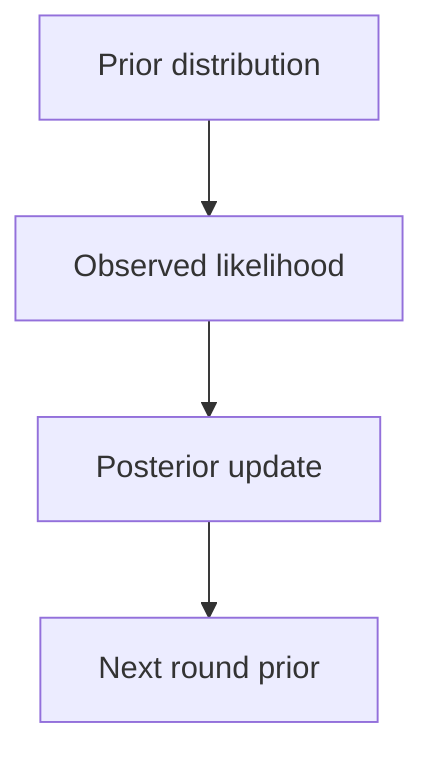

Bayesian methods treat parameters as distributions rather than point values. The
payoff is calibrated uncertainty and a principled way to incorporate prior
knowledge; the cost is computation and a modelling discipline that most problems
do not need.

> [!WHY] A low-traffic product segment receives a confident point estimate
> after only a few observations. Treating that number like a well-measured
> rate can steer spend before the uncertainty has been examined.

> [!GOALS]
>
> - Explain sequential Bayesian updating
> - Compute conjugate Beta-Binomial updates
> - Choose partial pooling for sparse groups

## The framing

```text
  FREQUENTIST      parameters are fixed and unknown; data is
                   random
                   → confidence intervals, p-values

  BAYESIAN         parameters are random; data is observed
                   → posterior distributions, credible
                     intervals
```

```text
  P(θ | data) ∝ P(data | θ) · P(θ)

  posterior      ∝ likelihood   × prior
```

```text
  what you get that a point estimate does not

  ✓  a full distribution over the parameter, not one number
  ✓  a natural way to encode PRIOR knowledge
  ✓  principled uncertainty that shrinks with more data
  ✓  sequential updating: today's posterior is tomorrow's
     prior
```

## Priors

```text
  INFORMATIVE      encodes real knowledge
                   "conversion rates in this business are
                    typically 1–5%"
  WEAKLY
  INFORMATIVE      rules out the absurd without asserting
                   much → the sensible default
  UNINFORMATIVE    minimal influence; often improper
  CONJUGATE        chosen so the posterior has the same form
                   → closed-form updates
```

```text
  the classic conjugate pair

    Beta prior + Binomial likelihood → Beta posterior

    prior Beta(α, β), then s successes in n trials
    → posterior Beta(α + s, β + n − s)

  → the update is ADDITION. no integration, no sampling.
```

That closed form is why Beta-Binomial appears everywhere in A/B testing and
bandits: the posterior is maintained by incrementing two counters.

**The prior is a modelling choice you must defend.** With little data it dominates
the answer; with much data it washes out. Reporting a Bayesian result without
stating the prior, and without a sensitivity check on it, is incomplete.



## Computation

```text
  CONJUGATE          closed form. use it whenever it applies.

  MCMC               sample from the posterior
    Metropolis-Hastings, Gibbs, HMC / NUTS
    ✓ asymptotically exact
    ✗ slow; needs convergence diagnostics (R̂, effective
      sample size, divergences)

  VARIATIONAL
  INFERENCE          approximate the posterior with a simpler
                     family, optimise the fit
    ✓ fast, scales
    ✗ biased; typically UNDERESTIMATES uncertainty

  LAPLACE            a Gaussian approximation at the mode
                     → cheap; used for neural network
                       uncertainty
```

```text
  the practical rule

    small model, need accuracy    → MCMC (Stan, PyMC,
                                    NumPyro)
    large model, need speed       → variational
    neural networks               → ensembles or MC dropout,
                                    which approximate the
                                    same thing far more cheaply
```

## Where it genuinely pays

```text
  ✓  SMALL DATA — the prior does real work
  ✓  hierarchical structure — partial pooling across groups
  ✓  decisions requiring calibrated uncertainty
  ✓  A/B testing — "P(B is better)" is directly interpretable
     in a way a p-value is not
  ✓  sequential decisions — bandits
  ✓  incorporating genuine domain knowledge
  ✗  large data with a flat prior — the likelihood dominates
     and you get the frequentist answer more slowly
  ✗  when a point estimate is all the decision needs
```

## Hierarchical models

The most practically valuable Bayesian idea:

```text
  estimating conversion for 200 stores

    SEPARATE   each store's own rate
               → a store with 10 visits has a wild estimate
    POOLED     one global rate
               → ignores real differences
    HIERARCHICAL
               each store's rate drawn from a shared
               distribution
               → small stores SHRINK toward the global mean;
                 large stores keep their own estimate
```

```text
  PARTIAL POOLING is automatic and principled:

    the amount of shrinkage falls out of the data volume,
    rather than being a hyperparameter you tune.
```

This is the single most useful thing in the Bayesian toolkit for applied work:
any situation with many small groups — stores, users, products, regions — benefits
from it, and the alternative is either noisy per-group estimates or losing the
group structure entirely.

## Bayesian A/B testing

```text
  FREQUENTIST      "p = 0.03, reject the null"
  BAYESIAN         "P(B > A) = 0.94, and the expected loss
                    from choosing B is 0.2%"
```

```text
  ✓  directly interpretable
  ✓  no fixed horizon requirement — you may look continuously
     without inflating error the way peeking does
  ✓  incorporates prior knowledge from past experiments
  ✗  requires stating a prior
  ✗  "P(B better) > 0.95" is not the same guarantee as a
     5% false-positive rate; the operating characteristics
     must be checked by simulation
```

That last caveat is worth stating because the continuous-monitoring property is
often over-claimed: Bayesian methods do not make peeking free in general, they
change what the reported quantity means. Simulate your decision rule to know its
actual error rate.

> [!PITFALL] A posterior probability threshold does not automatically
> imply a matching frequentist false-positive guarantee.

> [!INTERVIEW] State the prior and how sensitive the conclusion is to it,
> especially with little data.

> [!CHECK] Why can variational inference mislead an uncertainty-sensitive
> decision?
>
> Its faster approximate family typically underestimates uncertainty.

> [!CHECK] What must accompany an MCMC result?
>
> Convergence diagnostics such as R-hat, effective sample size and
> divergences rather than only returned samples.

> [!CHECK] Why simulate a continuously monitored decision rule?
>
> Its actual operating error rate is not established merely by reporting a
> posterior probability.

## What to take away

1. Bayesian methods give a distribution over parameters rather than a point, with
   principled uncertainty and a way to encode prior knowledge.
2. The prior is a modelling choice that must be stated and sensitivity-checked; it
   dominates with little data and washes out with much.
3. Conjugate updates are closed-form — Beta-Binomial is two counters — which is why
   they underpin A/B testing and bandits.
4. MCMC is exact and slow; variational inference is fast and underestimates
   uncertainty; ensembles approximate the same benefit cheaply for neural networks.
5. Hierarchical partial pooling is the most practically valuable idea: shrinkage
   falls out of data volume rather than being tuned.
6. Bayesian A/B testing is directly interpretable but does not make peeking free —
   simulate the decision rule to know its real error rate.

Next: bandits, which apply this sequentially.

## Exercises

> [!EXERCISE recall] What does it mean that today’s posterior is
> tomorrow’s prior?
>
> **Solution:** Bayesian inference carries forward the updated
> distribution, then combines it with the next batch’s likelihood instead
> of resetting to the original prior or keeping only a point estimate.

> [!EXERCISE apply] Start with Beta(2,3). Observe 4 successes in 6 trials,
> then 1 success in 3 more trials. Compute both posterior distributions
> and verify the final answer with a single pooled update.
>
> **Solution:** The conjugate rule is Beta(alpha+s, beta+n−s). First:
> Beta(2+4, 3+6−4) = Beta(6,5). Second: Beta(6+1, 5+3−1) = Beta(7,7).
> Pooled data has s=4+1=5 and n=6+3=9, giving Beta(2+5, 3+9−5) =
> Beta(7,7), the same final distribution.

> [!EXERCISE stretch] A company estimates rates for many stores, some with
> very few visits and others with many. Recommend how to share information
> without erasing every store difference.
>
> **Solution:** Use a hierarchical model with partial pooling: sparse
> groups shrink toward the shared distribution while data-rich groups
> retain their own evidence. A weaker answer pools every store into one
> rate, discarding real differences; separate estimates alone leave small
> stores very noisy.
