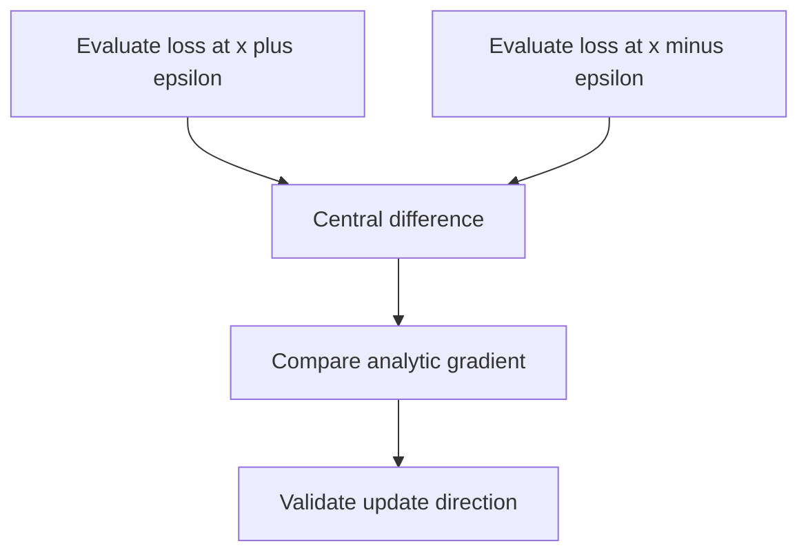

Training is optimisation: find parameters minimising a loss. The tools are the
gradient and the chain rule, and the interesting question is why gradient descent
works at all on a surface with no guarantees.

> [!WHY] A custom training loss appears to converge until an ordinary
> parameter update increases it sharply. Checking the gradient and its
> step size separately can prevent days of tuning around a faulty
> derivative.

> [!GOALS]
>
> - Explain gradient propagation through a chain
> - Compute a numerical gradient and descent step
> - Choose a response to an excessive learning rate

## The gradient

```text
  ∇f = [∂f/∂x₁, ∂f/∂x₂, ...]

  → points in the direction of STEEPEST ASCENT
  → its magnitude is how steep
  → descend by stepping AGAINST it
```

```text
  θ ← θ − η∇L(θ)

  the entire algorithm. everything else is a refinement of
  the step size and direction.
```

```text
  the local guarantee, and its limit

    the gradient describes the surface only INFINITESIMALLY.
    a step of size η may leave the region where that
    description holds — which is exactly what happens when
    the learning rate is too high.
```

## The chain rule

```text
  d/dx f(g(x)) = f'(g(x)) · g'(x)

  → and backpropagation is this, applied systematically over
    a computation graph, with intermediate results reused.
```

```text
  the multiplicative structure is why gradients vanish and
  explode:

    ∂L/∂x₁ = ∏ (local derivatives)

    each < 1 → the product shrinks exponentially with depth
    each > 1 → it grows

  → residual connections add a term with derivative 1, which
    breaks the product.
```

## Convexity, and living without it

```text
  CONVEX          one minimum, and it is global
                  → gradient descent finds it
                  → linear/logistic regression, SVMs

  NON-CONVEX      many local minima and saddle points
                  → no guarantee at all
                  → every neural network
```

```text
  so why does it work?

  □  in HIGH DIMENSIONS, most critical points are SADDLES,
     not local minima — a point is a local minimum only if
     the surface curves up in EVERY one of a million
     directions, which is vanishingly unlikely
  □  most local minima that exist are nearly as good as the
     global one
  □  stochastic gradient noise helps escape saddles
  □  overparameterisation makes good solutions abundant
```

**The saddle-point insight is the key one.** The intuition that
high-dimensional optimisation is hard because of local minima is largely wrong;
the difficulty is saddle points and plateaus, and noise handles them.

## Second-order information

```text
  the HESSIAN — the matrix of second derivatives — describes
  CURVATURE.

  □  positive definite → a local minimum
  □  mixed signs       → a saddle
  □  condition number  → how elongated the valley is
```

```text
  NEWTON'S METHOD uses it: θ ← θ − H⁻¹∇L
    → far faster convergence
    ✗ the Hessian is [params × params] — for a 7B model
      that is 49 × 10¹⁸ entries. impossible.

  so we use APPROXIMATIONS:
    momentum        an implicit smoothing of the gradient
    Adam            per-parameter scaling from the second
                    moment — a diagonal curvature estimate
    L-BFGS          a low-rank Hessian approximation; used
                    for smaller problems
```

Adam is best understood as a cheap, diagonal approximation to second-order
information: it scales each parameter's step by an estimate of that parameter's
gradient magnitude, which adapts to differing curvature per dimension.

## Constrained optimisation, briefly

```text
  LAGRANGE MULTIPLIERS turn a constrained problem into an
  unconstrained one by adding a penalty term.

  → which is exactly what regularisation is:
      "minimise loss subject to ‖w‖ ≤ c"
      becomes
      "minimise loss + λ‖w‖"

  → and λ is the multiplier
```

Seeing weight decay as a constraint made soft is worth the reframing: it explains
why λ trades off against the loss rather than being an independent setting.

## Numerical gradients, for debugging

```text
  ∂f/∂x ≈ [f(x+ε) − f(x−ε)] / 2ε

  → too slow for training
  → INVALUABLE for verifying a hand-written gradient

  if your analytic gradient and the numerical one disagree
  beyond tolerance, the analytic one is wrong.
```

This is the standard check for custom autograd functions and custom losses, and it
takes minutes to write.



## Practical implications

```text
  □  the LEARNING RATE is the step size, and the single most
     important hyperparameter
  □  gradient CLIPPING bounds the step when the gradient is
     enormous
  □  gradient NORM is the best early warning of divergence
  □  a plateau in the loss may be a saddle, not a minimum —
     patience or a warm restart can escape it
  □  the loss SURFACE depends on the parameterisation:
     normalisation reshapes it, which is why it helps
```

> [!PITFALL] A gradient is a local description; multiplying it by a large
> step size can leave the region where it predicts improvement.

> [!INTERVIEW] Distinguish a wrong derivative from a correct derivative
> used with a poor step size.

> [!CHECK] Which direction does the gradient point?
>
> Steepest ascent; gradient descent steps against it.

> [!CHECK] Why is a full Newton step infeasible for huge models?
>
> The Hessian has one entry per parameter pair, so its storage and
> manipulation scale quadratically in parameter count.

> [!CHECK] How does regularization relate to a constraint?
>
> A norm constraint can be made soft by a penalty with a multiplier
> trading its cost against the loss.

## What to take away

1. The gradient is a local, infinitesimal description; a step too large leaves the
   region where it applies.
2. Backprop's multiplicative chain is why gradients vanish and explode, and residual
   connections break the product with a derivative-1 term.
3. Neural network optimisation is non-convex with no guarantees, and works because
   high-dimensional critical points are mostly saddles rather than local minima.
4. Second-order methods converge faster and are infeasible at scale; Adam is a cheap
   diagonal approximation to curvature.
5. Regularisation is a constraint made soft via a Lagrange multiplier, which is what
   λ actually is.
6. Numerical gradient checking is the standard way to verify a hand-written
   gradient, and it takes minutes.

Next: probability and statistics.

## Exercises

> [!EXERCISE recall] Why can repeated local derivatives make gradients
> vanish or explode, and what changes with a residual path?
>
> **Solution:** The chain rule multiplies local derivatives along a path,
> so repeatedly small or large factors shrink or grow the signal. A
> residual connection adds a derivative-1 path that breaks that pure
> product.

> [!EXERCISE apply] At x=2, epsilon=0.5, a loss evaluates to
> f(x+epsilon)=6.25 and f(x−epsilon)=2.25. Estimate its derivative, then
> make one descent step with eta=0.1 from theta=2 using that estimate.
>
> **Solution:** The central-difference formula is df/dx ≈
> [f(x+epsilon)−f(x−epsilon)]/(2 epsilon). The numerator is 6.25−2.25 = 4
> and denominator is 2×0.5 = 1, so the estimate is 4/1 = 4. The update is
> theta_new = theta−eta×gradient = 2−0.1×4 = 2−0.4 = 1.6. This
> finite-difference value is a debugging approximation, not an exact
> derivative guarantee.

> [!EXERCISE stretch] A verified derivative gives unstable training when
> the learning rate is raised sharply. Recommend what to examine before
> concluding that non-convex optimization is hopeless.
>
> **Solution:** Inspect the learning rate and gradient norm, reduce an
> excessive step and use clipping when gradients are enormous. A weaker
> answer keeps the oversized step and treats every increase in loss as
> proof of a bad local minimum: the local gradient promise does not extend
> to arbitrarily distant updates.
