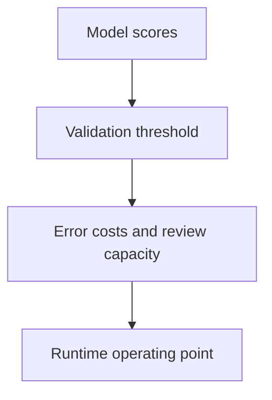

An evaluation metric encodes what you consider a mistake. Choosing it badly means
optimising for the wrong thing with perfect rigour, which is the most expensive
form of being wrong in ML.

> [!WHY] A rare-event classifier shows a strong overall score while its
> alert queue fills with false alarms. A metric that hides the operating
> threshold can make an unusable review workflow look ready to ship.

> [!GOALS]
>
> - Explain calibration separately from ranking
> - Compute precision and recall at a threshold
> - Choose slice-aware release evidence

## Classification metrics

```text
                  predicted
                  pos     neg
  actual  pos  │  TP   │  FN  │
          neg  │  FP   │  TN  │
```

```text
  ACCURACY      (TP+TN)/all
                → meaningless under imbalance

  PRECISION     TP/(TP+FP)
                "when we say yes, how often are we right?"
                → matters when a FALSE POSITIVE is costly

  RECALL        TP/(TP+FN)
                "of the real positives, how many did we
                 catch?"
                → matters when a FALSE NEGATIVE is costly

  F1            harmonic mean of the two
                → a compromise; hides which one is weak
```

```text
  the choice follows from the COST asymmetry:

    spam filter        precision — a lost real email is worse
                       than a spam that gets through
    cancer screening   recall — a missed case is far worse
                       than a false alarm
    fraud              depends on the review cost per alert
```

**Report precision and recall separately as well as F1.** F1 of 0.7 can be
precision 0.95/recall 0.55 or precision 0.55/recall 0.95, and those are completely
different systems.

## The curves

```text
  ROC                  TPR vs FPR across thresholds
                       AUC = P(a random positive scores above a
                       random negative)
                       ✗ MISLEADING under heavy imbalance, because
                         FPR is computed against an enormous negative
                         class

  PRECISION-RECALL     precision vs recall across thresholds
                       ✓ the right curve for imbalanced problems
                       → baseline AUC = the positive rate, not 0.5
```

```text
  1% positive rate

    ROC-AUC 0.95  sounds excellent
    at a usable threshold, precision may be 8%
    → 92 false alarms per true positive

  the PR curve shows this immediately; the ROC curve hides it.
```

## Thresholds

```text
  a model outputs a SCORE. the threshold is a SEPARATE
  decision, and it belongs to the product, not the model.

  □  choose it on a VALIDATION set, not the test set
  □  derive it from the relative cost of the two errors
  □  or from a capacity constraint: "we can review 500 alerts
     a day, so take the top 500"
  □  make it RUNTIME CONFIGURATION, so it can be changed
     during an incident
```

That last point, from the ML-incidents chapter, is worth building in advance: a
shifted score distribution is fixed by moving the threshold in minutes, versus
retraining in a day.



## Regression metrics

```text
  MAE     mean absolute error
          → robust to outliers; in the target's units
  RMSE    root mean squared error
          → penalises large errors heavily
  MAPE    mean absolute percentage error
          → scale-free; UNDEFINED at zero and asymmetric
            (it penalises over-prediction more)
  R²      fraction of variance explained
          → can be negative; comparable only within one
            dataset
```

```text
  the choice is again about cost:

    is an error of 10 twice as bad as an error of 5 (MAE),
    or four times as bad (RMSE)?
```

## Ranking metrics

```text
  PRECISION@k   relevant fraction in the top k
  RECALL@k      fraction of all relevant items in the top k
  MRR           1/rank of the first relevant result
  NDCG@k        graded relevance with a position discount
                → the standard for ranking
  MAP           average precision across the list
```

```text
  report at the k users actually SEE. NDCG@100 on a
  ten-item page measures ninety positions nobody looks at.
```

## Calibration

```text
  of the cases predicted at 0.7, do ~70% turn out positive?

  a RELIABILITY DIAGRAM plots predicted probability against
  observed frequency; the diagonal is perfect.

    observed
      1.0 │            ╱
          │         ╱ ╱      the model is OVERCONFIDENT:
          │      ╱ ╱         predicted 0.9, observed 0.7
          │   ╱ ╱
      0.0 └────────────▶ predicted
```

Neural networks are systematically overconfident, and temperature scaling — one
parameter, fitted on validation — fixes it while preserving ranking exactly. It is
the cheapest improvement available for any model whose probabilities feed a
decision.

## Slices

```text
  aggregate metrics HIDE segment failures.

    overall 0.94
      new users        0.71
      other languages  0.68
      mobile           0.89

  → and the segments where a model fails are frequently the
    ones that matter commercially or ethically.
```

Define the slices before evaluating, and gate on them: a model that improves
overall while regressing a protected or commercially important slice should not
ship without a decision.

## Comparing models

```text
  □  the SAME evaluation set, every time
  □  CONFIDENCE INTERVALS, not point estimates
  □  PAIRED comparison on the same examples — far more
     sensitive than comparing two means
  □  account for MULTIPLE COMPARISONS: picking the best of
     forty makes the validation metric optimistic
  □  a TEST SET touched once
  □  and: is the difference larger than run-to-run variance?
```

> [!PITFALL] Tuning a threshold on the test set spends the held-out
> evidence intended for the final assessment.

> [!INTERVIEW] Report both kinds of error and the operating constraint
> instead of one attractive aggregate score.

> [!CHECK] Why prefer a PR curve under strong imbalance?
>
> A large negative population can make ROC false-positive rates look small
> while precision at usable thresholds is poor.

> [!CHECK] Why pair model comparisons on the same examples?
>
> It provides a more sensitive comparison than unrelated means; confidence
> intervals and run variance still matter.

> [!CHECK] At which ranking cutoff should performance be reported?
>
> At the positions users actually see, not a much deeper list whose unseen
> items dominate the reported number.

## What to take away

1. The metric encodes what counts as a mistake; choose it from the relative cost of
   the two error types.
2. Report precision and recall separately — the same F1 describes completely
   different systems.
3. Use PR curves under imbalance; ROC-AUC hides poor precision because FPR is
   computed against an enormous negative class.
4. The threshold is a product decision separate from the model, and it should be
   runtime configuration.
5. Slice every evaluation and gate on slices — aggregates hide the failures that
   matter most.
6. Compare with paired tests and confidence intervals, and keep a test set touched
   once.

Next: causal inference and experimentation.

## Exercises

> [!EXERCISE recall] How can a model rank examples well yet have poor
> calibration?
>
> **Solution:** Ordering scores correctly does not mean their probability
> values match observed frequencies. Calibration asks whether cases scored
> at a given probability occur at roughly that frequency.

> [!EXERCISE apply] At a proposed threshold, TP=36, FP=12, FN=24 and
> TN=128. Compute precision, recall and accuracy. Explain why accuracy
> alone does not describe the positive-class behaviour.
>
> **Solution:** Precision = TP/(TP+FP) = 36/(36+12) = 36/48 = 0.75. Recall
> = TP/(TP+FN) = 36/(36+24) = 36/60 = 0.60. Total = 36+12+24+128 = 200;
> accuracy = (TP+TN)/total = (36+128)/200 = 164/200 = 0.82. The model is
> correct on 75% of its positive calls but finds only 60% of actual
> positives; the 82% aggregate hides both distinctions.

> [!EXERCISE stretch] A candidate improves overall evaluation while
> regressing a predeclared important language slice. Recommend release
> evidence.
>
> **Solution:** Gate and discuss the slice regression explicitly, compare
> on the same examples with uncertainty and reserve final test evidence
> for the chosen model. A weaker answer ships solely because the aggregate
> improved: gains elsewhere can mask a consequential segment failure.
