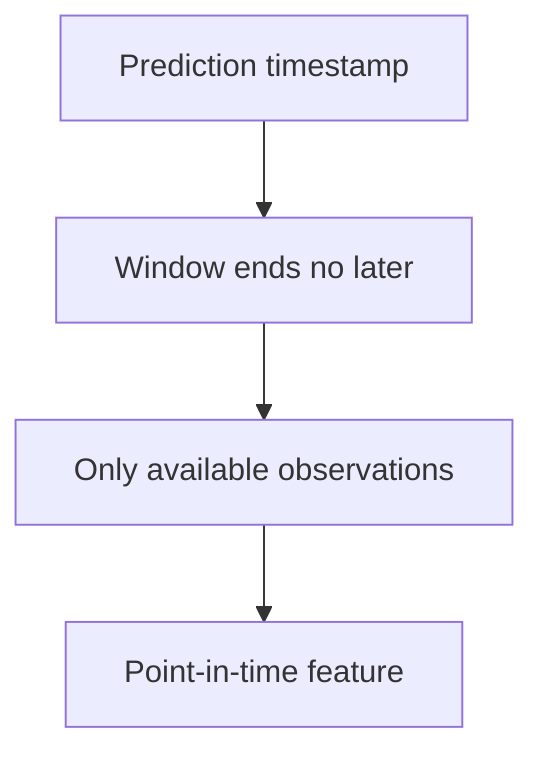

For tabular problems, feature quality dominates model choice. A gradient-boosted
tree on good features beats a neural network on raw ones, reliably — and the same
work is where leakage most often enters.

> [!WHY] A feature pipeline gets excellent validation results by fitting
> transformations on data that would arrive only after prediction time.
> The improvement disappears in production because the offline feature
> contained future information.

> [!GOALS]
>
> - Explain out-of-fold target encoding
> - Apply train-only scaling and time cutoffs
> - Preserve informative missingness

## Encoding categoricals

```text
  ONE-HOT           one binary column per level
                    ✓ no false ordering
                    ✗ explodes with high cardinality

  ORDINAL           map to integers
                    ✓ compact
                    ✗ implies an ORDER that may not exist
                    → fine for TREES, harmful for linear
                      models and networks

  TARGET / MEAN     replace a level with the mean target for
                    that level
                    ✓ compact and powerful for high
                      cardinality
                    ✗ LEAKS unless computed out-of-fold

  HASHING           hash into a fixed number of buckets
                    ✓ bounded memory; handles unseen levels
                    ✗ collisions

  EMBEDDINGS        learned dense vectors
                    ✓ captures similarity between levels
                    ✗ needs a model that learns them
```

```text
  TARGET ENCODING LEAKAGE — the classic

    computing the mean target per category over the WHOLE
    training set means each row's own label contributed to
    its own feature.

    → the model appears excellent in validation and fails in
      production.

    the fix: compute the encoding OUT-OF-FOLD, or with
    smoothing toward the global mean, or on a separate split.
```

This is the most common leakage in applied tabular ML, and it is subtle enough
that it survives review — the code looks like ordinary aggregation.

## Numerical transformations

```text
  SCALING            essential for linear models, networks,
                     kNN, SVM
                     unnecessary for TREES
    standard         (x − μ)/σ
    min-max          to [0,1]
    robust           uses median and IQR → outlier-tolerant

  LOG / BOX-COX      compress a heavy right tail
                     → for prices, counts, durations
  BINNING            continuous → discrete
                     → captures non-monotonic effects; loses
                       resolution
  POLYNOMIAL /
  INTERACTIONS       x₁x₂, x²
                     → trees find these automatically; linear
                       models need them explicitly
```

```text
  fit scalers on TRAIN ONLY, then apply.

  fitting on the full dataset is the preprocessing leakage
  from the point-in-time chapter, and it is one line.
```

## Missing values

```text
  the first question: WHY is it missing?

  MISSING COMPLETELY AT RANDOM   → imputation is safe
  MISSING AT RANDOM              → depends on observed data
  MISSING NOT AT RANDOM          → the missingness ITSELF is
                                   informative
```

```text
  → ALWAYS ADD A "was_missing" INDICATOR COLUMN.

  income being blank because someone declined to answer is
  a signal. imputing the mean and discarding that fact
  throws information away.
```

```text
  strategies
    mean/median      simple; distorts the distribution
    forward-fill     for time series
    model-based      predict it from other features
    a sentinel       −999 — fine for trees, terrible for
                     linear models
    NATIVE           trees handle it directly; use that
```

## Time features

```text
  □  CYCLICAL encoding for hour, day, month:
       sin(2πt/T), cos(2πt/T)
       → so 23:00 and 00:00 are adjacent, which an integer
         encoding gets wrong
  □  holidays, weekends, business hours
  □  time since / until an event
  □  ROLLING aggregates — and these are where leakage lives
```

```text
  a rolling feature must use a WINDOW ENDING AT OR BEFORE
  the prediction time.

    "average order value over the last 30 days" computed
    with today's data, for a prediction made in March,
    includes April.

  → the point-in-time correctness rule, in its most common
    concrete form.
```



## Feature selection

```text
  FILTER      correlation, mutual information, variance
              → fast, model-agnostic, ignores interactions
  WRAPPER     forward/backward selection with a model
              → accounts for interactions; expensive
  EMBEDDED    L1, tree importance
              → free with the model
```

```text
  why remove features at all

    □  fewer pipelines to maintain (the ML-debt argument)
    □  faster training and inference
    □  less overfitting on small data
    □  easier to explain

  → and leave-one-out evaluation, from the debt chapter, is
    how you decide.
```

## Domain features beat everything

```text
  the highest-value features come from understanding the
  problem, not from transformation recipes.

  fraud       velocity — transactions per hour;
              deviation from this user's own history;
              geographic impossibility (two countries in
              ten minutes)
  churn       trend in engagement, not its level;
              time since last meaningful action
  demand      lags at meaningful periods, promotions,
              weather, competitor prices
```

**Talk to a domain expert.** An hour with someone who understands the process
produces features that no automated transformation would find, and it is the
highest-return activity in most tabular ML projects.

## Automated feature engineering

```text
  □  polynomial and interaction expansion
  □  automated aggregation over relational tables
     (Featuretools-style)
  □  autoencoders and learned representations
  □  AutoML pipelines

  → they generate MANY features, most useless, with a real
    risk of leakage from automated aggregation across time
```

Automated tools are a supplement rather than a replacement, and their aggregation
features need the same point-in-time scrutiny as hand-written ones — more, because
nobody reviewed each one.

> [!PITFALL] An automated aggregation needs the same time-boundary
> scrutiny as a hand-written feature.

> [!INTERVIEW] State when each input was available and which split fitted
> each transformation.

> [!CHECK] Why can ordinal category codes mislead a linear model?
>
> They imply an order that may not exist; one-hot encoding avoids that
> false order.

> [!CHECK] Why use cyclical time encoding?
>
> It keeps the ends of a repeating period adjacent rather than far apart
> as raw integer codes.

> [!CHECK] Why can hashing bound feature memory?
>
> It maps levels, including unseen ones, into a fixed bucket count,
> accepting collisions.

## What to take away

1. Feature quality dominates model choice on tabular problems.
2. Target encoding leaks unless computed out-of-fold, and it is the most common
   leakage in applied tabular ML because the code looks like ordinary aggregation.
3. Fit scalers and imputers on the training split only; fitting on everything is
   one line of leakage.
4. Always add a was-missing indicator — missingness is frequently informative.
5. Use cyclical encoding for time, and make every rolling window end at or before
   the prediction time.
6. Domain features beat transformation recipes; an hour with a domain expert is the
   highest-return activity available.

Next: evaluating a model honestly.

## Exercises

> [!EXERCISE recall] How does whole-training-set target encoding leak a
> row’s label into its input?
>
> **Solution:** That row contributes to its category’s target mean, making
> its own label part of its feature. Compute the encoding out-of-fold or
> on a separate split so the row’s label is not used for its own feature.

> [!EXERCISE apply] A standard scaler fitted on training data has mu=10
> and sigma=2; a new value is 14. A 09:00 prediction also proposes a
> rolling aggregate including an observation first available at 09:05.
> Compute the scaled value and decide whether either transformation should
> be refitted using that later observation.
>
> **Solution:** Standard scaling is (x−mu)/sigma = (14−10)/2 = 4/2 = 2.
> Apply the training-fitted parameters without refitting on
> validation/future data. The 09:05 observation was unavailable at 09:00
> and must be excluded from that prediction’s rolling feature; later
> arrival cannot be retroactively treated as known input.

> [!EXERCISE stretch] An optional field is often missing because users
> deliberately decline to supply it. Recommend a missing-value
> representation.
>
> **Solution:** Choose an appropriate imputation/native handling strategy
> while retaining a was_missing indicator, since the absence may itself
> carry information. A weaker answer replaces every missing value with the
> mean and discards its origin: it makes declined answers
> indistinguishable from actual average values.
