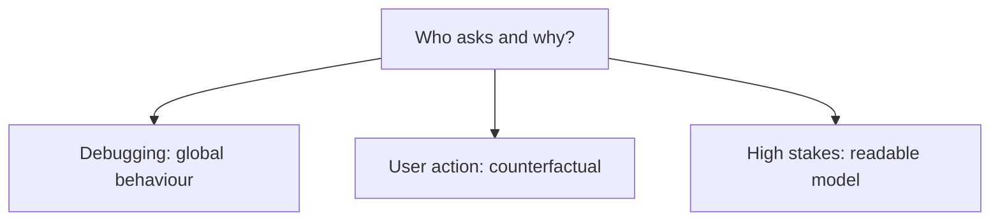

"Why did the model do that?" has several distinct answers depending on who is
asking and why. Choosing a method without knowing which question you are answering
produces explanations that are technically valid and practically useless.

> [!WHY] A user asks how to change an unfavourable prediction and receives
> a dense attribution plot. The explanation may describe the model yet
> fail to support the action the user needs.

> [!GOALS]
>
> - Distinguish attribution from causation
> - Choose explanation methods by audience and correlation
> - Evaluate an interpretable high-stakes alternative

## What the explanation is for

```text
  DEBUGGING          is the model using the features I expect?
                     → developer audience; approximate is fine

  TRUST              should a user act on this prediction?
                     → needs to be comprehensible to a
                       non-expert

  COMPLIANCE         a legally required reason for a decision
                     → needs to be defensible and stable

  SCIENCE            what does this tell us about the domain?
                     → needs to be CAUSAL, which most methods
                       are not

  FAIRNESS           is the model relying on something it
                     should not?
```

**Different purposes need different methods**, and the compliance case is the one
where the usual tools are weakest — a SHAP value is an attribution, not a reason a
regulator or a customer will accept.



## Intrinsically interpretable models

```text
  LINEAR / LOGISTIC     coefficients are directly readable
  DECISION TREE         a path is a rule
  RULE LISTS            explicitly if-then
  GAMs                  additive, with a plot per feature
                        → often nearly as accurate as a
                          black box on tabular data, and
                          fully readable
```

```text
  the argument worth taking seriously (Rudin):

    for HIGH-STAKES decisions, prefer an intrinsically
    interpretable model over explaining a black box.

    a post-hoc explanation is an APPROXIMATION of the
    model's behaviour, and it can be wrong in exactly the
    cases that matter.
```

Generalised additive models deserve more attention than they get: on tabular data
they frequently lose only a point or two of accuracy while being completely
readable, which is a good trade when a human must defend the decision.

## Post-hoc methods

```text
  GLOBAL — how does the model behave overall?

    PERMUTATION IMPORTANCE   shuffle a feature; measure the
                             drop
                             → model-agnostic, trustworthy
    PARTIAL DEPENDENCE       average prediction as one
                             feature varies
                             → MISLEADING when features are
                               correlated (it evaluates
                               impossible combinations)
    ALE PLOTS                accumulated local effects —
                             handles correlation properly

  LOCAL — why THIS prediction?

    LIME                     fit a simple model locally around
                             the instance
                             → intuitive; unstable across runs
    SHAP                     Shapley values: each feature's
                             contribution, with a fairness
                             axiomatisation
                             → the standard; expensive, though
                               TreeSHAP is fast for trees
    COUNTERFACTUAL           "what would need to change for a
                             different outcome?"
                             → the most ACTIONABLE form
```

```text
  counterfactuals are what people actually want:

    "your loan was declined"                  → unhelpful
    "income 20% higher, or debt 10% lower,
     would have been approved"                → actionable
```

## What these methods do not tell you

```text
  ✗  CAUSATION. an attribution says the model uses a feature,
     not that the feature causes the outcome.

  ✗  the RIGHT answer. explanations describe the model,
     including when the model is wrong.

  ✗  STABILITY. LIME gives different explanations on repeated
     runs; small input changes can change SHAP values a lot.

  ✗  ADVERSARIAL ROBUSTNESS. a model can be constructed to
     produce misleading explanations.
```

```text
  and the correlation problem, which affects everything:

    two correlated features SHARE credit arbitrarily.
    the model may use either; the attribution splits between
    them; and neither number reflects a stable fact about
    the model.
```

## Neural network interpretability

```text
  ATTENTION MAPS       suggestive; NOT explanations, as the
                       attention chapter said
  SALIENCY / GRAD-CAM  which input regions influence the
                       output; noisy but useful for vision
  PROBING              train a classifier on internal
                       activations to test what is encoded
  MECHANISTIC
  INTERPRETABILITY     reverse-engineer circuits and features
                       → sparse autoencoders decomposing
                         activations into interpretable
                         features is the active direction
```

Mechanistic interpretability is the most scientifically ambitious of these — an
attempt to actually explain the computation rather than to correlate with it — and
it remains a research programme rather than a deployable tool.

## Practical guidance

```text
  □  decide WHO the explanation is for and WHAT they will do
     with it, first
  □  for high stakes, prefer an interpretable model
  □  use permutation importance rather than gain importance
     (the tree bias from the ensembles chapter)
  □  offer COUNTERFACTUALS to end users — they are
     actionable
  □  check explanation STABILITY across seeds and small
     perturbations before trusting one
  □  do not present an explanation as a cause
  □  document what the model must NOT be used for — the
     model card point from the lifecycle topic
```

## Regulatory context

```text
  □  a "right to explanation" exists in some jurisdictions
     for automated decisions with significant effects
  □  what satisfies it is a legal question, and a SHAP plot
     usually does not
  □  what tends to be required: the main factors, in
     understandable terms, and a route to challenge the
     decision
  □  which favours simple models and counterfactuals over
     attribution methods
```

> [!PITFALL] An explanation can faithfully describe a wrong prediction
> without making it correct.

> [!INTERVIEW] Name the audience and intended use before presenting a
> technically valid attribution.

> [!CHECK] Why check LIME explanations across runs?
>
> The local approximation can be unstable, so one run is not reliable
> evidence of a stable reason.

> [!CHECK] Why are attention maps only suggestive?
>
> They do not by themselves explain the model’s full computation or
> establish the decision’s cause.

> [!CHECK] Why can correlated features make attribution credit unstable?
>
> They can share credit in arbitrary ways rather than each attribution
> being a stable fact.

## What to take away

1. Decide who the explanation is for and what they will do with it before choosing
   a method — debugging, trust, compliance and science need different things.
2. For high-stakes decisions, prefer an intrinsically interpretable model; a
   post-hoc explanation approximates the model and can be wrong where it matters.
3. Counterfactuals are the most actionable form for end users.
4. Attributions describe the model, not causation, and correlated features split
   credit arbitrarily.
5. Check explanation stability across seeds and perturbations before trusting one —
   LIME in particular is unstable.
6. Regulatory explanation requirements favour simple models and counterfactuals over
   attribution plots.

Next: fairness.

## Exercises

> [!EXERCISE recall] What does a feature attribution establish, and what
> causal claim does it not establish?
>
> **Solution:** It describes how the model uses a feature for its
> prediction. It does not establish that changing that feature causes the
> real-world outcome.

> [!EXERCISE apply] A developer wants to know whether a feature matters
> globally, but its correlated partner makes impossible combinations a
> concern. A user wants a comprehensible change that would alter this
> prediction. Choose appropriate tools and explain why a single
> partial-dependence plot is insufficient.
>
> **Solution:** For global checking, use permutation importance to measure
> the drop, and consider ALE rather than partial dependence when
> correlation makes artificial combinations misleading. For the user’s
> local action question, offer a counterfactual in comprehensible terms.
> One partial-dependence average is neither a robust treatment of
> correlated combinations nor a local actionable alternative.

> [!EXERCISE stretch] A high-stakes tabular model has a nearly as accurate
> readable alternative, but the team prefers a black box with a post-hoc
> plot. Recommend an evaluation.
>
> **Solution:** Take the intrinsically interpretable alternative seriously
> and compare the accuracy/readability trade-off for the actual decision.
> A weaker answer assumes an attribution plot supplies an equally
> defensible reason: it approximates behaviour and can fail in the cases
> where a human must defend the decision.
