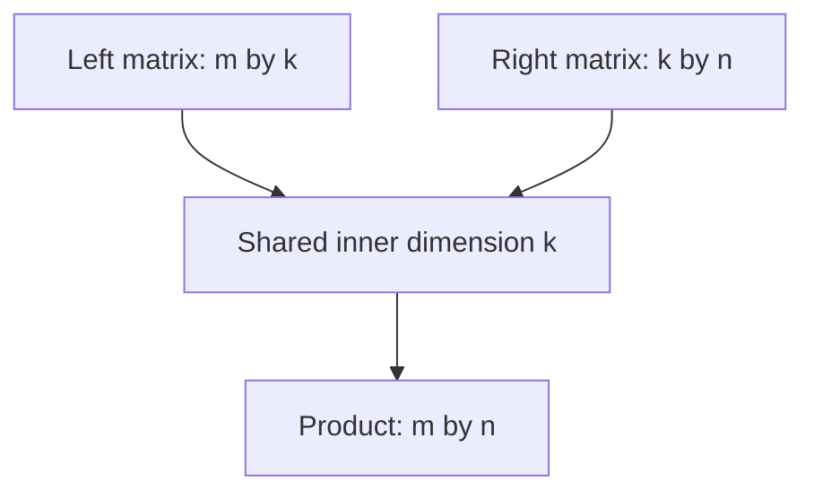

Machine learning is linear algebra with nonlinearities sprinkled in. The
operations are few, they recur constantly, and each has a geometric meaning that
makes the algebra intuitive rather than mechanical.

> [!WHY] A retrieval projection passes a shape check but uses the wrong
> transpose, changing what each output coordinate means. Writing
> dimensions and one worked entry can expose the mistake before a full
> training run.

> [!GOALS]
>
> - Explain rank as surviving directions
> - Compute a matrix-product entry and workload
> - Choose a stable linear-system solve

## Vectors and what operations mean

```text
  DOT PRODUCT      a · b = Σ aᵢbᵢ = ‖a‖‖b‖cos θ

    → a similarity measure
    → zero means ORTHOGONAL — no shared direction
    → this is why cosine similarity is the default for
      embeddings: it is the dot product with magnitude
      divided out
```

```text
  NORMS

    L2  ‖x‖₂ = √Σxᵢ²      Euclidean length
                          → smooth; used for weight decay
    L1  ‖x‖₁ = Σ|xᵢ|      → produces SPARSITY, because its
                            gradient does not shrink near zero
    L∞  max|xᵢ|           → the largest component
```

The L1/L2 distinction explains a practical fact: L1 regularisation drives weights
exactly to zero and L2 only shrinks them, because L1's gradient is constant while
L2's vanishes as the weight does.

```text
  PROJECTION       how much of a lies along b
    proj_b(a) = (a·b / ‖b‖²) b

  → the operation underneath least squares, PCA and
    attention's weighted sums
```

## Matrices as transformations

```text
  a matrix is a LINEAR MAP: it rotates, scales, shears and
  projects.

  Ax = b     apply the transformation A to x

  the columns of A are where the basis vectors LAND.
```

```text
  RANK        the number of independent directions the output
              can span
              → a rank-deficient matrix collapses dimensions,
                irreversibly

  DETERMINANT how much volume is scaled
              → zero means the transformation collapses space,
                so it has no inverse

  INVERSE     undo the transformation
              → exists only if full rank
              → and in practice you almost never compute it:
                SOLVE the system instead
```

**Never invert a matrix to solve a system.** `solve(A, b)` is faster and far more
numerically stable than `inv(A) @ b`, and the difference is not academic — the
explicit inverse loses precision badly for ill-conditioned matrices.

## Matrix multiplication is the workload

```text
  C = AB       Cᵢⱼ = Σₖ AᵢₖBₖⱼ

  [m×k] · [k×n] = [m×n],  costing 2mkn FLOPs
```

```text
  this single operation is
    □  a neural network layer
    □  attention scores (QKᵀ)
    □  the FFN's two projections
    □  a batch of dot products for retrieval

  → which is why the GPU topic's arithmetic intensity
    analysis focuses on it: large matmuls are the one
    compute-bound thing these models do.
```

```text
  and the shapes are the bugs

    [batch, seq, dim] × [dim, out]   ✓
    a transpose forgotten             → a silent broadcast, or
                                        a wrong-shaped result
    → assert shapes at boundaries
```



## Eigenvectors and eigenvalues

```text
  Av = λv

  → v is a direction the transformation does not ROTATE;
    it only SCALES it by λ
```

```text
  where they matter

  □  PCA — the eigenvectors of the covariance matrix are the
     directions of greatest variance
  □  the CONDITION NUMBER (λ_max/λ_min) predicts how hard a
     problem is to optimise: a high number means a loss
     surface that is a long narrow valley, and gradient
     descent zigzags
  □  spectral norms control how much a layer can amplify its
     input — the basis of spectral normalisation
```

The conditioning point connects directly to training dynamics: normalisation
layers help precisely because they improve conditioning, which is why they permit
larger learning rates.

## Singular value decomposition

```text
  A = UΣVᵀ

    U, V   orthonormal (rotations)
    Σ      diagonal, non-negative (scaling)

  → EVERY matrix is a rotation, then a scaling, then another
    rotation.
```

```text
  the low-rank approximation property

    keeping the k largest singular values gives the BEST
    possible rank-k approximation of A, in a precise sense
    (Eckart–Young).
```

```text
  which is why SVD is everywhere

    □  PCA is SVD of the centred data matrix
    □  LoRA's ΔW = BA is a learned low-rank update — the same
      structural idea
    □  matrix factorisation for recommendation
    □  compression, denoising, pseudo-inverse
```

**LoRA is the low-rank idea applied to fine-tuning**, and seeing it that way makes
the rank hyperparameter interpretable: it is how many independent directions of
change you allow.

## Practical numerics

```text
  □  CONDITION NUMBER — a high one means small input errors
     become large output errors
  □  prefer SOLVE to INVERSE, always
  □  the Gram matrix XᵀX squares the condition number, which
     is why the normal equations are numerically worse than
     a QR or SVD approach
  □  in float32, catastrophic cancellation is real: subtract
     nearly-equal numbers and you lose most of your precision
  □  batching matters: one large matmul beats many small ones
     on any accelerator
```

> [!PITFALL] Forming an explicit inverse to solve a system can lose
> numerical stability while doing unnecessary work.

> [!INTERVIEW] Write operand and output shapes before discussing speed or
> accelerator utilization.

> [!CHECK] Why can L1 promote sparse weights?
>
> Its gradient does not shrink toward zero in the same way as L2, so it
> can drive coefficients exactly to zero.

> [!CHECK] What does keeping the largest singular values provide?
>
> The best rank-constrained approximation in the chapter’s SVD sense,
> connecting compression and low-rank updates.

> [!CHECK] Why does conditioning affect training?
>
> An elongated loss valley makes gradient descent zigzag and amplifies
> numerical difficulties.

## What to take away

1. The dot product is a similarity measure and orthogonality means no shared
   direction — which is why cosine similarity is the embedding default.
2. L1 produces sparsity because its gradient does not vanish near zero; L2 only
   shrinks.
3. A matrix is a transformation; rank is how many directions survive it, and a
   collapsed dimension cannot be recovered.
4. Never invert a matrix to solve a system — `solve` is faster and far more stable.
5. The condition number predicts optimisation difficulty, which is why normalisation
   permits larger learning rates.
6. SVD gives the best low-rank approximation, and LoRA is that idea applied to
   fine-tuning — the rank is how many directions of change you allow.

Next: calculus and optimisation.

## Exercises

> [!EXERCISE recall] What does a rank-deficient linear map lose?
>
> **Solution:** Independent directions collapse, so some input information
> cannot be recovered by inversion. Rank describes how many independent
> output directions remain.

> [!EXERCISE apply] Multiply A of shape [3×4] by B of shape [4×2]. A’s
> first row is [1,2,0,−1], B’s first column is [2,0,3,1]. Find the output
> shape, C_11 and the chapter’s FLOP estimate.
>
> **Solution:** The shape rule [m×k][k×n]=[m×n] gives [3×2]. C_ij = sum_k
> A_ik B_kj, so C_11 = 1×2 + 2×0 + 0×3 + (−1)×1 = 2+0+0−1 = 1. The
> workload formula is 2mkn = 2×3×4×2 = 48 FLOPs under the stated
> multiply/add convention.

> [!EXERCISE stretch] A nearly ill-conditioned least-squares problem is
> implemented using inv(X-transpose X). Recommend a numerical approach.
>
> **Solution:** Use a QR or SVD-based solve rather than explicitly forming
> the inverse; avoid normal equations where their squared condition number
> is harmful. A weaker answer merely computes the inverse at the same
> precision and hopes for agreement: the numerical formulation itself
> worsens sensitivity.
