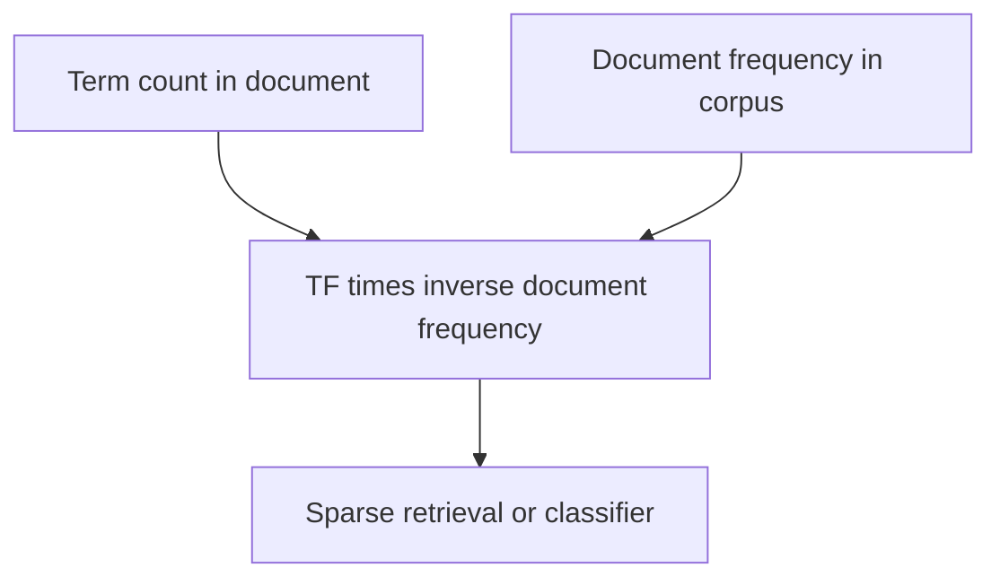

Before neural language models, text processing was a pipeline of explicit steps.
Most of it has been superseded, and a meaningful minority remains the right tool —
particularly where speed, interpretability or exact matching matter.

> [!WHY] A search feature misses an exact product identifier while a large
> model adds latency to a task that needs literal matching. A classical
> baseline can establish whether that operational cost buys useful signal.

> [!GOALS]
>
> - Explain static versus contextual word representations
> - Compute TF-IDF with a stated log base
> - Choose preprocessing appropriate to a modern model

## The classical pipeline

```text
  raw text
    │
    ├─▶ NORMALISATION    lowercase, strip punctuation,
    │                    unicode normalisation
    ├─▶ TOKENISATION     split into words
    ├─▶ STOPWORD REMOVAL drop "the", "of", "is"
    ├─▶ STEMMING /       "running" → "run"
    │   LEMMATISATION
    ├─▶ VECTORISATION    bag of words, TF-IDF
    └─▶ MODEL            naive Bayes, logistic regression, SVM
```

```text
  STEMMING       crude suffix chopping — fast, produces
                 non-words ("studies" → "studi")
  LEMMATISATION  dictionary-based, returns real words
                 ("better" → "good"); slower, needs POS
```

## TF-IDF, which has not gone away

```text
  TF-IDF(t, d) = tf(t,d) × log(N / df(t))

    term frequency        how often in THIS document
    inverse document
    frequency             how RARE across the corpus

  → common words score low, distinctive words score high
```

```text
  BM25 is TF-IDF with saturation and length normalisation,
  and it is what search engines actually use.

  → and, as the retrieval topic established, it BEATS dense
    embeddings on exact terms, rare words, identifiers and
    names — which is why hybrid retrieval exists.
```

**BM25 is the classical technique most worth knowing today.** It is fast, needs no
training, is fully interpretable, and complements embeddings rather than competing
with them.



## Word embeddings

```text
  WORD2VEC   predict a word from its context (CBOW), or the
             context from the word (skip-gram)
  GloVe      factorise a global co-occurrence matrix
  fastText   subword n-grams → handles unseen words and
             morphology
```

```text
  the limitation that transformers removed:

    ONE VECTOR PER WORD TYPE.

    "bank" has a single embedding, whether it is a river
    bank or a financial one.

  → contextual embeddings (BERT onward) give a different
    vector per occurrence, which is the decisive improvement.
```

Static embeddings remain useful where speed matters more than nuance, and
fastText's subword handling still beats many alternatives for morphologically rich
languages and noisy text.

## Classical tasks

```text
  POS TAGGING           word → part of speech
  NER                   extract people, places, organisations
  PARSING               constituency or dependency structure
  COREFERENCE           which mentions refer to the same
                        entity
  TOPIC MODELLING       LDA — latent topics over a corpus
```

```text
  these are now usually done BETTER by transformers, with
  two exceptions worth noting:

    □  a fine-tuned small model (or spaCy) does NER faster
       and cheaper than an LLM, at comparable quality on
       standard entity types
    □  LDA remains useful for EXPLORATORY corpus analysis
       where interpretable topics are the deliverable
```

## What still applies

```text
  ✓  BM25 / TF-IDF for retrieval and as a baseline
  ✓  regular expressions for structured extraction — dates,
     identifiers, phone numbers. do NOT use an LLM for a
     problem a regex solves.
  ✓  edit distance, phonetic matching for fuzzy dedup
  ✓  language identification
  ✓  spaCy-class pipelines for high-volume, latency-sensitive
     NER and parsing
  ✓  n-gram features as a fast, strong baseline for text
     classification
```

```text
  the baseline worth always computing:

    TF-IDF + logistic regression on your text classification
    problem.

  it trains in seconds and is frequently within a few points
  of a fine-tuned transformer — and if the transformer does
  not beat it clearly, the transformer is not worth its
  operational cost.
```

## What no longer applies

```text
  ✗  stopword removal before a transformer — the model uses
     those words
  ✗  stemming before a transformer — subword tokenization
     handles morphology
  ✗  hand-built feature pipelines for classification
  ✗  aggressive normalisation that destroys signal
     (casing carries meaning; "US" and "us" differ)
```

The over-normalisation point is worth flagging: classical pipelines lowercased and
stripped punctuation because sparse features needed it, and applying those habits
before a modern model discards information the model would have used.

> [!PITFALL] Classical normalization can discard casing and small words
> that a contextual model would have used.

> [!INTERVIEW] Explain what the simplest exact-match or sparse baseline
> achieves before paying for a larger model.

> [!CHECK] Why can BM25 complement dense retrieval?
>
> It handles exact terms, identifiers and rare names well rather than
> depending only on semantic similarity.

> [!CHECK] How do stemming and lemmatization differ?
>
> Stemming chops suffixes and may produce nonwords; lemmatization uses
> linguistic/dictionary information to return real forms.

> [!CHECK] When is a regular expression a reasonable extraction tool?
>
> For structured patterns such as known identifier or date formats, where
> a language model adds unnecessary machinery.

## What to take away

1. BM25 is the classical technique most worth knowing today — fast, untrained,
   interpretable, and complementary to embeddings on exact terms.
2. Static word embeddings assign one vector per word type, which is the limitation
   contextual models removed.
3. Use a regex for problems a regex solves; do not reach for a language model to
   extract a date format.
4. TF-IDF plus logistic regression is a seconds-to-train baseline that a
   transformer must clearly beat to justify its cost.
5. Small fine-tuned models and spaCy-class pipelines remain right for high-volume
   NER and parsing.
6. Do not apply classical preprocessing — stopword removal, stemming, aggressive
   normalisation — before a modern model; it discards signal the model would use.

Next: interpretability.

## Exercises

> [!EXERCISE recall] What limitation of static word embeddings do
> contextual embeddings remove?
>
> **Solution:** A static type has one vector across different senses; a
> contextual representation can differ for each occurrence according to
> its surrounding text.

> [!EXERCISE apply] Use base-10 logs and raw term counts in TF-IDF. A
> document contains term R three times and term C twice; a 1,000-document
> corpus contains R in 10 documents and C in all 1,000. Compute both
> weights and compare their role.
>
> **Solution:** TF-IDF(t,d) = tf(t,d)×log(N/df(t)). R has N/df = 1,000/10
> = 100 and log10(100)=2, so its weight is 3×2=6. C has N/df =
> 1,000/1,000=1 and log10(1)=0, so its weight is 2×0=0. Under this
> explicitly unsmoothed formula, the corpus-wide term contributes no
> distinguishing weight despite its document count.

> [!EXERCISE stretch] A transformer pipeline inherits lowercasing,
> stopword removal and stemming from an older sparse classifier. Recommend
> a review.
>
> **Solution:** Remove inherited transformations that destroy signal the
> modern model expects, rather than applying the classical recipe
> automatically. Preserve meaningful casing and words unless the actual
> model’s input design requires otherwise. A weaker answer keeps all old
> steps because they improved sparse features: that evidence does not
> establish they suit contextual/subword inputs.
