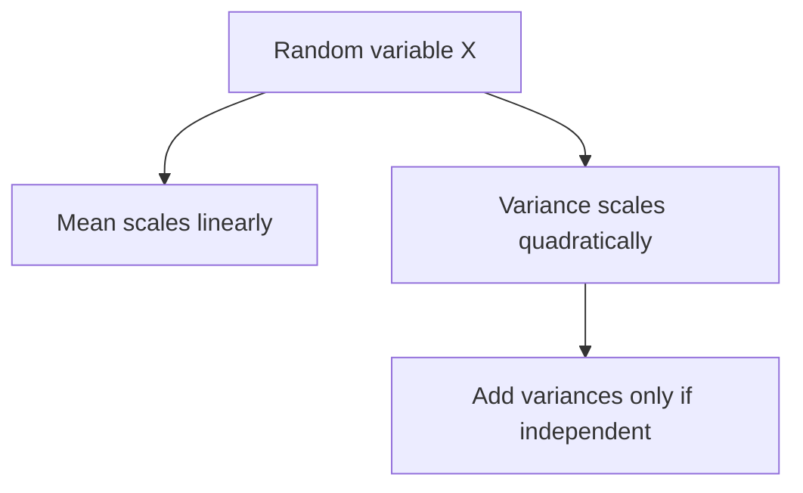

Machine learning is applied probability: a model is a conditional distribution, a
loss is usually a negative log-likelihood, and evaluation is statistical
inference. The concepts below are the ones that recur, with the practical errors
attached.

> [!WHY] A forecast changes units and an engineer multiplies its
> uncertainty by the same factor as its mean. The downstream decision then
> receives the wrong spread even though the transformed average is right.

> [!GOALS]
>
> - Distinguish epistemic and aleatoric uncertainty
> - Transform expectations and variances correctly
> - Interpret an underpowered non-significant result

## Distributions worth knowing

```text
  BERNOULLI      one binary trial
  BINOMIAL       n independent Bernoulli trials
  CATEGORICAL    one draw from k classes → softmax outputs
  GAUSSIAN       the default for continuous quantities;
                 justified by the CLT
  POISSON        counts of rare events in a fixed interval
  EXPONENTIAL    waiting times
  BETA           a distribution over PROBABILITIES →
                 conjugate prior for Bernoulli
  DIRICHLET      over categorical distributions
```

```text
  the CENTRAL LIMIT THEOREM

    the sum of many independent contributions tends to a
    Gaussian, regardless of their individual distributions.

  → which is why Gaussians are everywhere
  → and why the assumption FAILS when contributions are not
    independent or are heavy-tailed — latency being the
    canonical example: it is not Gaussian, which is why the
    mean is the wrong summary
```

## Bayes and the terms

```text
  P(H|E) = P(E|H) · P(H) / P(E)

    posterior = likelihood × prior / evidence
```

```text
  the base-rate example, worth doing once

    a test is 99% accurate; the disease affects 1 in 10,000.
    you test positive. what is P(disease)?

      P(D|+) = (0.99 × 0.0001) /
               (0.99 × 0.0001 + 0.01 × 0.9999)
             ≈ 0.0098

    → under 1%. the false positives from the vast healthy
      population overwhelm the true positives.
```

**This is the single most consequential statistical intuition for ML
practitioners**, because it is exactly the situation of a rare-class classifier:
fraud, disease, defects, anomalies. A 99%-accurate detector for a 0.01% event is
mostly wrong when it fires, and the reason is the base rate rather than the model.

## Estimation

```text
  MLE      maximise P(data | θ)
           → minimising cross-entropy IS maximum likelihood
             for a categorical model
           → overfits with little data

  MAP      maximise P(data | θ) · P(θ)
           → adding a Gaussian prior is exactly L2
             regularisation
           → adding a Laplace prior is exactly L1

  BAYESIAN keep the whole posterior rather than a point
           → uncertainty comes free; usually intractable
```

That MAP correspondence is worth internalising: **weight decay is a Gaussian prior
on the weights**, which is why the regularisation strength and the prior variance
are the same parameter viewed two ways.

## Expectation, variance, covariance

```text
  E[X]              the mean
  Var(X)            spread
  Cov(X,Y)          joint variation
  Corr(X,Y)         normalised covariance, in [−1, 1]

  KEY IDENTITIES

    E[aX + b]  = aE[X] + b          expectation is linear
    Var(aX)    = a²Var(X)           variance is not
    Var(X+Y)   = Var(X)+Var(Y)      ONLY if independent
```

```text
  and the one people misapply:

    CORRELATION MEASURES LINEAR ASSOCIATION ONLY.

    y = x² over a symmetric range has correlation ZERO and
    perfect dependence.
```



## Hypothesis testing and its traps

```text
  □  a p-value is P(data this extreme | null hypothesis true)
     — NOT P(null is true)
  □  it says nothing about EFFECT SIZE
  □  at large n, everything is significant — which is why the
     drift chapter insisted on effect sizes
  □  multiple comparisons: 20 tests at α=0.05 gives roughly
     one false positive by construction
  □  p-hacking: choosing the analysis after seeing the data
  □  a non-significant result is not evidence of no effect;
     it may be an underpowered test
```

```text
  report CONFIDENCE INTERVALS and EFFECT SIZES.

    "accuracy 0.94 [0.91, 0.96]" says everything
    "accuracy 0.94, p < 0.05" says almost nothing
```

**Power** is the neglected half: the probability of detecting an effect that
exists. Running an underpowered test and concluding "no difference" is the most
common statistical error in applied ML, because it looks like a result.

## Distributions over models

```text
  ALEATORIC uncertainty   inherent noise in the data
                          → irreducible; more data does not
                            help

  EPISTEMIC uncertainty   uncertainty about the MODEL
                          → reducible with more data
```

```text
  the distinction matters operationally:

    high epistemic  → this input is unlike training data.
                      collect more, or defer to a human.
    high aleatoric  → the outcome is genuinely uncertain.
                      more data will not fix it.
```

A softmax probability conflates the two, which is why a model can be confidently
wrong on out-of-distribution input: the softmax says nothing about whether the
input resembles anything seen in training. Ensembles and Bayesian approximations
separate them, which is what makes them useful for out-of-distribution detection.

## Calibration

```text
  of the cases predicted at 0.7, do ~70% turn out positive?

  a model can RANK correctly and be badly calibrated —
  and every threshold-based decision depends on the
  probability, not the ranking.
```

```text
  fixes
    TEMPERATURE SCALING   divide logits by a learned T,
                          fitted on a validation set
                          → simple, effective, preserves
                            ranking exactly
    ISOTONIC / PLATT      more flexible; needs more data
```

Modern neural networks are systematically **overconfident**, and temperature
scaling is a one-parameter fix that costs nothing and preserves accuracy exactly.
It is under-used relative to how cheap it is.

> [!PITFALL] Zero correlation rules out only linear association; it is not
> a certificate of independence.

> [!INTERVIEW] State independence and the uncertainty quantity before
> transforming or combining it.

> [!CHECK] What roles do prior and likelihood have in Bayes’ rule?
>
> The prior describes the hypothesis before this evidence; the likelihood
> describes the observed evidence under that hypothesis.

> [!CHECK] What estimation view corresponds to adding a Gaussian weight
> prior?
>
> MAP estimation, with the chapter’s correspondence to L2 regularization.

> [!CHECK] Why report intervals and effect size rather than only a
> p-value?
>
> They communicate magnitude and uncertainty; significance alone does not
> tell the size or usefulness of the effect.

## What to take away

1. The CLT explains why Gaussians are everywhere and why the assumption fails for
   heavy-tailed quantities like latency.
2. The base-rate calculation is the most consequential statistical intuition for ML:
   a highly accurate detector for a rare event is mostly wrong when it fires.
3. Cross-entropy minimisation is maximum likelihood, and weight decay is a Gaussian
   prior — regularisation strength and prior variance are the same parameter.
4. Correlation measures linear association only; zero correlation does not mean
   independence.
5. Report effect sizes and confidence intervals, and power your tests — an
   underpowered null result looks like a finding and is not.
6. Neural networks are systematically overconfident; temperature scaling fixes
   calibration with one parameter and preserves ranking exactly.

Next: what learning theory says about generalisation.

## Exercises

> [!EXERCISE recall] Which uncertainty can more representative data
> reduce, and which remains inherent?
>
> **Solution:** Epistemic uncertainty concerns the model and can shrink
> with data. Aleatoric uncertainty is inherent outcome noise that
> collecting more data does not remove.

> [!EXERCISE apply] Let E[X]=3 and Var(X)=2. Compute E[2X+5] and Var(2X).
> Then an independent Y has Var(Y)=3; compute Var(2X+Y), stating where
> independence is needed.
>
> **Solution:** Use E[aX+b]=aE[X]+b: E[2X+5]=2×3+5=6+5=11. Use
> Var(aX)=a²Var(X): Var(2X)=2²×2=4×2=8. For independent quantities,
> Var(U+V)=Var(U)+Var(V), so Var(2X+Y)=8+3=11. Independence is needed for
> that sum-of-variances step, not for the linear expectation identity.

> [!EXERCISE stretch] A small experiment is non-significant and a team
> wants to announce that there is no effect. Recommend an interpretation.
>
> **Solution:** Check power, the confidence interval and plausible effect
> sizes before concluding what the data excludes. A weaker answer equates
> failure to reject with evidence of no effect: a weak test may simply be
> unable to detect a real difference.
