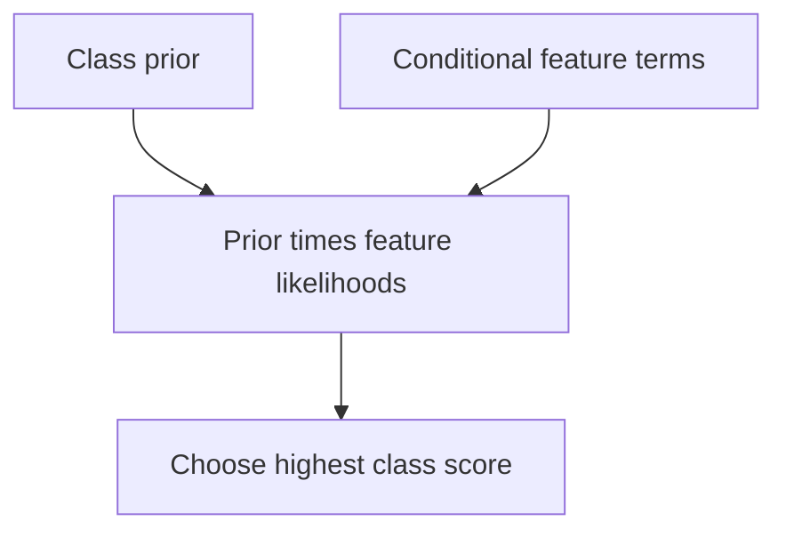

Supervised learning maps inputs to labels. The classical models are worth knowing
not for nostalgia but because they remain the right answer for a large fraction of
real problems, and because their assumptions make the trade-offs explicit in a way
a neural network's do not.

> [!WHY] A team replaces a quick tabular baseline with a complex model
> before checking feature quality. Extra training and deployment work can
> then hide the fact that no useful signal was added.

> [!GOALS]
>
> - Explain regularization’s feature-selection effect
> - Compute a naive-Bayes class decision
> - Choose an ordered baseline improvement plan

## Linear regression

```text
  ŷ = w·x + b
  loss = mean squared error
```

```text
  what it assumes
    □  the relationship is LINEAR in the features
    □  errors are independent, with constant variance
    □  features are not perfectly collinear

  it has a CLOSED-FORM solution, w = (XᵀX)⁻¹Xᵀy — which, per
  the linear algebra chapter, you should compute with a QR or
  SVD solve rather than the explicit inverse.
```

```text
  its enduring value: INTERPRETABILITY. each coefficient is
  "holding everything else constant, a one-unit change in
  this feature moves the prediction by w".

  → no other model gives you that as cleanly, and in
    regulated settings it is often the deciding factor.
```

## Logistic regression

```text
  P(y=1|x) = σ(w·x + b)
  loss = cross-entropy (= maximum likelihood)
```

```text
  □  a LINEAR decision boundary in feature space
  □  outputs CALIBRATED probabilities — genuinely, unlike
     most neural networks
  □  convex, so optimisation has one answer
  □  scales to enormous sparse feature spaces
```

**Logistic regression is the most under-rated baseline in ML.** On problems with
good features it is frequently within a few points of anything more complex,
trains in seconds, gives calibrated probabilities, and is explainable. A deep model
that does not beat it has a bug or no signal, as the training-debugging chapter
said.

## Regularised variants

```text
  RIDGE (L2)     shrinks coefficients toward zero
                 → handles collinearity; keeps all features
  LASSO (L1)     drives coefficients EXACTLY to zero
                 → performs feature SELECTION
  ELASTIC NET    both; the practical default when p ≫ n
```

The L1 sparsity property comes from the gradient argument in the linear-algebra
chapter, and it makes Lasso a feature-selection method as much as a regulariser.

## k-nearest neighbours

```text
  predict from the k closest training examples.

  □  NO training — all the work is at prediction time
  □  a non-linear decision boundary for free
  □  needs a meaningful distance metric
  □  degrades badly in high dimensions (everything is
     equidistant)
  □  prediction cost grows with the dataset
```

kNN is worth knowing because **modern retrieval is kNN**: the vector-search topic
is entirely about making it fast at scale. The algorithm did not go away; it moved
into infrastructure.

## Support vector machines

```text
  find the hyperplane with the largest MARGIN between
  classes.

  □  the KERNEL TRICK computes inner products in a
     high-dimensional space without ever forming it
     → non-linear boundaries with a linear method
  □  strong on small, high-dimensional data
  □  scales poorly past ~100k samples
  □  no calibrated probabilities without extra fitting
```

SVMs dominated before deep learning and are now niche, but the kernel trick is a
genuinely elegant idea and the max-margin principle recurs.

## Naive Bayes

```text
  P(y|x) ∝ P(y) ∏ P(xᵢ|y)

  the "naive" assumption: features are conditionally
  independent given the class.

  □  the assumption is almost always FALSE
  □  and it works anyway, because the DECISION only needs the
     argmax to be right, not the probabilities
  □  extremely fast; strong with little data
  □  the classic text-classification baseline
```

The reason it survives a false assumption is worth understanding: it produces badly
calibrated probabilities and frequently correct rankings, and classification needs
the ranking.



## Choosing

```text
  TABULAR, mixed types            gradient-boosted trees
  TABULAR, need interpretability  linear / logistic regression
  TEXT, small data                naive Bayes or linear on
                                  TF-IDF
  TEXT, large data                a pretrained transformer
  IMAGES                          a pretrained CNN or ViT
  SEQUENCES                       a transformer
  SMALL, high-dimensional         regularised linear, or SVM
  need CALIBRATED probabilities   logistic regression, or
                                  calibrate afterwards
```

```text
  the honest ordering for a new problem

    1. a trivial baseline (majority class, most popular)
    2. logistic regression or gradient boosting on simple
       features
    3. better features
    4. a more complex model
    5. an ensemble

  most projects should stop at 2 or 3.
```

**Step 3 before step 4** is the ordering people invert. Feature quality dominates
model choice for most tabular problems, and the effort spent on a better
architecture is usually better spent on a better representation of the input.

## The class-imbalance problem

```text
  1% positive rate

  □  accuracy is meaningless — predict all-negative for 99%
  □  use PR-AUC, precision@k, or recall at a fixed precision
  □  RESAMPLING (oversample minority, undersample majority)
     changes the base rate and therefore the calibration
  □  CLASS WEIGHTS in the loss are usually cleaner
  □  THRESHOLD TUNING on a validation set is the most direct
     lever, and the most often forgotten
```

Threshold tuning deserves the emphasis: the model outputs a score, and the
operating point is a separate decision that should follow from the relative cost of
false positives and false negatives — not from the default of 0.5.

> [!PITFALL] A high all-negative accuracy on an imbalanced task says
> little about whether useful positives are found.

> [!INTERVIEW] Name the model’s assumptions and baseline performance
> before choosing more complexity.

> [!CHECK] Why can kNN inference become costly as data grows?
>
> It places the work at prediction time and needs a meaningful distance to
> training examples.

> [!CHECK] What does the kernel trick avoid constructing?
>
> An explicit high-dimensional feature representation while computing its
> inner products.

> [!CHECK] How should a linear-regression system be solved numerically?
>
> Prefer a QR or SVD solve to explicitly computing the normal-equation
> inverse.

## What to take away

1. Linear and logistic regression remain strong baselines with calibrated
   probabilities and genuine interpretability; a complex model that does not beat
   them has a bug or no signal.
2. L1 performs feature selection because it drives coefficients exactly to zero.
3. kNN did not go away — modern vector retrieval is kNN moved into infrastructure.
4. Naive Bayes works despite a false assumption because classification needs the
   ranking, not the probabilities.
5. Improve features before increasing model complexity; most projects should stop
   at a simple model on good features.
6. Under class imbalance, accuracy is meaningless and threshold tuning against the
   relative cost of errors is the most direct and most forgotten lever.

Next: trees and ensembles, which win on tabular data.

## Exercises

> [!EXERCISE recall] How do Lasso and Ridge differ as feature selectors?
>
> **Solution:** L1/Lasso can drive coefficients exactly to zero and
> thereby select features. L2/Ridge shrinks coefficients while generally
> retaining them.

> [!EXERCISE apply] For two observed features, class A has prior 0.6 and
> conditional likelihoods 0.5 and 0.2; B has prior 0.4 and likelihoods
> 0.25 and 0.8. Using the chapter’s conditional-independence model, choose
> a class and say whether normalized probabilities were required.
>
> **Solution:** The rule is P(y|x) proportional to P(y)×product_i
> P(x_i|y). A’s score is 0.6×0.5×0.2 = 0.3×0.2 = 0.06. B’s is 0.4×0.25×0.8
> = 0.1×0.8 = 0.08. Choose B since 0.08>0.06. A common normalization is
> unnecessary for the argmax, and a correct ordering does not imply
> well-calibrated probabilities when the independence assumption is false.

> [!EXERCISE stretch] A mixed-type tabular project has only a trivial
> baseline and proposes a large network next. Recommend an experiment
> sequence.
>
> **Solution:** Try a simple logistic or boosted-tree baseline on
> reasonable features, improve the features and justify a more complex
> model only with a clear gain. A weaker answer jumps directly to
> architecture search: it spends effort before learning whether feature
> quality and a simple model already solve the problem.
