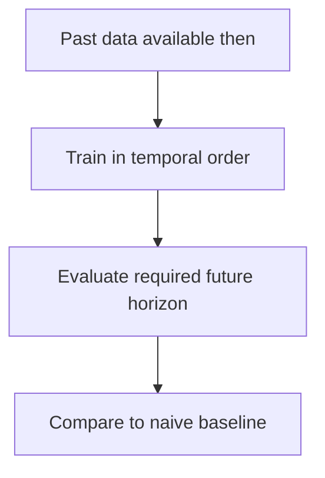

Time series violates the assumption every other method rests on: observations are
not independent, and the future must not inform the past. Both the modelling and
the evaluation need different treatment, and getting the evaluation wrong is the
more common failure.

> [!WHY] A forecast looks excellent in a retrospective test that uses
> revised source values unavailable on the forecast date. The operational
> system cannot reproduce that apparent advantage because it never had
> those inputs.

> [!GOALS]
>
> - Explain why naive baselines matter
> - Compare scaled forecast errors across series
> - Design a historically faithful backtest

## The structure

```text
  a series decomposes into

    TREND        long-run direction
    SEASONALITY  repeating cycles (daily, weekly, annual)
    CYCLE        irregular longer-run swings
    NOISE        the residual
```

```text
  STATIONARITY: the statistical properties do not change
  over time.

  many classical methods REQUIRE it.
  → achieved by DIFFERENCING (yₜ − yₜ₋₁), by removing a
    trend, or by a log transform for multiplicative growth
  → tested with ADF or KPSS
```

## The classical methods

```text
  NAIVE            ŷₜ₊₁ = yₜ
                   → the baseline every forecast must beat,
                     and frequently does not
  SEASONAL NAIVE   ŷₜ₊₁ = yₜ₊₁₋ₛ (the same point last season)
                   → a strong baseline for seasonal data

  ARIMA            autoregression + differencing + moving
                   average
                   ✓ interpretable, well-understood
                   ✗ univariate; needs stationarity; manual
                     order selection

  EXPONENTIAL
  SMOOTHING / ETS  weighted average with exponentially
                   decaying weights; Holt-Winters adds trend
                   and seasonality
                   ✓ simple, robust, hard to beat on short
                     series

  PROPHET          decomposition with changepoints and
                   holiday effects
                   ✓ handles missing data and irregular
                     spacing; good defaults
```

**The naive baselines matter.** A large fraction of forecasting projects produce a
model that does not beat seasonal naive, and it is discovered late because nobody
computed the baseline first.

## ML approaches

```text
  reframe as SUPERVISED learning with lag features:

    features: y(t−1), y(t−2), ..., rolling means, calendar
              features, external regressors
    target:   y(t)

  → then use gradient boosting, which is frequently the
    strongest approach on real business series
```

```text
  DEEP LEARNING
    LSTM / GRU     historically standard
    TCN            dilated convolutions; parallel training
    TRANSFORMERS   Informer, PatchTST — competitive on long
                   horizons
    FOUNDATION
    MODELS         pretrained on many series; promising for
                   zero-shot forecasting
```

```text
  the honest position, repeatedly reproduced in forecasting
  competitions:

    on typical business series — short, noisy, seasonal —
    STATISTICAL METHODS AND GRADIENT BOOSTING ARE HARD TO
    BEAT.

    deep learning wins with many related series, long
    histories and rich covariates.
```

## The evaluation traps

```text
  □  NEVER RANDOM-SPLIT.
       a random split trains on the future and tests on the
       past. the metric is meaningless and optimistic.

  □  use TEMPORAL splits, and WALK-FORWARD validation:

       train[───────] test[──]
       train[─────────] test[──]
       train[───────────] test[──]

       → also shows whether performance DECAYS over time

  □  match the evaluation HORIZON to the use case
       one-step-ahead is much easier than 30-step-ahead, and
       reporting the former for a system that needs the
       latter is misleading

  □  LAG FEATURES must only use past values
       → the point-in-time rule again

  □  BACKTESTING must simulate what was KNOWN at the time,
       including data that arrived late
```

The late-arrival point is subtle and important: a backtest using the final,
corrected value of a series tests a model with information that did not exist at
prediction time. Financial and operational data are frequently revised, and
backtesting on revised data systematically overstates performance.

## Metrics

```text
  MAE / RMSE     in the target's units; not comparable across
                 series of different scale
  MAPE           scale-free; UNDEFINED at zero and asymmetric
  sMAPE          symmetric variant; still awkward
  MASE           scaled by the NAIVE forecast's error
                 → comparable across series, and it makes
                   "did we beat naive?" the unit
```

**MASE is the right default for multiple series**, because it makes the naive
baseline the denominator: a MASE above 1 means the model is worse than doing
nothing, which is exactly the check people skip.



## Practical guidance

```text
  □  PLOT THE SERIES. seriously — trend, seasonality, level
     shifts, outliers and missing periods are visible in
     seconds and invisible in a metric
  □  compute the naive and seasonal-naive baselines FIRST
  □  handle missing timestamps explicitly; a gap is not zero
  □  outliers: is it an error, or a real event (a promotion,
     an outage)? they need different treatment
  □  forecast INTERVALS, not just point forecasts — the
     uncertainty is usually the actionable part
  □  aggregate before forecasting where you can: weekly
     totals are far more predictable than daily
  □  hierarchical series need RECONCILIATION so parts sum to
     the whole
```

The interval point deserves emphasis: a demand forecast of 1,000 units is far less
useful than "between 800 and 1,300 with 90% confidence", because the inventory
decision depends on the spread rather than the centre.

> [!PITFALL] A gap in timestamps is not automatically a zero observation.

> [!INTERVIEW] State the horizon and information available at each
> prediction date before presenting a backtest score.

> [!CHECK] What does differencing change?
>
> It uses consecutive changes instead of levels to help remove
> nonstationary trend structure.

> [!CHECK] Why might a one-step evaluation mislead a long-horizon
> application?
>
> It measures an easier task than the actual required forecast horizon.

> [!CHECK] Why provide forecast intervals?
>
> Decisions can depend on spread and risk rather than only the forecast’s
> central point.

## What to take away

1. Decompose into trend, seasonality and noise, and test stationarity — many
   classical methods require it.
2. Compute naive and seasonal-naive baselines first; a large fraction of
   forecasting projects never beat them.
3. Reframing as supervised learning with lag features and using gradient boosting
   is frequently the strongest practical approach.
4. Never random-split; use temporal splits and walk-forward validation, and match
   the evaluation horizon to the use case.
5. Backtest on the data as it was *known at the time* — revised data overstates
   performance.
6. Use MASE for multiple series so "did we beat naive" is the unit, and forecast
   intervals rather than points.

Next: Bayesian methods.

## Exercises

> [!EXERCISE recall] Why compute naive and seasonal-naive forecasts before
> a more elaborate model?
>
> **Solution:** They are strong, cheap references that many elaborate
> forecasts do not beat. Without them an apparently useful model may add
> complexity without improvement.

> [!EXERCISE apply] Using the chapter’s naive-error scaling, series A has
> model absolute error 3 and naive scaling error 4; B has model error 8
> and naive scaling error 10. Compute MASE for each and compare what raw
> errors alone would suggest. Treat the supplied errors as the
> already-computed aggregate errors.
>
> **Solution:** MASE = model error / naive scaling error. A gives
> 3/4=0.75; B gives 8/10=0.80. Both are below 1 and beat their respective
> naive references. A is better relative to its reference, but B’s larger
> raw error does not by itself indicate a proportionally worse model
> because the series have different scales. Compare the ratios, not 3
> versus 8 in isolation.

> [!EXERCISE stretch] A historical evaluation random-splits dates and
> loads the latest corrected source values. Recommend a replacement.
>
> **Solution:** Use temporal walk-forward evaluation at the required
> horizon and reconstruct what data was actually known at each prediction
> time, including late arrivals and revisions. A weaker answer only sorts
> the final report by date: it leaves future training information and
> revised inputs inside the evaluation.
