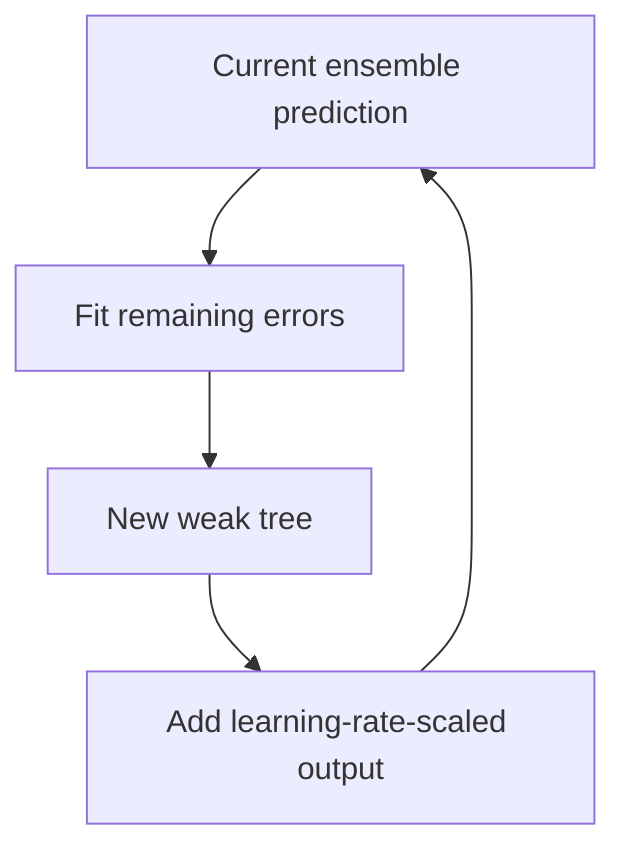

On tabular problems — the majority of business ML — gradient-boosted decision
trees remain the strongest method, and it is not close. Understanding why is
useful, because the reason is about inductive bias rather than about maturity.

> [!WHY] A tabular model’s default importance plot ranks an identifier
> first. Acting on that plot without checking its bias can send feature
> work toward a high-cardinality artefact instead of useful signal.

> [!GOALS]
>
> - Distinguish bagging from boosting
> - Compute sequential boosting predictions
> - Check a suspicious importance ranking

## Decision trees

```text
  recursively split the data on the feature and threshold
  that best separates the target.

              age > 30?
             ╱          ╲
          yes            no
         ╱                 ╲
   income > 50k?          predict A
    ╱        ╲
  yes         no
predict B   predict A
```

```text
  split criteria
    GINI IMPURITY     classification; cheap
    ENTROPY           classification; similar in practice
    VARIANCE          regression
```

```text
  the properties that matter

  ✓  handles mixed types with no preprocessing
  ✓  NO SCALING NEEDED — splits are order-based
  ✓  captures non-linearities and interactions naturally
  ✓  handles missing values natively (a default direction)
  ✓  interpretable when shallow
  ✗  a single tree is HIGH VARIANCE — a small data change
     produces a different tree
  ✗  axis-aligned splits approximate diagonal boundaries
     poorly
```

The no-scaling property is a genuine practical advantage: tree models are immune to
the feature-scaling mistakes that silently degrade neural networks and linear
models.

## Bagging and random forests

```text
  BAGGING    train many trees on bootstrap samples; average

    → variance falls, bias unchanged
    → averaging N independent estimators divides variance by N

  RANDOM FOREST adds: consider only a random SUBSET of
  features at each split
    → decorrelates the trees, so averaging helps more
```

```text
  ✓  robust, hard to overfit, few hyperparameters
  ✓  out-of-bag samples give a free validation estimate
  ✓  parallel — every tree is independent
  ✗  usually a point or two behind boosting
```

Random forests are the low-effort choice: they work acceptably with default
settings, which is not true of boosting.

## Gradient boosting

```text
  build trees SEQUENTIALLY, each fitting the RESIDUAL
  errors of the ensemble so far.

    F₀ = a constant
    Fₘ = Fₘ₋₁ + η · hₘ(x)     where hₘ fits the gradient of
                              the loss w.r.t. Fₘ₋₁
```

```text
  → it is gradient descent in FUNCTION space:
    each tree is a step in the direction that most reduces
    the loss.
```

```text
  bagging reduces VARIANCE; boosting reduces BIAS.

  → which is why boosting is more accurate and more prone
    to overfitting, and needs a learning rate, early
    stopping and regularisation.
```

```text
  the implementations

  XGBoost     regularised objective, second-order gradients,
              excellent engineering
  LightGBM    histogram binning + leaf-wise growth
              → much faster on large data
  CatBoost    ordered boosting; native categorical handling
              → best out of the box for high-cardinality
                categoricals
```

```text
  the parameters that matter, in order

    learning rate       0.01–0.1 (lower needs more trees)
    n_estimators        with EARLY STOPPING, not a fixed count
    max_depth           3–8; deeper overfits
    subsample           0.7–0.9
    colsample_bytree    0.7–0.9
    min_child_weight    guards against tiny leaves
    reg_lambda / alpha  L2 / L1 on leaf weights
```



## Why trees beat neural networks on tabular data

The question is worth answering properly, because the answer is not "neural
networks are immature".

```text
  □  TABULAR DATA HAS NO SPATIAL OR SEQUENTIAL STRUCTURE
     for a network to exploit — the inductive biases that
     make CNNs and transformers powerful do not apply

  □  features are HETEROGENEOUS in scale and meaning; trees
     are invariant to monotonic transformations, networks
     are not

  □  axis-aligned splits match how tabular relationships
     are often actually structured (thresholds, categories)

  □  trees are robust to UNINFORMATIVE features; networks
     must learn to ignore them

  □  tabular datasets are usually SMALL by deep learning
     standards
```

**Use gradient boosting for tabular data.** Deep learning on tabular problems is an
active research area with periodic claims of parity, and the practical answer for a
working engineer has been stable for a decade.

## Interpretation

```text
  FEATURE IMPORTANCE
    gain-based     how much each feature reduced the loss
                   → BIASED toward high-cardinality features
    permutation    shuffle a feature, measure the drop
                   → slower, more trustworthy

  SHAP
    per-prediction attribution with theoretical grounding
    → the standard for explaining an individual decision

  PARTIAL DEPENDENCE
    how the prediction varies with one feature
    → misleading when features are correlated
```

The gain-importance bias is worth knowing because it is the default in every
library: a high-cardinality feature (like an id) gets many split opportunities and
therefore high importance, whether or not it is genuinely predictive. Permutation
importance is the check.

> [!PITFALL] Gain importance gives high-cardinality fields more split
> opportunities, even when they are not meaningfully predictive.

> [!INTERVIEW] Explain the data’s structure and the model’s inductive bias
> rather than relying on a universal architecture ranking.

> [!CHECK] Why do order-based tree splits need no standard scaling?
>
> Monotonic rescaling preserves the ordering used by thresholds rather
> than changing distance geometry.

> [!CHECK] Why randomize feature subsets in a forest?
>
> It decorrelates trees so averaging can reduce variance more effectively.

> [!CHECK] Why use early stopping instead of a fixed large tree count?
>
> Boosting can overfit; validation-based stopping limits adding trees
> after useful generalization gains end.

## What to take away

1. Trees need no scaling, handle mixed types and missing values natively, and
   capture interactions — which removes most preprocessing failure modes.
2. Bagging reduces variance and boosting reduces bias, which is why boosting is more
   accurate and needs more careful regularisation.
3. Gradient boosting is gradient descent in function space, each tree fitting the
   current residual.
4. Trees beat neural networks on tabular data because tabular data lacks the
   structure that network inductive biases exploit — not because networks are
   immature.
5. Use early stopping rather than a fixed tree count, and start from LightGBM or
   CatBoost defaults.
6. Gain-based feature importance is biased toward high-cardinality features; check
   with permutation importance.

Next: learning without labels.

## Exercises

> [!EXERCISE recall] How do bagging and boosting attack different error
> sources?
>
> **Solution:** Bagging averages independently trained estimators to
> reduce variance. Boosting fits successive residual/gradient errors to
> reduce bias and therefore needs more careful learning rate and
> regularization control.

> [!EXERCISE apply] At one input, start F_0=10, use eta=0.2, and let the
> first two newly fitted trees output h_1=−4 and h_2=3. Compute the
> ensemble after each step.
>
> **Solution:** The update is F_m = F_(m−1)+eta×h_m(x). First
> F_1=10+0.2×(−4)=10−0.8=9.2. Then F_2=9.2+0.2×3=9.2+0.6=9.8. The trees
> contribute scaled corrections, not standalone predictions whose
> unweighted average replaces the ensemble.

> [!EXERCISE stretch] An id field tops gain-based importance and a team
> proposes collecting more id-like fields. Recommend a check first.
>
> **Solution:** Measure permutation importance by shuffling the field and
> observing the performance drop, checking whether it truly contributes
> rather than only offering many split points. A weaker answer treats high
> gain importance as causal or stable evidence of value: high-cardinality
> opportunity can inflate the ranking.
