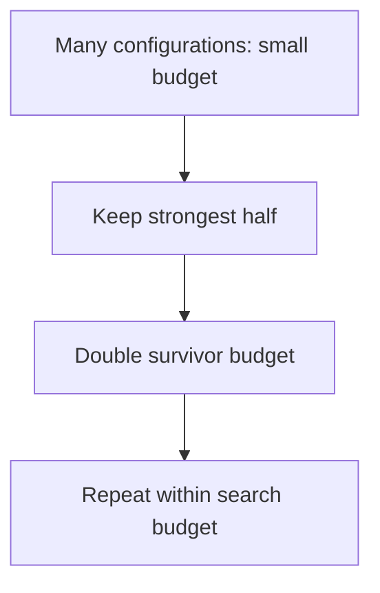

Hyperparameters are the settings not learned from data: learning rate, depth,
regularisation strength, architecture choices. Searching them well is mostly about
spending a fixed budget efficiently and not over-fitting the validation set in the
process.

> [!WHY] A large search produces a tiny validation winner that disappears
> with another seed. Spending more trials on the same validation set may
> only make the lucky result look more convincing.

> [!GOALS]
>
> - Explain why random search explores useful dimensions
> - Compute a successive-halving training budget
> - Choose evidence for a noisy search winner

## The search strategies

```text
  MANUAL            expert intuition
                    ✓ fast when you know the domain
                    ✗ does not scale; not reproducible

  GRID              exhaustive over a lattice
                    ✗ WASTEFUL: it spends the same number of
                      distinct values on the dimension that
                      matters and the one that does not

  RANDOM            sample from distributions
                    ✓ strictly better than grid at equal
                      budget (Bergstra & Bengio)
                    → 60 random samples land within the top
                      5% along the important dimensions with
                      ~95% probability

  BAYESIAN          model the objective; sample where
                    expected improvement is highest
                    ✓ best sample efficiency
                    ✗ sequential, so parallelises poorly

  HYPERBAND / ASHA  allocate budget adaptively; kill bad runs
                    early
                    ✓ usually the best WALL-CLOCK choice
                    ✓ combines with Bayesian sampling (BOHB)

  EVOLUTIONARY      mutate and select
                    → for large discrete spaces
```

```text
  why random beats grid, precisely

    with a grid of 5×5, you test 5 distinct values of each
    parameter.
    with 25 random samples, you test 25 distinct values of
    EACH — because every sample varies both.

    if only one parameter matters, grid explored it 5 times
    and random explored it 25 times.
```

## Successive halving

```text
  the idea behind Hyperband:

    start N configurations with a small budget
    keep the best half; double their budget
    repeat

    N=64 at 1 epoch
    32 at 2
    16 at 4
     8 at 8
     ...

  → most of the budget goes to promising configurations
  → typically 5–20× faster than training everything fully
```

```text
  the assumption it makes: early performance PREDICTS final
  performance.

  → usually true, and not always: a configuration with a
    long warmup or a low learning rate can look bad early
    and win eventually.
```



## What to search, and how

```text
  □  search LOG-scale for learning rate, weight decay,
     regularisation — they matter multiplicatively
  □  search LINEAR for layer counts, batch sizes
  □  fix the seed DURING search, then re-verify the winner
     across several seeds
  □  search the RANGES that matter — a badly chosen range
     wastes the whole budget
  □  record the SEARCH SPACE, not only the winner:
     "we tried LR from 1e-5 to 1e-1" is the reusable
     knowledge
```

```text
  the parameters worth searching, in order of impact

    learning rate            almost always dominant
    batch size (with LR)
    regularisation strength
    architecture width/depth
    everything else
```

## Overfitting the validation set

The failure specific to search, and the one that produces unreproducible results:

```text
  testing 200 configurations and picking the best means the
  validation metric is OPTIMISTICALLY BIASED — you have
  implicitly fitted to it.

  → the held-out performance of the winner will be worse
    than its validation performance, systematically
```

```text
  the defences

  □  a TEST SET touched once, on the final choice
  □  nested cross-validation for small data
  □  prefer fewer, better-chosen trials to many random ones
  □  be suspicious of a winner that beats the runner-up by
     less than the seed-to-seed variance
```

That last check is the practical one: if the top five configurations are within
noise of each other, you have not found a better configuration — you have found the
luckiest one.

## AutoML

```text
  automates: preprocessing, model selection, hyperparameter
  search, ensembling

    AutoGluon, auto-sklearn, H2O, cloud AutoML services
```

```text
  ✓  a strong BASELINE quickly, with little expertise
  ✓  good at tabular problems
  ✓  useful as a check on a hand-built model
  ✗  expensive in compute
  ✗  the result is often a large opaque ensemble
  ✗  it does not do FEATURE ENGINEERING or PROBLEM FRAMING,
     which is where most of the value is
```

**AutoML is best used as a baseline generator.** Run it, see what score is
achievable, and use that number to judge whether your hand-built model is worth
its complexity. Using it as the deliverable produces a model nobody can explain or
maintain.

## Practical guidance

```text
  □  start with sensible DEFAULTS — modern libraries have
     good ones
  □  tune the learning rate first, and often only
  □  use ASHA or Hyperband when you have parallel compute
  □  budget the search: define trials and time in advance
  □  log every trial (the experiment-tracking chapter)
  □  stop when improvements are within noise
  □  and remember: better DATA and FEATURES beat better
     hyperparameters, nearly always
```

> [!PITFALL] Early stopping in a search assumes early performance predicts
> the final result; long-warmup configurations can violate it.

> [!INTERVIEW] Record the search space and budget, then distinguish a
> reproducible gain from validation luck.

> [!CHECK] Why search learning rates on a log scale?
>
> Their meaningful changes are multiplicative across orders of magnitude
> rather than evenly spaced additive steps.

> [!CHECK] What should be logged beyond the winning setting?
>
> The searched ranges, all trials and budget so later work can reuse what
> was actually explored.

> [!CHECK] Why is AutoML not a substitute for problem framing?
>
> It automates pipeline/model choices but does not establish that the
> target or available features solve the right problem.

## What to take away

1. Random search strictly beats grid at equal budget because every sample varies
   every dimension.
2. Successive halving (Hyperband/ASHA) is usually the best wall-clock choice, on the
   assumption that early performance predicts final performance.
3. Search learning rate and regularisation on a log scale, and record the search
   space rather than only the winner.
4. Testing many configurations biases the validation metric — keep a test set
   touched once, and distrust a winner inside the noise band.
5. AutoML is a baseline generator rather than a deliverable; it does not do feature
   engineering or problem framing.
6. Better data and features beat better hyperparameters nearly always — tune the
   learning rate and move on.

That completes the ML Foundations track. It connects forward to **Deep Learning**
for what these ideas become at scale, and to **ML Systems** for putting them into
production.

## Exercises

> [!EXERCISE recall] Why does random search use a fixed trial budget more
> effectively than a grid when few dimensions matter?
>
> **Solution:** Each random sample varies every dimension, while a grid
> repeats the same few values of the important dimension as it changes
> unimportant ones. That spends fewer distinct probes on the useful axis.

> [!EXERCISE apply] Start 16 configurations at 2 epochs; keep half to a
> cumulative 4 epochs and half again to a cumulative 8. Survivors resume
> checkpoints. Compute additional training at each stage and compare with
> training all 16 to 8 epochs.
>
> **Solution:** Apply “keep half, double cumulative budget.” Stage 1 uses
> 16×2=32 configuration-epochs. Stage 2 keeps 16/2=8 and adds 4−2=2 each:
> 8×2=16. Stage 3 keeps 8/2=4 and adds 8−4=4 each: 4×4=16. Total is
> 32+16+16=64. Full training uses 16×8=128, so this schedule uses 64
> fewer, half the epoch budget under these assumptions; it does not
> guarantee the same winner.

> [!EXERCISE stretch] The validation winner beats its runner-up by less
> than observed seed-to-seed variation after many trials. Recommend a
> conclusion and next evaluation.
>
> **Solution:** Treat the ranking as uncertain, recheck the candidate over
> several seeds and retain a test set for the final choice. A weaker
> answer announces the maximum validation score as a discovered
> improvement: selection across many noisy trials is optimistic and can
> reward the luckiest run.
