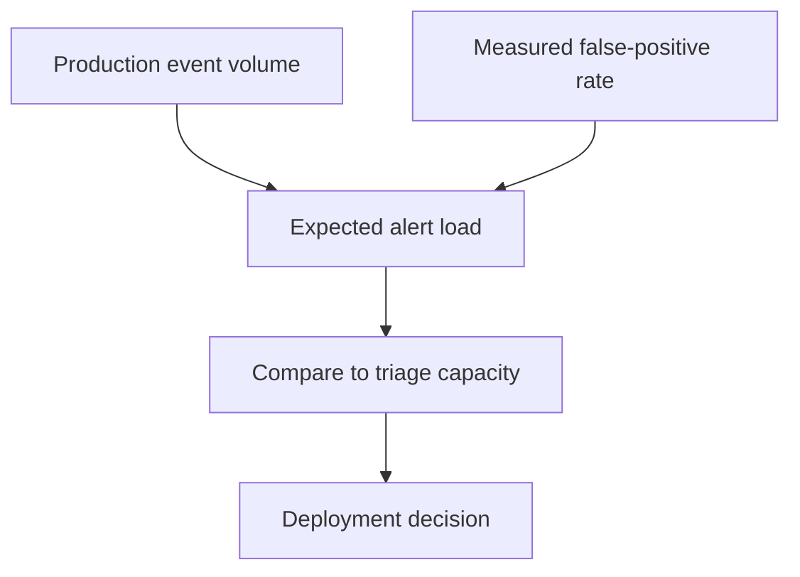

Unsupervised learning finds structure in unlabelled data. Its central difficulty
is not the algorithms — most are simple — but evaluation: with no ground truth,
"is this good?" has no direct answer, and that shapes how it should be used.

> [!WHY] An anomaly detector’s tiny false-positive rate becomes thousands
> of daily alerts at production volume. Without a triage calculation, a
> promising model can create a queue people learn to ignore.

> [!GOALS]
>
> - Compare clustering assumptions
> - Compute alert load against review capacity
> - Validate a visualization in original space

## Clustering

```text
  k-MEANS
    assign points to the nearest of k centroids; recompute
    centroids; repeat.

    ✓ fast, simple, scales
    ✗ you must choose k
    ✗ assumes spherical, similar-sized clusters
    ✗ sensitive to initialisation (use k-means++)
    ✗ every point is assigned, including outliers
```

```text
  DBSCAN
    density-based: cluster dense regions, label sparse
    points as NOISE.
    ✓ finds arbitrary shapes; no k needed; handles outliers
    ✗ struggles with varying density; two parameters to tune

  HIERARCHICAL
    build a tree of nested clusters.
    ✓ no k needed up front; the dendrogram is informative
    ✗ O(n²) or worse

  GAUSSIAN MIXTURES
    soft assignment with a probabilistic model.
    ✓ probabilities, elliptical clusters, a likelihood to
      compare
    ✗ more parameters; can be unstable
```

```text
  choosing k, and why it is unsatisfying

    ELBOW        plot within-cluster variance against k; look
                 for a bend — often ambiguous
    SILHOUETTE   how well each point fits its cluster vs the
                 next best
    GAP STATISTIC compare against a null reference
    DOMAIN       the number that is useful to the business
```

**The last is usually the right answer.** If clustering feeds a product decision —
five customer segments a marketing team can act on — then five is the right k
regardless of what the silhouette score prefers. Clustering is more often a
communication tool than a discovery one.

## Dimensionality reduction

```text
  PCA
    project onto the directions of greatest variance.
    → the eigenvectors of the covariance matrix; SVD of the
      centred data

    ✓ linear, fast, deterministic, invertible
    ✓ components are interpretable as variance directions
    ✗ LINEAR only; needs centring and usually scaling
```

```text
  t-SNE / UMAP
    preserve LOCAL neighbourhood structure for visualisation.

    ✓ excellent 2D plots that reveal cluster structure
    ✗ VISUALISATION ONLY — do not feed them to a model
    ✗ distances BETWEEN clusters are meaningless
    ✗ cluster SIZES are meaningless
    ✗ stochastic; different runs give different pictures
```

```text
  the warning that matters:

    people read t-SNE plots as maps. they are not.

    two clusters far apart in a t-SNE plot are not
    necessarily far apart in the data, and a tight cluster
    is not necessarily dense.
```

UMAP preserves more global structure than t-SNE and is faster, which makes it the
better default — but the same caution applies. Use these to *generate hypotheses*,
then verify in the original space.

```text
  AUTOENCODERS
    a neural bottleneck: compress and reconstruct.
    ✓ non-linear; a learned representation
    ✗ needs training; the latent space has no guaranteed
      structure without a VAE-style prior
```

## Anomaly detection

```text
  the framing question first:

    do you have SOME labelled anomalies?
      → supervised, or semi-supervised. use them.
    none at all?
      → unsupervised, and evaluation will be hard.
```

```text
  ISOLATION FOREST     anomalies are easier to ISOLATE by
                       random splits — they need fewer splits
                       → fast, effective, few parameters
  ONE-CLASS SVM        learn a boundary around normal data
  LOCAL OUTLIER FACTOR density relative to neighbours
  RECONSTRUCTION       train an autoencoder on normal data;
                       high reconstruction error = anomaly
  STATISTICAL          z-scores, quantiles — often sufficient
                       and always worth trying first
```

```text
  the hard parts, which are not the algorithm

  □  anomalies are RARE, so you have almost no examples to
     validate against
  □  the definition of "anomalous" drifts
  □  a false positive rate that seems tiny is enormous at
     volume: 0.1% of 10M events is 10,000 alerts per day
  □  novel anomalies differ from historical ones by
     definition
```

**Compute the alert volume before deploying an anomaly detector.** A detector with
a 0.1% false-positive rate on a high-volume stream produces more alerts than any
team can triage, and the system is then ignored — which is worse than not having
it.



## Matrix factorisation

```text
  approximate a sparse matrix as a product of two low-rank
  factors.

    R [users × items]  ≈  U [users × k] · Vᵀ [k × items]

  → the classic collaborative-filtering method
  → and it is the same low-rank idea as SVD, PCA and LoRA
```

## The evaluation problem

```text
  with no ground truth:

  INTRINSIC     silhouette, reconstruction error, likelihood
                → measure the objective, not usefulness

  EXTRINSIC     does it improve a DOWNSTREAM task?
                → the only measure that matters

  HUMAN         do the clusters mean something to a domain
                expert?
```

```text
  the practical rule:

    evaluate unsupervised methods by what they ENABLE, not
    by their internal metrics.

    a clustering with a worse silhouette that produces
    segments a marketing team can act on is the better
    clustering.
```

> [!PITFALL] A visually separated cluster in a t-SNE plot is a hypothesis,
> not a measured distance in the original data.

> [!INTERVIEW] Evaluate what the representation enables downstream rather
> than only its internal objective.

> [!CHECK] What is PCA preserving?
>
> Directions of greatest variance through a linear projection of centered
> data.

> [!CHECK] What is matrix factorization’s low-rank representation?
>
> A user-by-item matrix is approximated as a product of lower-dimensional
> user and item factors.

> [!CHECK] Why use available anomaly labels?
>
> Even a limited labelled set can support supervised or semi-supervised
> methods and more meaningful validation than pretending no ground truth
> exists.

## What to take away

1. k-means assumes spherical similar-sized clusters and assigns every point;
   DBSCAN handles arbitrary shapes and outliers at the cost of two parameters.
2. Choosing k by domain usefulness is usually better than by an internal metric —
   clustering is more often a communication tool than a discovery one.
3. PCA is linear, fast and interpretable; t-SNE and UMAP are for visualisation only,
   and inter-cluster distances and cluster sizes in their plots are meaningless.
4. For anomaly detection, use labels if you have any, and compute the alert volume
   before deploying — an ignored detector is worse than none.
5. Matrix factorisation is the same low-rank idea as SVD, PCA and LoRA.
6. Evaluate unsupervised methods by what they enable downstream, not by internal
   metrics.

Next: feature engineering, which usually matters more than the model.

## Exercises

> [!EXERCISE recall] How do k-means and DBSCAN differ in assumptions and
> treatment of outliers?
>
> **Solution:** k-means chooses a fixed number of roughly spherical
> clusters and assigns every point. DBSCAN groups dense regions of
> arbitrary shape and can mark sparse points as noise, but varying density
> and its parameter choices remain difficulties.

> [!EXERCISE apply] Assume 4 million normal events per day, a measured
> false-positive rate of 0.2%, and capacity for 600 reviews daily.
> Estimate false alerts and evaluate the deployment constraint before
> counting any true anomalies.
>
> **Solution:** False alerts = normal-event count×false-positive rate.
> Convert 0.2% to 0.002, giving 4,000,000×0.002=8,000 false alerts/day.
> Excess over capacity is 8,000−600=7,400; the load ratio is
> 8,000/600≈13.33, rounded to two decimals. False alerts alone exceed
> capacity, so the measured operating point is unsuitable without changing
> the review/threshold design and validating it.

> [!EXERCISE stretch] A UMAP plot suggests business segments and the team
> wants to adopt them solely because the picture looks clean. Recommend
> validation.
>
> **Solution:** Verify the hypothesized structure in original space,
> consult domain usefulness and test the downstream decision it enables. A
> weaker answer treats inter-cluster visual distances or sizes as the
> original geometry: these stochastic visualization embeddings do not
> justify that reading.
