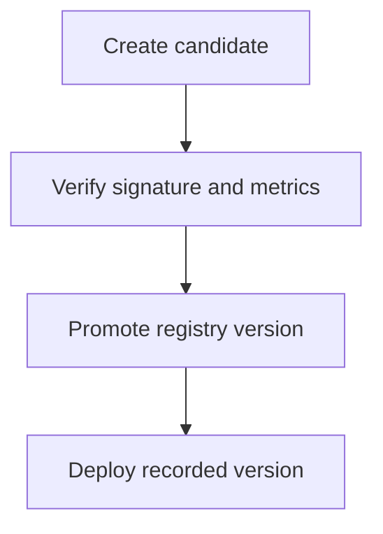

A tracking system records experiments. A registry records **what is deployable and
what is deployed**. The distinction matters: an experiment is a question, a
registered model is a commitment, and conflating them means production models are
chosen by whoever last exported a pickle.

> [!WHY] A deployed model consumes features in a different order while
> every field still has the right type. The release looks healthy at the
> API layer and silently produces scores for the wrong inputs.

> [!GOALS]
>
> - Explain the role of lineage
> - Apply a promotion gate
> - Choose a rollback design

## What a registry holds

```text
  MODEL: churn-predictor
  ├── version 1   ARCHIVED     shipped Jan, replaced
  ├── version 2   ARCHIVED
  ├── version 3   PRODUCTION   serving 100% of traffic
  ├── version 4   STAGING      canary at 5%
  └── version 5   NONE         registered, not promoted

  per version:
    □  the artifact (weights + preprocessing + feature order)
    □  the run id that produced it   ← the link back to tracking
    □  metrics, on the standard evaluation set
    □  the signature: input schema and output schema
    □  who registered it, who approved the promotion, when
    □  stage transition history
```

The **link back to the run** is the load-bearing field. Without it, a production
model is an artifact with metrics attached and no provenance — you cannot rebuild
it, cannot see what data it used, and cannot tell what was different about it.

## Stages, and why promotion should be a gate

```text
  NONE ──▶ STAGING ──▶ PRODUCTION ──▶ ARCHIVED
             │              │
             │              └── rollback: previous version
             │                  returns to PRODUCTION
             └── canary, shadow, offline gates
```

Promotion is where the automated checks belong:

```text
  a model may not enter PRODUCTION unless:
    □  it beats the current production model on the standard
       evaluation set
    □  no protected SLICE regresses beyond a threshold
    □  guardrail metrics are within bounds
    □  the input signature matches what serving sends
    □  it meets the latency and size budget
    □  the artifact loads and scores a fixture correctly
```

The signature check is the cheap one that prevents a real class of incident: a
model retrained with a changed feature set, deployed against a serving path that
still sends the old vector. The shapes match, the values are misaligned, and the
predictions are confident nonsense. Comparing the declared input signature against
the serving contract catches it at promotion time.



## The signature is a contract

```text
  {
    "inputs": [
      {"name": "days_since_signup",  "type": "float64"},
      {"name": "orders_30d",         "type": "int64"},
      {"name": "plan_tier",          "type": "string",
       "allowed": ["free", "pro", "enterprise"]}
    ],
    "outputs": [
      {"name": "p_churn", "type": "float64", "range": [0, 1]}
    ]
  }
```

Treat it exactly as an API contract, because it is one — with the same
compatibility rules as the messaging track:

```text
  SAFE       adding an OPTIONAL input with a default
  BREAKING   adding a required input
  BREAKING   removing an input
  BREAKING   reordering inputs        ← silent, and catastrophic
  BREAKING   changing an output's range or meaning
```

The reordering line is worth its own emphasis. Feature order is part of the
contract and nothing type-checks it; a model expecting `[age, income]` served
`[income, age]` produces plausible wrong answers indefinitely.

**And the output distribution is part of the contract too**, for the
undeclared-consumer reason from the lifecycle topic: a retrain that shifts scores
from a mean of 0.3 to 0.5 breaks every downstream threshold while passing every
schema check. Record the score distribution at registration and compare it on
promotion.

## Lineage

The question that arrives during an incident or an audit:

> A customer was denied on 3 September. Why?

Answering it requires an unbroken chain:

```text
  PREDICTION
    prediction id, timestamp, output
      │
      ├──▶ MODEL VERSION      which model produced it
      │        │
      │        ├──▶ RUN       which training run
      │        │      ├──▶ DATASET version
      │        │      ├──▶ CODE commit
      │        │      ├──▶ CONFIG
      │        │      └──▶ ENVIRONMENT digest
      │        │
      │        └──▶ EVALUATION results at promotion
      │
      └──▶ INPUT FEATURES     the exact vector, logged at serve time
               │
               └──▶ FEATURE definitions and their versions
```

Two links do most of the work and are the ones usually missing:

**The prediction log must record the model version and the input vector.** Not
just the output. Without the input you cannot reproduce the prediction; without
the version you do not know which model to ask.

**The model artifact must embed its own run id**, so a model recovered from a
server with no deployment record can still be traced.

Regulated domains make this a requirement; everywhere else it is what turns "the
model did something strange" from an unanswerable complaint into a ten-minute
investigation.

## Deployment: the registry as the source of truth

```text
  BAD
    someone copies model.pkl to a server, or bakes it into an
    image built from a laptop
    → what is actually running is unknown

  GOOD
    deployment references a registry version
      model: churn-predictor
      version: 4        (or stage: PRODUCTION)
    → the running model is always identifiable, and rollback
      is a version change
```

```text
  LOAD AT STARTUP                   HOT RELOAD

  the version is pinned in the      the service watches the
  deployment; a new model is a      registry and swaps the model
  new deployment                    without restarting

  + the standard deploy machinery   + faster rollout
    applies: canary, rollback,      - the running version is no
    audit                             longer visible in the
  + what is running is obvious        deployment
  - slower to roll out              - needs its own canary and
                                      rollback machinery
```

**Prefer load-at-startup.** Treating a model version as a deployment means you
inherit the canary, rollback, audit and observability you already have for code —
which is a large amount of machinery you do not have to rebuild. Hot reload is
worth it only when models change many times a day.

## Storing the artifact

```text
  □  object storage (S3/GCS), content-addressed by hash
  □  IMMUTABLE — a version is never overwritten
  □  the hash recorded in the registry, verified on load
  □  retention: keep every version that ever served production
     traffic, for as long as you may need to explain a decision
```

Immutability is the property that makes the rest meaningful. A version whose bytes
can change is not a version, and "we rolled back to v3" means nothing if v3 was
replaced in place.

Verifying the hash on load catches a corrupted download, which is rare and
extremely confusing when it happens — a partially transferred model file loads and
produces garbage rather than failing.

## Governance, proportionate to the stakes

```text
  LOW STAKES (a recommendation carousel)
    automated promotion on the evaluation gate

  MEDIUM (pricing, ranking, content moderation)
    automated gate + a human approval
    + a model card
    + slice metrics reviewed

  HIGH (credit, hiring, medical, safety)
    all of the above
    + documented fairness assessment
    + an explainability requirement
    + an audit trail of the approval
    + a defined review cadence
```

The failure mode at both ends is the same shape: **process disproportionate to
stakes.** Requiring a committee for a carousel means teams route around the
registry; allowing automated promotion for a credit model means an unreviewed
model makes decisions about people. Match the gate to the consequence.

> [!CHECK] Which identity should prediction logs carry?
>
> The model version, linked through the registry to the producing training
> run.

> [!CHECK] Why include score distributions in the contract?
>
> Existing downstream thresholds can change behavior when the score scale
> changes.

## What to take away

1. A registry records what is deployable and deployed; the link back to the
   training run is the field that makes a production model traceable at all.
2. Promotion is the right place for automated gates: beats production, no slice
   regresses, signature matches serving, latency and size within budget.
3. The model signature is an API contract with the same compatibility rules — and
   feature order is part of it, silently and catastrophically.
4. The output score distribution is part of the contract too, because downstream
   thresholds depend on it.
5. Lineage requires prediction logs carrying the model version and input vector,
   and an artifact embedding its own run id.
6. Deploy by referencing a registry version and prefer load-at-startup, so models
   inherit the canary, rollback and audit machinery code already has.

Next: determinism in practice — how far to chase it and where to stop.

## Exercises

> [!EXERCISE recall] Why does the trained artifact need a link to the
> experiment run?
>
> **Solution:** The link connects the deployed version to the data,
> configuration and metrics that produced it. A model file alone cannot
> explain those inputs.

> [!EXERCISE apply] A candidate beats production on average, exceeds the
> latency budget and moves a positional feature. Should the registry
> promote it?
>
> **Solution:** Block promotion. The candidate violates the latency
> constraint and the serving signature, even with a better aggregate
> score. Revalidate the updated input contract and performance before
> rollout.

> [!EXERCISE stretch] A model file is manually overwritten during
> releases. How would you make rollback reliable?
>
> **Solution:** Deploy immutable registry versions through the normal
> release mechanism and record the version with predictions. Overwriting a
> shared artifact loses the identity and reproducibility of the prior
> serving release.
