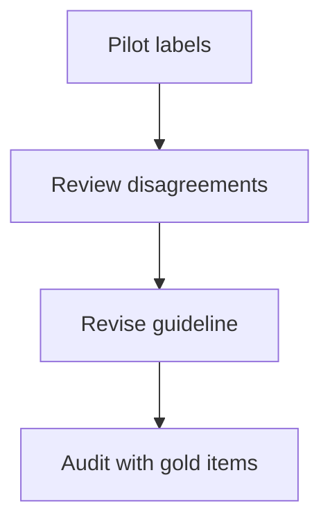

Supervised learning needs labels, and labels come from people. That makes
annotation a process-design problem as much as a data problem — and its quality
sets a hard ceiling that no amount of modelling can exceed.

> [!WHY] Two annotators disagree consistently about whether a borderline
> ticket belongs in the target class. Adding more labels at the same pace
> scales the disagreement and consumes budget without improving the task
> definition.

> [!GOALS]
>
> - Explain chance-adjusted agreement
> - Choose labeling acquisition
> - Plan a guideline repair

## The ceiling

```text
  if two competent annotators agree only 75% of the time,
  then the task itself is 25% ambiguous.

  → a model cannot exceed ~75% "accuracy" against either
    annotator, because the disagreement is in the task,
    not in the model
```

**Measure inter-annotator agreement before training anything.** It tells you the
achievable ceiling, and low agreement is nearly always a _definition_ problem
rather than an annotator problem — the guidelines are ambiguous, the categories
overlap, or the task is genuinely subjective.

```text
  raw agreement       the fraction of items both labelled the
                      same
                      → inflated when one class dominates:
                        two annotators labelling everything
                        "negative" agree 95% by chance

  COHEN'S KAPPA       agreement corrected for chance
                      < 0.4  poor
                      0.4–0.6 moderate
                      0.6–0.8 substantial
                      > 0.8  excellent

  KRIPPENDORFF'S      handles >2 annotators, missing data,
  ALPHA               and ordinal or continuous labels
```

Report kappa, not raw agreement. On imbalanced tasks raw agreement is almost
meaningless.

## Guidelines are the product

```text
  a guideline document should contain:

  □  a precise definition of each label
  □  DECISION RULES for the boundaries between them
  □  worked examples: clear positives, clear negatives, and
     the HARD cases
  □  explicit instructions for ambiguity — a "cannot tell"
     option, and when to use it
  □  what to do with a case not covered
```

**The "cannot tell" option is important and often omitted.** Forcing a decision on
genuinely ambiguous items injects noise, and the items are informative: a high
rate of "cannot tell" in a category means the category needs splitting or
redefining.

```text
  the loop that actually produces good guidelines

    draft → label 100 items → measure agreement →
    review the DISAGREEMENTS → refine the guidelines →
    repeat

  disagreements are the signal. each one is either an
  annotator error (train them) or a guideline gap (fix it).
```

Guidelines are never right on the first draft, and the teams that treat them as a
living document produce dramatically better data than those that write them once.

## The process

```text
  □  ONBOARD with a qualification set — annotators must pass
     before their work counts
  □  overlap: N annotators per item, at least on a sample
  □  ADJUDICATION for disagreements — a senior annotator or a
     resolution rule
  □  a GOLD SET seeded into the stream to measure ongoing
     quality per annotator
  □  regular calibration sessions where the team reviews hard
     cases together
  □  feedback to annotators, so quality improves rather than
     drifts
```

```text
  the gold-set mechanism

    ~5% of items are pre-labelled ground truth, mixed in
    invisibly.

    → per-annotator accuracy, continuously
    → detects drift, fatigue, and gaming
    → and it is the only way to know quality WITHOUT
      relabelling everything
```

**Full overlap on every item is expensive and usually unnecessary.** Overlap
heavily at the start to establish agreement and calibrate, then reduce to a sample
plus a gold set for ongoing monitoring.



## Aggregating multiple labels

```text
  MAJORITY VOTE        simple; treats all annotators equally
  WEIGHTED VOTE        weight by measured annotator accuracy
  DAWID–SKENE          jointly estimate the true label AND each
                       annotator's reliability, iteratively
                       → better, especially with variable
                         annotator quality
  KEEP THE
  DISTRIBUTION         do not collapse to one label; train on
                       the soft label
                       → the best option for genuinely
                         subjective tasks
```

The last is worth considering more often. If three of five annotators say
"toxic", the item is 60% toxic — training on that soft label preserves information
that a hard majority vote discards, and it produces better-calibrated models.

## Active learning

Labelling the most informative examples rather than random ones:

```text
  1. train on what you have
  2. score the unlabelled pool
  3. select the most INFORMATIVE items
  4. label those
  5. repeat
```

```text
  selection strategies

  UNCERTAINTY     items where the model is least confident
                  → simple; can select outliers and noise
  MARGIN          smallest gap between the top two classes
                  → usually better than raw uncertainty
  DIVERSITY       cover the input space, not just the boundary
  DISAGREEMENT    where an ensemble disagrees
  EXPECTED
  IMPACT          items that would most change the model
                  → principled, expensive
```

```text
  typical result: 2–10× fewer labels for the same performance
```

The failure mode to know: **pure uncertainty sampling selects garbage.**
Mislabelled, corrupted and out-of-distribution items are exactly the items a model
is most uncertain about, so a naive loop spends its budget labelling noise.
Combine uncertainty with a diversity or density term, and filter obvious junk.

## Reducing the labelling requirement

```text
  WEAK SUPERVISION      combine noisy labelling FUNCTIONS
                        (heuristics, rules, existing models)
                        and learn their accuracies
                        → Snorkel-style; produces probabilistic
                          labels at scale

  PROGRAMMATIC          rules where rules are reliable

  DISTANT SUPERVISION   an existing database as noisy labels

  MODEL-ASSISTED        a model pre-labels; humans CORRECT
                        → 3–10× faster than labelling from
                          scratch, and it BIASES annotators
                          toward accepting the model's answer

  SYNTHETIC             generated data, including from an LLM
                        → cheap and scalable; risks amplifying
                          the generator's biases and produces
                          a ceiling at the generator's quality

  SELF-SUPERVISED       pretrain on unlabelled data, fine-tune
                        on a small labelled set
                        → the highest-leverage option where
                          it applies
```

**Model-assisted labelling's automation bias is real and measurable.** Annotators
shown a suggested label accept it far more often than they would have chosen it,
including when it is wrong. The mitigations: show suggestions only for
high-confidence cases, hide them for a sample to measure the effect, and track
per-annotator acceptance rates.

## Human-in-the-loop in production

Labelling is not only a training-time activity:

```text
  REVIEW QUEUE       low-confidence predictions go to a human
                     → the human's decision is both the answer
                       AND a training label

  ESCALATION         high-stakes or ambiguous cases

  SPOT CHECKS        a random sample reviewed continuously
                     → the only unbiased estimate of production
                       accuracy

  APPEALS            users contest a decision
                     → high-value labels, and a legal
                       requirement in some domains
```

```text
  the review queue closes the loop:

    predict → uncertain? → human decides → the decision is
    logged as a label → next retrain includes it

  → the system improves exactly where it was weakest
```

That design is worth reaching for whenever a human is in the loop anyway. It turns
an operational cost into a data pipeline, and it concentrates labelling effort
precisely on the boundary where it is most informative.

**But beware the bias**: a review queue fed only by low-confidence predictions
produces training data drawn from the boundary, not from the distribution. Mixing
in randomly sampled items keeps the label set representative.

> [!PITFALL] A high acceptance rate in model-assisted labeling can reflect
> anchoring on the suggestion.

> [!INTERVIEW] Show a concrete ambiguous example and how the guideline
> helps annotators resolve it.

> [!CHECK] Why seed gold examples into the regular stream?
>
> They provide an ongoing quality check against known labels.

> [!CHECK] What does a cannot-tell label capture?
>
> Cases where the evidence cannot support a reliable classification.

> [!CHECK] Why preserve a label distribution for subjective data?
>
> It records disagreement that a single majority label would erase.

## What to take away

1. Inter-annotator agreement is the ceiling on model performance; measure it with
   kappa, not raw agreement, and treat low agreement as a definition problem.
2. Guidelines are a living product refined from observed disagreements, and a
   "cannot tell" option prevents forced noise.
3. Seed a gold set into the stream — it is the only way to measure ongoing quality
   without relabelling everything.
4. Consider keeping the label distribution rather than collapsing to a majority
   vote, especially for subjective tasks.
5. Active learning gives 2–10× label efficiency, but pure uncertainty sampling
   selects noise — combine it with diversity.
6. Model-assisted labelling is 3–10× faster and biases annotators toward accepting
   the model; a production review queue closes the loop but needs random sampling
   mixed in to stay representative.

That completes labelling. Next in the track: **privacy-preserving ML** — training
on data you are not allowed to see.

## Exercises

> [!EXERCISE recall] Why does raw agreement overstate consistency on a
> skewed labeling task?
>
> **Solution:** Annotators can often agree by repeatedly choosing the
> common class. Kappa adjusts for agreement expected by chance.

> [!EXERCISE apply] The uncertainty queue contains near-identical
> unreadable examples. There is a fixed review budget and new categories
> are rare. How should the next batch be chosen?
>
> **Solution:** Combine uncertainty with diversity and keep some
> representative samples. Use the cannot-tell option for genuinely
> unresolvable items. Pure uncertainty sampling can spend the budget on
> repeated noise.

> [!EXERCISE stretch] Two reviewers consistently classify the same
> borderline case differently despite high overall agreement. What should
> the team do before hiring more reviewers?
>
> **Solution:** Adjudicate representative disagreements, add examples and
> counterexamples to the guideline, and run another calibration pilot.
> Additional reviewers using the same ambiguous rule increase the volume
> of inconsistent labels.
