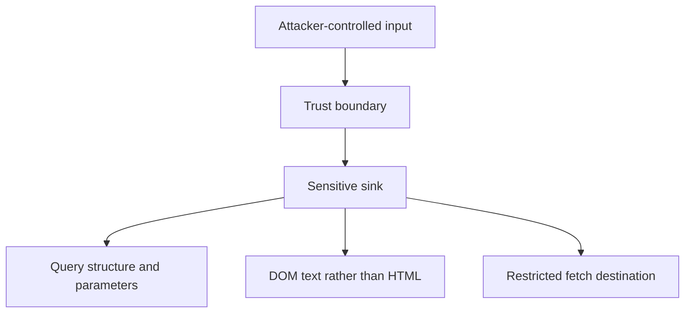

Nearly every vulnerability in this chapter is a variation on ONE mistake:
treating attacker-controlled input as though it were trusted, at some point
where that trust matters. The specific forms it takes — SQL injection, XSS,
SSRF — look unrelated on the surface; underneath, they're the same
trust-boundary failure from the Security Foundations chapter, applied to a
different sink.

> [!WHY] A URL preview endpoint accepts an address that points at internal
> infrastructure. A feature meant to fetch a picture can then expose
> credentials using the server’s own network reach.

> [!GOALS]
>
> - Explain structural separation of SQL syntax and data
> - Choose controls for different untrusted-input sinks
> - Design a cross-site request boundary

## Injection: data treated as code

```text
  const query = `SELECT * FROM users WHERE name = '${userInput}'`;

  userInput = "'; DROP TABLE users; --"

  → the resulting query: SELECT * FROM users WHERE name = '';
    DROP TABLE users; --' — the attacker's INPUT became part of
    the executed CODE, because string concatenation makes no
    distinction between "data" and "SQL syntax."
```

```text
  const query = 'SELECT * FROM users WHERE name = ?';
  db.query(query, [userInput]);

  → PARAMETERIZED QUERIES fix this structurally: the database
    driver sends the query STRUCTURE and the DATA as SEPARATE
    channels — userInput is NEVER interpreted as SQL syntax, no
    matter what characters it contains, because it's never
    concatenated into the query string at all. this eliminates
    the ENTIRE vulnerability class, not just the specific
    attack string above — escaping special characters manually
    is the fragile alternative that keeps finding new edge
    cases attackers discover.
```

## XSS: the same mistake, in the browser instead of the database

```text
  element.innerHTML = userComment;    // ✗ if userComment
                                          contains
                                          "<script>steal
                                          Cookies()</script>",
                                          it EXECUTES in every
                                          OTHER user's browser
                                          who views this page

  element.textContent = userComment;   // ✓ rendered as
                                           literal TEXT, never
                                           parsed as HTML/JS
```

```text
  → this is the IDENTICAL shape as SQL injection — attacker
    data treated as executable CODE (HTML/JavaScript, this
    time) instead of as inert data — and the fix is the SAME
    shape too: keep DATA and CODE on separate channels
    (textContent, not innerHTML; or a templating engine that
    escapes by default) rather than trying to sanitize/escape
    every possible dangerous character by hand.
```

```text
  → this is precisely why the Markdown chapter's own rule
    (never render raw HTML from the database, no `rehype-raw`)
    exists — rendering user-supplied content as HTML is
    exactly this vulnerability, and refusing to parse raw HTML
    at all eliminates the entire class rather than trying to
    sanitize it correctly, which is a genuinely harder problem
    than it looks.
```

## CSRF: exploiting an authenticated session from another site

```text
  

  → if a LOGGED-IN user's browser loads this (embedded on a
    completely UNRELATED, malicious site), the browser
    AUTOMATICALLY attaches the bank's session cookie to the
    request — the bank's server sees a request with a VALID
    session cookie and has no way to tell it wasn't
    intentionally initiated by the actual user.
```

```text
  → the fix: a CSRF TOKEN (a random value the server issues, the
    form includes, and the server verifies matches on submit) —
    the attacker's forged request has no way to know or include
    this token, since it's not part of what the cookie
    automatically carries. `SameSite=Strict` cookies (the
    AuthN/AuthZ chapter's session cookie flags) are a SECOND,
    complementary defense: the cookie simply isn't SENT on a
    cross-site request at all, closing the attack at the
    browser level rather than requiring server-side token
    verification.
```

## SSRF: tricking the SERVER into making a request

```text
  fetchImage(userProvidedUrl)     // user provides:
                                     "http://169.254.169.254/
                                     latest/meta-data/
                                     iam/security-credentials/"
                                     — a CLOUD METADATA endpoint,
                                     reachable only from WITHIN
                                     the cloud provider's own
                                     network

  → if your SERVER fetches whatever URL a user supplies (an
    image-fetching feature, a webhook validator, a URL
    preview), an attacker can point it at INTERNAL-only
    resources the server can reach but the ATTACKER never
    directly could — the cloud metadata endpoint above can leak
    the server's own IAM credentials, the Cloud Primitives
    chapter's over-provisioned-role risk made directly
    exploitable through this exact path.
```

```text
  → the fix: an ALLOWLIST of permitted destination hosts/schemes for any
    server-side fetch of a user-supplied URL, and explicitly BLOCKING
    requests to internal/private IP ranges — treating a user-supplied URL as
    fully trusted input for the SERVER's own outbound request is the same
    trust-boundary mistake as every other vulnerability in this chapter,
    just with the server itself as the confused party.
```

## Deserialization: reconstructing an object from untrusted bytes

```text
  → some serialization formats (Java's native serialization,
    Python's pickle) can, when DESERIALIZING, execute ARBITRARY
    CODE embedded in the crafted input — deserializing
    UNTRUSTED data with one of these formats is equivalent to
    directly running attacker-supplied code, not merely parsing
    data.

  → the fix: use a data-only format (JSON, Protobuf — the
    Serialization and Schemas chapter's formats) for anything
    crossing a trust boundary, specifically BECAUSE they have
    no mechanism for embedding executable behavior in the
    serialized data at all — the vulnerability class doesn't
    exist for a format that was never designed to reconstruct
    arbitrary code objects in the first place.
```

## Path traversal: escaping the intended directory

```text
  readFile(`/uploads/${userFilename}`)

  userFilename = "../../../etc/passwd"

  → the resulting path escapes the INTENDED /uploads directory
    entirely — this is exactly the path-traversal risk the
    Curriculum module's own content.ts explicitly guards
    against when reading a chapter file off disk, for exactly
    this reason: a filename is untrusted input the moment it
    comes from a user or a URL parameter.
```

## The pattern underneath all of it

```text
  every vulnerability above is the SAME failure, applied to a
  different SINK (a database query, the DOM, a server's own
  outbound request, a deserializer, a filesystem path):

    ATTACKER-CONTROLLED INPUT reaches a SENSITIVE OPERATION
    without the operation TREATING it as untrusted.
```

```text
  → this is exactly why "the OWASP Top 10" isn't ten unrelated
    things to memorize — it's ONE mistake (trust-boundary
    Security Foundations's core lesson, again), appearing in
    ten different disguises depending on which sink the
    untrusted data eventually reaches.
```



> [!PITFALL] Escaping one observed attack string leaves the underlying
> data-as-code boundary fragile.

> [!INTERVIEW] Name the input, trust boundary and sink before proposing a
> control.

> [!CHECK] What makes CSRF different from a stolen session cookie?
>
> The browser sends its own valid cookie on a forged cross-site request;
> the attacker need not possess the cookie.

> [!CHECK] Why choose a data-only format at an untrusted deserialization
> boundary?
>
> It has no mechanism for reconstructing executable behaviour as arbitrary
> code objects.

> [!CHECK] What does a guessed filename threaten?
>
> A traversal path can escape the intended uploads directory and reach
> another filesystem location.

## What to take away

1. SQL injection and XSS are the identical shape — attacker data treated as
   executable code instead of inert data — and both are fixed the same way:
   keep data and code on structurally separate channels, not by escaping
   dangerous characters by hand.
2. CSRF exploits a browser automatically attaching a valid session cookie
   to a cross-site request — a CSRF token plus `SameSite=Strict` cookies are
   complementary defenses at different layers.
3. SSRF tricks the server into fetching internal-only resources on an
   attacker's behalf — an allowlist of permitted destinations, blocking
   private IP ranges, is the fix for a server-side fetch of a user-supplied
   URL.
4. Deserializing untrusted data with a format that can execute embedded
   code is equivalent to running attacker-supplied code directly — a
   data-only format (JSON, Protobuf) eliminates the vulnerability class by
   having no mechanism to embed behavior at all.
5. Every vulnerability in this chapter is the same failure — attacker-controlled
   input reaching a sensitive operation without being treated as untrusted —
   applied to a different sink, not ten unrelated things to memorize.

## Exercises

> [!EXERCISE recall] Why do parameterized queries address more than one
> malicious quote sequence?
>
> **Solution:** The driver keeps query structure separate from parameter
> data. Input is not parsed as SQL syntax, rather than relying on a
> hand-maintained list of characters to escape.

> [!EXERCISE apply] A profile feature concatenates a display name into
> SQL, assigns a comment to innerHTML, and fetches a user URL with
> unrestricted server networking. Choose a control for each sink; would
> parameterizing SQL fix all three?
>
> **Solution:** Use query parameters for the name, textContent or
> default-escaping rendering for the comment, and a permitted host/scheme
> allowlist plus blocking internal/private destinations for the fetch. SQL
> parameterization only separates SQL syntax and data; it does not change
> the DOM parser or the server’s outbound destination policy.

> [!EXERCISE stretch] A state-changing endpoint treats any request with a
> valid session cookie as intentional. The team proposes hiding the
> action’s button from other sites. Recommend a server/browser boundary
> that addresses the actual attack.
>
> **Solution:** Require a server-issued CSRF token that is checked on
> submission, and use SameSite=Strict cookies as the complementary
> browser-side defence described here. A weaker answer only hides the
> button: a hostile page can induce a request while the browser carries
> the user’s valid cookie. Cookie authentication alone does not establish
> the user intentionally initiated this action.
