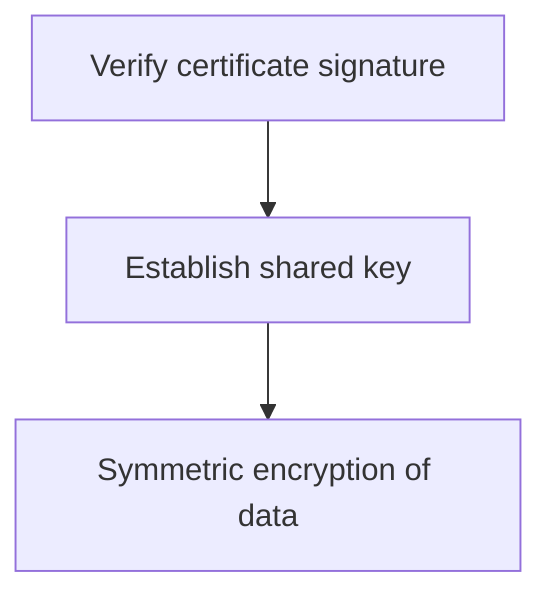

"Never roll your own crypto" is good advice that's easy to follow
superficially (use a library) and hard to follow correctly (use the RIGHT
primitive, the right way, for the right purpose). This chapter is enough to
tell the primitives apart and know which mistakes are the ones that
actually matter.

> [!WHY] A password database is stolen and its fast checksums become an
> offline guessing target. Choosing a familiar hash without considering
> its purpose can make every guess cheap for the attacker.

> [!GOALS]
>
> - Distinguish signature guarantees from confidentiality
> - Choose cryptographic primitives by purpose
> - Explain why audited composition matters

## Hashing: one-way, and specifically NOT for passwords alone

```text
  hash("hello") → 2cf24dba5fb0a30e...    — DETERMINISTIC (same
                                             input, same output,
                                             always), ONE-WAY
                                             (cannot be reversed
                                             back to "hello"),
                                             and a tiny input
                                             CHANGE produces a
                                             COMPLETELY different
                                             output
```

```text
  → a GENERAL-PURPOSE hash (SHA-256) is FAST — deliberately,
    for checksums and data integrity — which makes it a BAD
    choice for hashing PASSWORDS specifically: a fast hash lets
    an attacker with a stolen hash try BILLIONS of guesses per
    second (a "brute force" or "dictionary" attack against the
    hash, offline, with no rate limit to stop them).

  → PASSWORD hashing needs a SLOW, deliberately EXPENSIVE
    algorithm (bcrypt, scrypt, Argon2) — the same slowness that's
    a minor cost for you (one legitimate login, occasionally) is
    a crippling cost for an attacker (billions of attempted
    guesses, each one now expensive instead of nearly free).
    using SHA-256 directly for password storage is a real,
    common, and serious mistake — the algorithm being a "hash"
    isn't the point; being SLOW BY DESIGN is.
```

## Symmetric encryption: one key, both directions

```text
  encrypt(data, key) → ciphertext
  decrypt(ciphertext, key) → data      — the SAME key both
                                          encrypts and decrypts

  → fast, and the right choice when BOTH sides already share a
    secret key (encrypting data at rest in your own database,
    where only your own application needs to decrypt it later)
    — the hard problem it does NOT solve: how do the two sides
    get the SAME key in the first place, securely, especially
    if they've never communicated before.
```

## Asymmetric (public-key) encryption: two keys, one problem symmetric can't solve

```text
  a KEY PAIR: a PUBLIC key (shareable with anyone, openly) and
  a PRIVATE key (kept secret, never shared)

    encrypt WITH the public key → only decryptable WITH the
                                    matching private key
    sign WITH the private key    → verifiable by anyone WITH
                                    the matching public key
```

```text
  → this solves symmetric encryption's key-distribution
    problem: a public key can be published OPENLY (no secure
    channel needed to share it) — anyone can encrypt a message
    TO you using your public key, and only YOUR private key can
    decrypt it. the trade: asymmetric crypto is computationally
    much SLOWER than symmetric — which is exactly why TLS uses
    asymmetric crypto only for the HANDSHAKE (exchanging a
    SHARED symmetric key securely), then switches to fast
    symmetric encryption for the actual data — the best of
    both, used for what each is actually good at.
```

## Digital signatures: proving authenticity, not secrecy

```text
  sign(message, privateKey) → signature
  verify(message, signature, publicKey) → true/false

  → a signature proves the message came from whoever holds the
    PRIVATE key, and that it WASN'T altered after signing — this
    is AUTHENTICITY and INTEGRITY, a genuinely different
    property from ENCRYPTION's confidentiality. a signed message
    can still be read by anyone (signing doesn't hide the
    content) — it proves WHO sent it and that it's UNCHANGED,
    which is exactly what a JWT's signature (Identity's
    territory) or a software package's signature (Supply Chain
    Security's territory) actually needs, neither of which
    requires hiding the content itself.
```

## TLS: the practical composition of all of the above

```text
  the Computer Networking and Practical Networking chapters
  already covered TLS's role in the stack and its certificate
  chain — here's WHICH primitives it actually composes:

    1. the CERTIFICATE (containing a public key) is VERIFIED
       via a SIGNATURE from a trusted certificate authority
       (digital signatures, above)
    2. an asymmetric handshake ESTABLISHES a shared symmetric
       key, securely, over a connection with no prior shared
       secret (asymmetric encryption solving symmetric's
       key-distribution problem, above)
    3. the ACTUAL data is encrypted with the fast symmetric
       key for the REST of the connection (symmetric
       encryption, above)
```

```text
  → TLS isn't a fourth, separate primitive — it's a well-engineered
    COMPOSITION of the three above, each one doing exactly the part it's
    suited for, which is precisely why "never roll your own crypto" applies
    with even MORE force to composing primitives together correctly (getting
    the SEQUENCING and interaction right) than to any single primitive
    in isolation.
```



## Why "never roll your own" is not overcaution

```text
  cryptographic algorithms are, individually, mathematically
  sound and PUBLICLY published — the actual, real-world failure
  point is almost never the ALGORITHM itself, it's the
  IMPLEMENTATION: a subtle timing side-channel (an operation
  that takes measurably different TIME depending on secret
  data, which an attacker can exploit to infer the secret), a
  predictable "random" number that isn't actually random, an
  off-by-one in a buffer that leaks adjacent memory (the
  Systems Programming chapter's undefined behavior, directly,
  in security-critical code).

  → these are GENUINELY subtle bugs that have bitten expert
    cryptographers publishing PEER-REVIEWED work — a
    well-maintained, widely-used library has had FAR more
    expert scrutiny than any custom implementation realistically
    will, which is the actual, concrete reason the advice holds,
    not merely caution for its own sake.
```

> [!PITFALL] A digital signature authenticates unchanged content; it does
> not hide that content.

> [!INTERVIEW] Say which property is required before naming a primitive or
> library.

> [!CHECK] Why is symmetric encryption efficient after a shared key
> exists?
>
> The same secret key supports encryption and decryption and the primitive
> is fast; distributing that key securely remains a separate problem.

> [!CHECK] What does a public/private pair permit without sharing the
> private key?
>
> Others can encrypt to the public key or verify signatures using it while
> the private key remains secret.

> [!CHECK] Why can published sound algorithms still fail in products?
>
> Timing leakage, predictable randomness or memory bugs can undermine
> their implementation.

## What to take away

1. A general-purpose hash is deliberately fast, which is exactly why it's
   wrong for passwords — password hashing needs a deliberately slow
   algorithm (bcrypt, scrypt, Argon2) that makes billions of offline
   guesses expensive.
2. Symmetric encryption is fast but needs both sides to already share a
   key; asymmetric encryption solves that key-distribution problem at the
   cost of being much slower — which is why TLS uses asymmetric only for
   the handshake and switches to symmetric for the actual data.
3. A digital signature proves authenticity and integrity (who sent it,
   unaltered) without hiding the content — a genuinely different property
   from encryption's confidentiality.
4. TLS isn't a fourth primitive — it's a well-engineered composition of
   signatures, asymmetric key exchange, and symmetric encryption, each
   doing the part it's suited for.
5. "Never roll your own crypto" holds because the real-world failure point
   is almost always the implementation (timing side-channels, bad
   randomness, memory bugs), not the published algorithm — a widely-used
   library has had far more expert scrutiny than any custom implementation
   realistically will.

## Exercises

> [!EXERCISE recall] What does a verified digital signature establish, and
> what does it leave visible?
>
> **Solution:** It establishes authenticity from the private-key holder
> and integrity of the signed message. The message remains readable;
> signing supplies no confidentiality by itself.

> [!EXERCISE apply] A design uses SHA-256 alone for passwords, a signature
> to keep a public announcement unaltered, and symmetric encryption for
> stored records the application later decrypts. Evaluate each choice and
> identify the missing key-management concern.
>
> **Solution:** Replace the fast general-purpose password hash with a
> deliberately expensive password-hashing algorithm from the chapter. The
> signature suits an announcement needing authenticity and integrity
> without secrecy. Symmetric encryption suits records with a shared
> application secret, but securely distributing and holding that key is
> still necessary; choosing encryption does not solve key distribution.

> [!EXERCISE stretch] A team proposes composing its own TLS replacement
> from standard primitives because the algorithms are public. Recommend a
> path.
>
> **Solution:** Use a well-maintained, scrutinized implementation and its
> established composition. A weaker answer implements the same algorithms
> independently and assumes that proves safety: sequencing, timing
> behaviour, randomness and memory handling can fail even when the
> individual mathematical primitives are sound.
