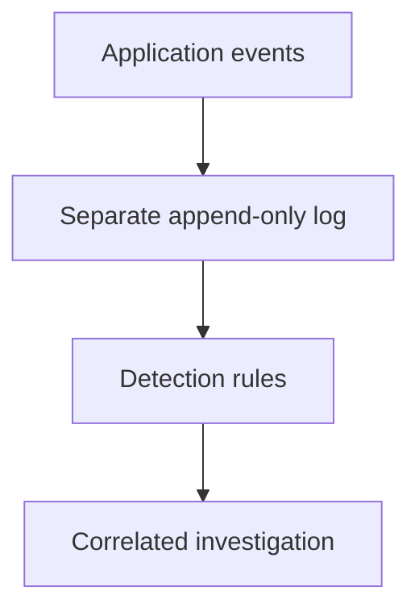

The Observability chapter covered logs, metrics, and traces for
understanding a system's own behavior. This chapter is the security-specific
version of the same discipline — aimed not at "why is this slow" but at "did
someone attack us, when, how, and what did they actually get to" — which
asks genuinely different questions of the same underlying data.

> [!WHY] An investigation finds months of application logs but cannot tell
> which account read a sensitive record. Restoring the host immediately
> may also erase the evidence needed to explain how access happened.

> [!GOALS]
>
> - Explain the fields a security audit needs
> - Correlate an incident timeline across systems
> - Choose evidence-preserving containment

## Audit trails: what actually needs to be logged

```text
  an ORDINARY application log answers "what happened, for
  debugging" — a SECURITY audit trail specifically needs to
  answer "WHO did WHAT, WHEN, and (critically) FROM WHERE" —
  authentication events (success AND failure), authorization
  DECISIONS (not just the outcome, but what permission was
  checked), and any access to genuinely SENSITIVE data or
  action.

  → this is a DIFFERENT logging discipline than the
    Observability chapter's operational structured logging —
    an audit log specifically needs to survive an investigation
    MONTHS later, asking questions nobody anticipated needing to
    ask at the moment the event was originally logged.
```

## Tamper evidence: a log an attacker can edit isn't trustworthy

```text
  → if an attacker who compromises a system can also EDIT or
    DELETE the audit log recording their own actions, the log's
    entire value as EVIDENCE evaporates — "the log shows nothing
    suspicious" becomes meaningless the moment the log itself is
    something the attacker could have altered.

  → the fix: WRITE audit logs to an APPEND-ONLY destination the compromised
    system ITSELF cannot modify after the fact — a separate logging service
    with restricted delete permissions, or a genuinely append-only log
    structure (conceptually similar to the Event Sourcing and CQRS chapter's
    immutable event log, applied here specifically FOR its tamper-resistance
    property rather than for replay/audit-trail convenience). the log needs
    to be SEPARATE from, and protected from, exactly the system whose
    compromise it's meant to help investigate.
```



## Detection rules: turning "we have logs" into "we notice"

```text
  → having comprehensive logs is necessary but NOT sufficient —
    someone (or something automated) needs to actually be
    WATCHING them for suspicious patterns, or a genuine attack
    sits fully RECORDED but completely UNNOTICED, discovered
    (if ever) only much later, by accident or through unrelated
    means.

  ✓  a single account attempting login from TWO geographically
     distant locations within an implausibly short time window
  ✓  a normal USER account SUDDENLY performing ADMIN-level
     actions it's never performed before
  ✓  data access at an UNUSUAL volume or an UNUSUAL time,
     relative to that specific account's own established
     baseline pattern
```

```text
  → this is the Observability and SLOs chapters' symptom-vs-cause alerting
    distinction, applied to security specifically: a good detection rule
    flags a genuinely ANOMALOUS PATTERN, not merely "any admin action"
    (which fires constantly, for entirely legitimate reasons, producing
    exactly the alert fatigue those chapters already warned about — except
    here, the missed alert buried in the noise could be an active, ongoing
    breach rather than a system health metric).
```

## What an investigation actually needs

```text
  when responding to a suspected incident, the questions that
  actually matter:

    ✓  WHEN did the compromise actually BEGIN (not merely when
       it was first NOTICED — these are frequently very
       different moments, sometimes by weeks or months)
    ✓  WHAT was accessed, specifically — which data, which
       systems, precisely
    ✓  is the attacker STILL present/active right now, or was
       this a one-time, already-concluded event
    ✓  what's the FULL scope — a single compromised account, or
       a broader systemic compromise reaching further
```

```text
  → answering these needs CORRELATED data ACROSS systems (an auth log, an
    application log, a network log, all cross-referenced against each other
    for the same time window and the same actor) — this is precisely why
    CENTRALIZED logging (the Observability chapter's log aggregation)
    matters enormously for security specifically, not merely for
    convenience: correlating events scattered across a dozen different
    systems' own separate, un-aggregated logs, under real time pressure
    during an active investigation, is dramatically harder than querying one
    already-centralized, already-correlatable source.
```

## The incident response connection

```text
  → a SECURITY incident follows the Incident Response and
    Postmortems chapter's SAME core structure (detect,
    mitigate, investigate, blameless postmortem) — with one
    genuinely important addition specific to security
    incidents: PRESERVING EVIDENCE matters here in a way it
    typically doesn't for an ordinary reliability outage. a
    compromised system might need to be ISOLATED (kept running,
    but cut off from the network) rather than immediately
    restarted or rolled back, specifically so forensic evidence
    of HOW the attacker got in isn't destroyed in the process of
    restoring normal service.
```

```text
  → this is a real, occasionally uncomfortable tension with
    "mitigate before you diagnose" — for a genuine security
    incident specifically, PREMATURELY destroying evidence in
    the rush to restore service can mean NEVER actually learning
    how the attacker got in, which leaves the exact same door
    open for them (or anyone who discovers the same gap
    independently) to walk right back through it again, later.
```

> [!PITFALL] A clean-looking log proves little if the compromised
> application can delete its entries.

> [!INTERVIEW] Distinguish when compromise began from when someone first
> noticed it.

> [!CHECK] What turns stored logs into detection?
>
> Active rules watch for suspicious patterns; otherwise an attack can
> remain recorded but unnoticed.

> [!CHECK] Why is any admin action a noisy alert?
>
> Ordinary legitimate work triggers it; an account suddenly acting outside
> its own baseline is more informative.

> [!CHECK] Why centralize logs for an investigation?
>
> It makes events from auth, application and network systems correlatable
> by actor and time rather than scattered across hosts.

## What to take away

1. A security audit trail answers "who did what, when, from where" — a
   genuinely different logging discipline than operational debugging logs,
   since it needs to answer questions nobody anticipated at investigation
   time, months later.
2. A log an attacker can edit after compromising the system isn't
   trustworthy evidence — audit logs need an append-only destination
   separate from, and protected from, the system they're meant to help
   investigate.
3. Comprehensive logs without active detection rules watching them mean a
   real attack can sit fully recorded but completely unnoticed — the same
   symptom-vs-cause alerting distinction from observability, applied to
   security.
4. Answering a real investigation's questions needs correlated data across
   systems, which is exactly why centralized log aggregation matters
   enormously for security, not merely for convenience.
5. A security incident follows the same detect-mitigate-investigate-postmortem
   structure as any other, with one addition: preserving forensic evidence
   sometimes means isolating rather than immediately restoring a compromised
   system, creating a real tension with mitigate-before-diagnose that a
   reliability outage doesn't have.

## Exercises

> [!EXERCISE recall] Which questions should an audit event answer beyond a
> debugging message?
>
> **Solution:** Who did what, when and from where, including
> authentication outcomes, the permission checked for an authorization
> decision and sensitive accesses.

> [!EXERCISE apply] For the same actor, auth logs show a new login at
> 02:10, application logs show sensitive reads at 02:14, and network logs
> show unusual outbound activity at 02:17. An alert fires at 03:00. What
> timeline is supported, and what remains unknown?
>
> **Solution:** Correlate the login, reads and outbound activity in that
> order. The alert is 50 minutes after the login and 46 after the reads;
> it is a discovery time, not proof of a 03:00 start. Investigate whether
> compromise began before 02:10, exactly what was accessed and whether the
> actor remains active. The sequence alone does not prove every event was
> malicious or establish the full scope.

> [!EXERCISE stretch] An apparently compromised host still contains
> evidence of entry. Recommend a containment approach before a routine
> restart.
>
> **Solution:** Consider isolating it from the network while preserving
> its state and protecting the separate audit trail, then investigate
> scope and entry. A weaker answer immediately restarts or rolls back as
> if this were only a reliability outage: it can destroy evidence needed
> to close the original access path. Balance containment with evidence
> preservation deliberately.
