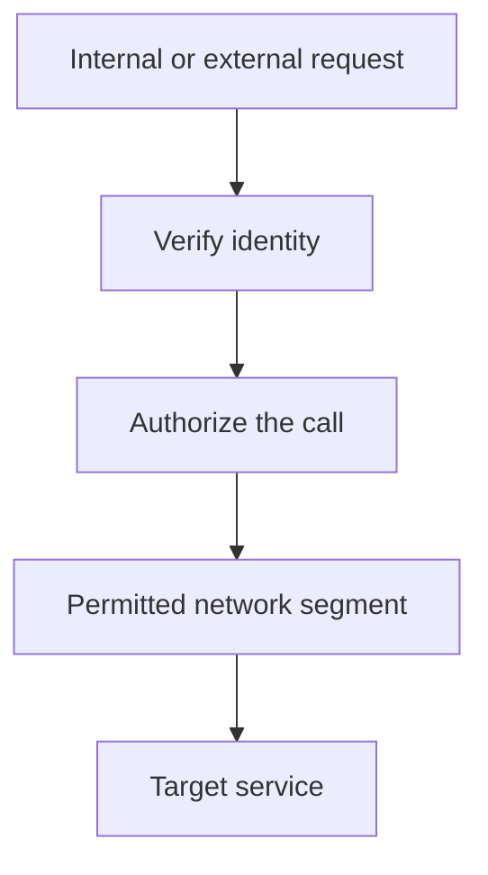

Traditional network security assumed a hard perimeter — a firewall at the
edge, and everything inside it implicitly trusted. That model has a specific
failure mode (once an attacker is inside, they're trusted everywhere), and
zero trust is the direct response: stop trusting location, and verify
everything, everywhere, every time.

> [!WHY] A phished laptop connects through the VPN and an internal service
> accepts it solely because it is inside the network. A perimeter success
> becomes lateral access unless verification continues at internal
> boundaries.

> [!GOALS]
>
> - Explain zero trust beyond network location
> - Choose independent identity and network controls
> - Design repeatable host hardening

## The perimeter model's failure mode

```text
  the OLD assumption: "inside the corporate network/VPC" =
  trusted; "outside it" = untrusted, needs verification at the
  edge.

  → the failure this produces: once an attacker gets INSIDE the
    perimeter (a phished credential, a compromised laptop on
    the VPN, one vulnerable internal service), they can often
    move LATERALLY with minimal further friction — internal
    services historically trusted requests simply because they
    arrived from "inside," with no per-request verification of
    WHO or WHAT was actually making the call.
```

## Zero trust: verify every request, regardless of origin

```text
  → the reframe: NEVER trust based on network LOCATION alone —
    verify the IDENTITY of every request, EVERY TIME, whether
    it originates from outside the network or from a service
    sitting right next to the target inside it.

  → this is the service-mesh chapter's mTLS made into a
    PRINCIPLE rather than a mechanism: every service-to-service
    call is authenticated and authorized on its OWN merits,
    regardless of which network segment it happens to arrive
    from — "it came from inside the VPC" stops being treated as
    evidence of legitimacy by itself.
```

## Segmentation: limiting how far a breach can spread

```text
  → even WITH zero trust's per-request verification, network
    SEGMENTATION (the Practical Networking chapter's VPC/subnet
    boundaries, deliberately drawn along TRUST lines) still adds
    real, independent value — this is defense in depth,
    concretely: segmentation limits the BLAST RADIUS of a
    breach even if the verification layer itself is somehow
    bypassed or has a flaw nobody's found yet.
```

```text
  → a database segment that's UNREACHABLE from a compromised web server's
    network segment at all is protected by BOTH the network boundary AND
    whatever identity verification exists — TWO independent layers, the same
    deliberate redundancy the Security Foundations chapter's
    defense-in-depth principle calls for, neither one alone
    assumed sufficient.
```



## WAFs: a layer that catches known patterns, imperfectly

```text
  a WEB APPLICATION FIREWALL sits in front of an application,
  inspecting requests for KNOWN malicious PATTERNS (a SQL
  injection signature, a known exploit's specific shape) and
  blocking matches before they reach the application at all.

  → a WAF is a REAL, useful layer — but it is NOT a substitute for fixing
    the actual vulnerability in application code: it catches KNOWN patterns,
    and a novel attack (or a known pattern slightly obfuscated to evade
    signature matching) can slip through — this is exactly the Web
    Application Security chapter's parameterized-queries-fix-the-whole-class
    point, restated: the WAF is ONE layer of defense in depth, not a
    replacement for the actual, structural fix.
```

## DDoS mitigation: absorbing scale you can't out-engineer

```text
  a DENIAL OF SERVICE attack overwhelms a system with sheer
  VOLUME (traffic, connections, requests) rather than exploiting
  a specific application bug — a DISTRIBUTED one (DDoS) sources
  that volume from MANY machines simultaneously, which is
  specifically what makes simple IP-blocking an inadequate
  defense (there's no single source to block).

  → REAL mitigation at scale generally requires a specialized
    provider with the AGGREGATE capacity to absorb traffic
    volumes far beyond what any single application's own
    infrastructure could realistically be provisioned to
    handle — this is the Capacity Planning and Cost chapter's
    headroom concept, at a scale that's usually not economical
    to self-provision for, which is exactly why it's typically
    handled by a shared, specialized layer rather than by each
    individual application independently.
```

## Hardening a host: reducing what an attacker can actually reach

```text
  → HARDENING means deliberately reducing a system's ATTACK
    SURFACE — disabling unused services (a service that isn't
    running can't have a vulnerability in it exploited), closing
    unnecessary open ports, removing default credentials, and
    applying the principle of least privilege (Security
    Foundations, again) to what a given host or service account
    can actually access.
```

```text
  → this is a genuinely ONGOING discipline, not a one-time setup step: a
    host hardened correctly at PROVISIONING time accumulates unused
    services, forgotten open ports, and stale accounts over its actual
    OPERATIONAL life unless hardening is periodically RE-VERIFIED —
    infrastructure as code (declarative, reproducible provisioning) helps
    here specifically because a host can be REBUILT from a known-hardened
    definition rather than drifting slowly, in ways nobody's tracking, over
    months or years of ad hoc manual changes.
```

> [!PITFALL] A WAF’s known-pattern matching cannot replace a structural
> application fix.

> [!INTERVIEW] Explain which control still limits damage if another layer
> is bypassed.

> [!CHECK] Why does one IP block fail against a distributed denial of
> service?
>
> Traffic comes from many sources; there is no single origin whose removal
> stops the volume.

> [!CHECK] Why disable an unused service?
>
> Removing it reduces the attack surface: a non-running service cannot
> expose its runtime vulnerability.

> [!CHECK] Why is a specialized DDoS provider often appropriate?
>
> Its shared aggregate absorption capacity can exceed what an individual
> application can economically provision.

## What to take away

1. The perimeter model's failure mode is that an attacker who gets inside
   is then implicitly trusted everywhere — zero trust responds by verifying
   every request's identity regardless of network origin.
2. Zero trust is mTLS's per-request verification made into a principle
   rather than a mechanism — "it came from inside the network" stops being
   treated as evidence of legitimacy.
3. Network segmentation still adds independent value even under zero
   trust — it limits blast radius if the identity-verification layer is
   ever bypassed, the same deliberate redundancy defense in depth calls for.
4. A WAF catches known attack patterns but isn't a substitute for fixing
   the actual application vulnerability — it's one layer of defense in
   depth, not a replacement for the structural fix.
5. Hardening a host is an ongoing discipline, not a one-time setup step —
   infrastructure as code helps specifically because a host can be rebuilt
   from a known-hardened definition rather than drifting unnoticed over
   months of manual changes.

## Exercises

> [!EXERCISE recall] What does zero trust require of an internal service
> call?
>
> **Solution:** Authenticate and authorize the call on its own merits
> regardless of its network origin. Being inside the VPC is not evidence
> of legitimacy by itself.

> [!EXERCISE apply] A compromised frontend host attempts to reach a
> database segment it never needs. Design A trusts all internal origins. B
> verifies caller identity but permits every network path. C adds identity
> verification and makes this database unreachable from the frontend
> segment. Choose and explain the independent layers.
>
> **Solution:** Choose C. Verification checks who may act; segmentation
> separately denies an unnecessary path. If the identity layer is
> bypassed, the network boundary still limits this breach’s reach. A
> grants trust from location, and B leaves only one layer on this path;
> neither supplies C’s independent containment.

> [!EXERCISE stretch] A host was hardened at launch but has accumulated
> stale accounts and unused ports after manual changes. Recommend a
> maintenance approach.
>
> **Solution:** Periodically re-verify services, ports, default
> credentials and least privilege, and use a known-hardened declarative
> definition to rebuild rather than preserve unexplained drift. A weaker
> answer records that the launch checklist passed and leaves the current
> host alone: the attack surface has changed since provisioning.
