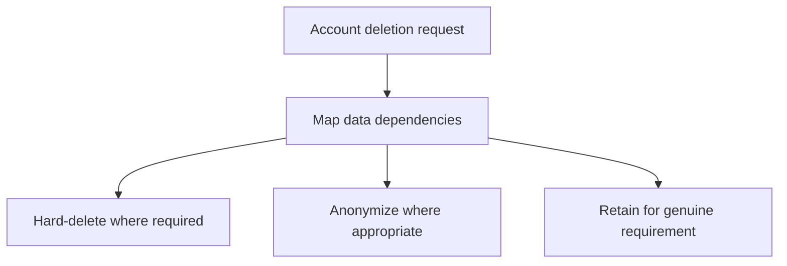

Privacy regulation (GDPR and its many regional equivalents) is frequently
treated as a legal compliance checklist applied after a system is built.
Retrofitting it that way is genuinely painful — the actual engineering
insight is that privacy-respecting design constraints, applied from the
start, are cheaper and more effective than a compliance audit bolted onto a
system that was never designed with them in mind.

> [!WHY] An account-deletion feature hides the profile while copies remain
> in comments and analytics tables. A recoverable row can still retain the
> personal data the deletion workflow was meant to address.

> [!GOALS]
>
> - Explain re-identification across combined fields
> - Choose deletion actions from explicit requirements
> - Design collection around a current purpose

## PII: broader than it sounds

```text
  the OBVIOUS category: name, email, phone number, government
  ID, physical address

  the LESS OBVIOUS category: an IP address, a device
  fingerprint, a precise location history, a combination of
  otherwise-innocuous attributes (birth date + zip code + sex
  is, famously, enough to uniquely identify a large majority of
  Americans, even with no NAME attached at all)
```

```text
  → PII isn't only data that's OBVIOUSLY personal in isolation
    — a dataset that's individually harmless field by field can
    become RE-IDENTIFYING in combination, which is precisely why
    "we don't store names" doesn't, by itself, mean a dataset
    is safely anonymous. treating "is this PII" as a per-field
    checklist misses this combinatorial risk entirely.
```

## Data minimization: not collecting what you don't need

```text
  "we might need it someday" is NOT data minimization's
  standard — the actual discipline: collect ONLY what a
  SPECIFIC, CURRENT feature genuinely requires, and don't
  collect a field "just in case" it becomes useful later.

  → this isn't merely a compliance nicety — it's a REAL
    security property: data that was NEVER collected cannot be
    leaked in a breach, cannot be subpoenaed, cannot be
    misused by an insider, and cannot become a liability in a
    regulatory investigation, all "for free," simply by never
    having existed in the first place. this is the Security
    Foundations chapter's least-privilege principle, applied to
    DATA COLLECTION rather than to access permissions.
```

## Retention: data has a lifecycle, not just a creation date

```text
  → data collected for a LEGITIMATE, time-bounded purpose (a
    password-reset token, valid for 15 minutes; a session log,
    useful for 90 days of debugging) should be DELETED once that
    purpose has genuinely passed — keeping it INDEFINITELY "just
    because storage is cheap" is exactly how a system
    accumulates a large, growing liability with no
    corresponding ongoing benefit.
```

```text
  → this project's own soft-deletes-everywhere rule (CLAUDE.md's
    architecture rules) is worth distinguishing carefully from
    retention POLICY: soft-delete means "recoverable, not
    immediately gone from the row" — it does NOT by itself mean
    "compliant with a retention/deletion REQUIREMENT," which
    needs an actual, eventual HARD delete on a defined schedule
    once the legally/functionally required retention window has
    genuinely passed. these are two different, complementary
    concerns, not the same mechanism solving both.
```

## Designing for deletion: the feature most systems bolt on too late

```text
  "delete my account" sounds simple, until you ask: does it
  delete the user's ORDERS too? their COMMENTS on other users'
  posts? their entries in an AUDIT LOG a compliance requirement
  says must be retained? their appearance in OTHER users' data
  (a message they sent someone else)?

  → a system DESIGNED from the start with deletion in mind
    tracks these DEPENDENCIES deliberately — which tables
    reference user data, and what SPECIFICALLY should happen to
    each one on deletion (hard-delete, anonymize in place,
    retain due to a genuine legal requirement) — a system that
    bolts this on LATER usually discovers the dependency graph
    is far larger and messier than anyone tracked, because
    nobody was keeping score as the schema grew.
```



## Consent and purpose limitation

```text
  → data collected for ONE stated purpose (say, order
    fulfillment) being REPURPOSED later for something
    DIFFERENT (marketing analytics, a new unrelated feature)
    without a fresh, genuine basis for that NEW use is a real
    compliance problem under most modern privacy regulation
    frameworks — the PURPOSE a user consented to matters, not
    merely whether consent was obtained for SOMETHING at some
    point in the past.
```

## Cross-border data transfer

```text
  → some regulations restrict WHERE certain categories of
    personal data may be physically STORED or PROCESSED
    (data residency requirements) — this is a genuinely real
    engineering constraint on infrastructure choices (which
    cloud REGION a database lives in, which region a backup
    replicates to), not purely a legal/paperwork concern that
    stops at a contract — a database replica in the wrong
    region can be an actual, technical compliance violation,
    not just a documentation gap.
```

> [!PITFALL] Soft deletion is a recovery mechanism; it does not by itself
> enforce eventual removal.

> [!INTERVIEW] Name the actual purpose, dependencies and retention
> requirement before selecting a storage action.

> [!CHECK] Why can collecting less improve security?
>
> Data never collected cannot later leak or be misused; it removes the
> exposure entirely.

> [!CHECK] Why do backups matter to residency design?
>
> A replica or backup’s processing/storage region is part of the
> infrastructure constraint, not just the primary database region.

> [!CHECK] Why is old consent not an automatic basis for a new feature?
>
> Consent to a stated purpose does not itself establish a basis for an
> unrelated later use.

## What to take away

1. PII extends beyond obviously-personal fields — otherwise-innocuous
   attributes can become re-identifying in combination, which is why "we
   don't store names" doesn't by itself mean a dataset is safely anonymous.
2. Data minimization is a real security property, not just a compliance
   nicety — data that was never collected cannot be leaked, subpoenaed, or
   misused, for free, simply by never having existed.
3. Soft deletes and retention compliance are two different, complementary
   concerns — recoverable-but-present is not the same guarantee as
   eventually hard-deleted once a required retention window passes.
4. Designing for deletion from the start means deliberately tracking which
   tables reference user data and what should happen to each on deletion —
   bolting it on later usually reveals a far larger dependency graph than
   anyone tracked.
5. Data residency requirements are a real engineering constraint on
   infrastructure choices (which cloud region a database or its backup
   lives in), not purely a legal/paperwork concern.

## Exercises

> [!EXERCISE recall] Why does removing names not establish that a dataset
> is anonymous?
>
> **Solution:** Other attributes, including combinations of otherwise
> innocuous fields, may identify a person. Assess the combined dataset
> rather than treating PII as a checklist of obvious individual fields.

> [!EXERCISE apply] Assume a product’s reviewed policy requires profile
> removal, comment anonymization and retention of specified audit records
> for a defined window. A developer proposes only setting deleted_at on
> the user. Choose a workflow from these given requirements.
>
> **Solution:** Map the profile, comments and audit dependencies.
> Hard-delete the profile as required, anonymize linked comments, and
> retain only the specified audit records through their defined window
> before applying their eventual disposition. A deleted_at flag leaves the
> data recoverable and does not implement any of those three requirements
> by itself. These are scenario requirements, not universal legal
> retention periods.

> [!EXERCISE stretch] A delivery feature needs an address, but a team also
> wants indefinite precise location history in case a future analytics
> feature needs it. Recommend a collection policy.
>
> **Solution:** Collect what the current delivery purpose requires, define
> its lifecycle and avoid speculative history collection. A weaker answer
> collects everything and relies only on restricted access: it preserves a
> breach and misuse liability for data without a current justified
> purpose. Revisit a genuine new use with its own basis rather than
> assuming the delivery purpose covers it.
