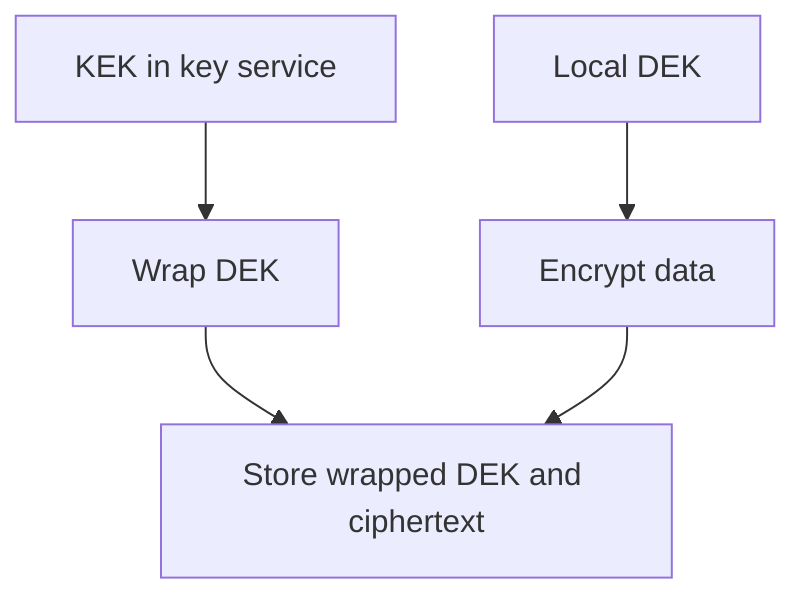

A "secret" (an API key, a database password, an encryption key) has a
lifecycle problem regular data doesn't: it must be stored somewhere, reach
every process that needs it, and eventually be replaced — all without ever
sitting somewhere an attacker (or a careless commit) can find it. Most
secrets leaks aren't sophisticated attacks; they're a secret ending up
somewhere it was never meant to be, by an ordinary, easy mistake.

> [!WHY] A debug line copies a live token into centralized logs, and
> deleting the line leaves earlier copies accessible. The exposure has
> spread beyond the credential’s intended audience and needs a lifecycle
> response.

> [!GOALS]
>
> - Explain the distinct roles of DEK and KEK
> - Evaluate envelope rotation work
> - Choose containment for a committed credential

## The most common leak: committed to git

```text
  const stripeKey = "sk_live_51H8x...";   // ✗ committed,
                                              now PERMANENTLY
                                              in git history

  → even DELETING the file in a later commit does NOT remove
    it from history — the Git and Version Control chapter's
    commit DAG means every past commit, including the one with
    the secret, is still THERE, reachable by anyone with repo
    access (or anyone who ever cloned it before the "fix"),
    forever, unless the history itself is rewritten (a real,
    disruptive operation) — this is exactly why the ONLY real
    fix for a committed secret is ROTATING it (treating it as
    permanently compromised), not deleting it from the file and
    hoping.
```

```text
  → the actual, practical defenses: a PRE-COMMIT hook scanning
    for secret-shaped strings BEFORE a commit is even created
    (catching the mistake before it enters history at all), and
    a `.env` file (holding real secrets locally) that's in
    `.gitignore` from the START of a project, not added
    reactively after the first leak.
```

## Environment variables: better than hardcoding, still not a vault

```text
  process.env.DATABASE_PASSWORD

  → better than a hardcoded string IN the source code — but an
    environment variable is still VISIBLE to anything with
    access to the process (a crash dump that includes the
    environment, a debugging tool, a misconfigured logging
    setup that accidentally logs the full environment) — it's
    a real improvement over hardcoding, not a complete solution
    for a genuinely sensitive secret.
```

## Secrets managers: centralized, audited, rotatable

```text
  a dedicated SECRETS MANAGER (AWS Secrets Manager, HashiCorp
  Vault, a cloud provider's equivalent) stores secrets
  CENTRALLY, with:

    ✓  ACCESS CONTROL — the same IAM discipline the Cloud
       Primitives chapter covers, applied to WHO can read
       WHICH secret specifically
    ✓  an AUDIT LOG — who accessed which secret, when — a real,
       queryable record for after-the-fact investigation
    ✓  ROTATION support — often AUTOMATED, on a schedule,
       without an application redeploy
```

```text
  → this is the Infrastructure as Code chapter's discipline
    applied specifically to secrets: infrastructure DEFINITIONS
    live in version control, reviewable — but the ACTUAL secret
    VALUES referenced by that infrastructure never do, kept in
    a system built specifically to hold them safely instead.
```

## Envelope encryption: encrypting the key that encrypts the data

```text
  DATA ENCRYPTION KEY (DEK)      encrypts the actual DATA —
                                 generated fresh, often PER
                                 record/file

  KEY ENCRYPTION KEY (KEK)         encrypts the DEK itself —
                                 held in a secure key-management
                                 service, rarely if ever
                                 touches disk directly

  stored:  encrypted_data + encrypted(DEK, using KEK)
```

```text
  → why not just encrypt everything DIRECTLY with the KEK? two
    real, practical reasons: performance (asking a remote KMS
    to encrypt/decrypt EVERY individual record is a network
    round trip per operation — encrypting with a LOCAL DEK is
    fast, and only the small DEK itself needs the remote KMS
    round trip) and BLAST RADIUS (rotating the KEK re-encrypts
    only the small DEKs, not the entire, potentially enormous,
    dataset — envelope encryption is specifically what makes
    KEY ROTATION practical at real data volumes, rather than a
    theoretically-nice-but-operationally-infeasible idea).
```



## Rotation: planned, not just reactive

```text
  REACTIVE rotation     "this key MIGHT be compromised, rotate
                        it NOW" — urgent, disruptive, done
                        under pressure

  SCHEDULED rotation      rotating on a REGULAR cadence, whether
                        or not compromise is suspected —
                        bounds the DAMAGE WINDOW of a leak that
                        hasn't even been DISCOVERED yet, and
                        (just as importantly) keeps the
                        ROTATION PROCESS itself exercised and
                        working, rather than being attempted for
                        the very first time during an actual
                        emergency
```

```text
  → a rotation process that's NEVER been run outside of a real incident is a
    real, common failure mode — the SAME "an untested backup is a hope"
    lesson from the running-databases-in-production chapter, applied to key
    rotation: if the FIRST time you rotate a key is during an actual
    emergency, you're debugging the rotation PROCESS itself while ALSO
    responding to a live incident, which is genuinely the worst possible
    moment to discover it doesn't actually work cleanly.
```

## Secrets in logs: the leak nobody notices

```text
  logger.info(`Authenticating with token: ${apiToken}`);  ✗
    → the secret is now in EVERY log aggregation system, every
      log-viewing tool, every engineer with log access — a far
      WIDER exposure than the original credential's intended
      audience, and one that's easy to introduce accidentally
      via a debug log line nobody thought carefully about.
```

```text
  → the fix: REDACT known-sensitive field NAMES at the LOGGING
    LAYER itself (a structured logger that automatically masks
    fields named `password`, `token`, `apiKey`, `secret`) —
    catching this AUTOMATICALLY, rather than relying on every
    engineer remembering never to log a secret manually, every
    single time, everywhere in a growing codebase.
```

> [!PITFALL] Environment variables avoid source hardcoding but can still
> leak through dumps, tooling or logs.

> [!INTERVIEW] Distinguish rotating a key from merely removing one visible
> copy of it.

> [!CHECK] Why run rotation before an emergency?
>
> Regular execution exercises the process so an incident does not become
> its first operational test.

> [!CHECK] What does a secrets manager add beyond a plain variable?
>
> Central access control, access audit records and rotation support.

> [!CHECK] Where should known-sensitive log fields be masked?
>
> At the structured logging layer, so protection does not depend on each
> engineer remembering every call site.

## What to take away

1. A secret committed to git remains in history even after the file is
   later deleted — the only real fix is rotating it as permanently
   compromised, not editing the file and hoping.
2. A secrets manager adds access control, an audit log, and rotation
   support that a plain environment variable doesn't provide — the same
   IaC discipline applied specifically to secret values.
3. Envelope encryption (a data key encrypting content, a key-encryption-key
   encrypting the data key) makes rotation practical at real data volumes —
   rotating the KEK re-encrypts only small keys, not the entire dataset.
4. Scheduled rotation, done regularly whether or not compromise is
   suspected, keeps the rotation process itself exercised — a rotation
   attempted for the first time during a real incident is debugging two
   problems simultaneously.
5. A logging layer that automatically redacts known-sensitive field names
   catches secret leaks in log lines that no individual engineer
   remembered to avoid — a systemic fix rather than relying on discipline
   alone.

## Exercises

> [!EXERCISE recall] Which key encrypts the data in envelope encryption,
> and which wraps that key?
>
> **Solution:** The DEK encrypts the actual content locally; the KEK held
> in a secure key-management service encrypts the DEK. Stored content
> includes ciphertext and the wrapped DEK.

> [!EXERCISE apply] Assume 400 files of 25 MB each, with a 32-byte DEK per
> file. For a planned KEK rotation, compare content volume with raw DEK
> material to rewrap; ignore metadata and encryption expansion. Does
> planned KEK rotation inherently require re-encrypting all content?
>
> **Solution:** Content totals 400 × 25 = 10,000 MB. DEK material totals
> 400 × 32 = 12,800 bytes. Planned KEK rotation rewraps the small DEKs
> rather than re-encrypting all 10,000 MB of content. The byte count is
> key material under the stated simplifications, not an estimate of
> network calls or total protocol traffic.

> [!EXERCISE stretch] A production API key was committed and later removed
> from the latest source. Recommend the necessary response and prevention.
>
> **Solution:** Treat the exposed credential as compromised and rotate it.
> Prevent recurrence with secret scanning before commits and ignored local
> secret files; keep real values out of infrastructure definitions. A
> weaker answer only deletes the current line: past commits and existing
> clones can still contain the credential.
