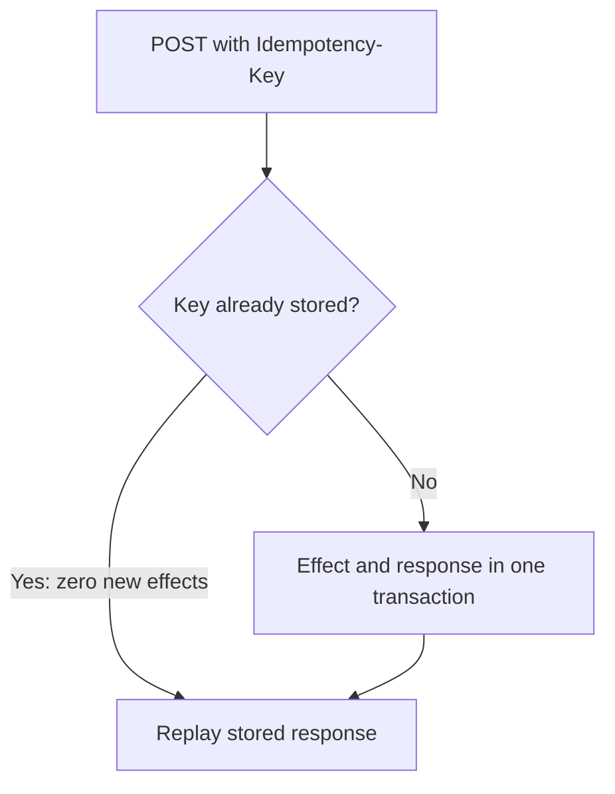
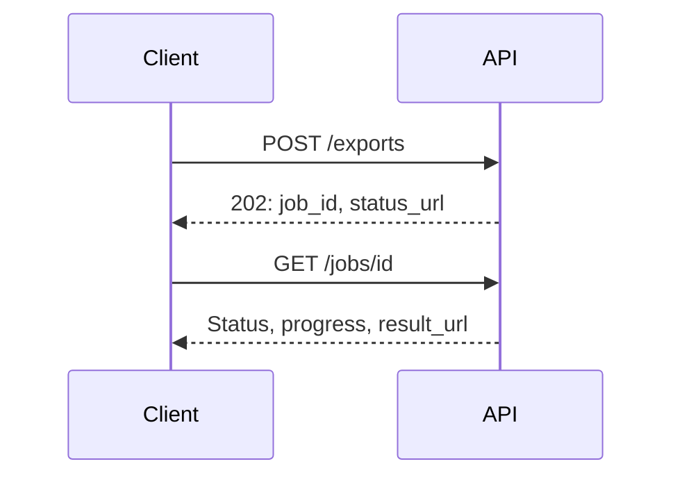

An API is the most durable thing in a system — implementations get rewritten,
databases get replaced, and the interface persists because other people depend on
it. The decisions below are the ones that are cheap now and very expensive later.

> [!WHY] A partner has shipped your offset-pagination API to thousands of clients when a large account starts timing out on deep pages. The API contract has become an operational limit that every client now depends on.

> [!GOALS]
>
> - Choose a stable cursor for ordered collections
> - Specify replay behavior for retried writes
> - Compute pagination cost and explain when an API change is breaking
> - Design errors and long-running operations clients can recover from

## Pagination

```text
  OFFSET                 ?page=3&limit=20
    ✗ SLOW at depth: the database must scan and discard
      everything before the offset
    ✗ INCORRECT under concurrent writes — an insert shifts
      everything, so items are skipped or repeated

  CURSOR / KEYSET        ?after=eyJpZCI6...&limit=20
    → WHERE (created_at, id) < (:ts, :id) ORDER BY ... LIMIT 20
    ✓ constant time at any depth
    ✓ stable under inserts
    ✗ no random access to "page 47"
```

> [!KEY] **Use cursor pagination.** Offset pagination is the single most common API design
> mistake that becomes unfixable: once clients depend on page numbers, changing it
> is a breaking change, and by then the deep pages are timing out.

```text
  the cursor should be OPAQUE — base64 of the sort key —
  so its internals can change without breaking clients.
```

## Idempotency

```text
  every non-idempotent write should accept an
  Idempotency-Key.

  POST /payments
  Idempotency-Key: 7f3c-a91e-...

  server: seen this key?
    yes → return the STORED RESPONSE, do nothing
    no  → perform, store the response against the key
```



```text
  the two details, from the partial-failure chapter
    □  store the key IN THE SAME TRANSACTION as the effect
    □  store and replay the RESPONSE, not just a flag
```

## Rate limiting

```text
  □  limit per CLIENT, per ENDPOINT — a cheap read and an
     expensive report should not share a budget
  □  return 429 with Retry-After
  □  expose the limits in headers so clients can self-pace:
       X-RateLimit-Limit / Remaining / Reset
  □  distinguish limits from quotas: a limit is per-second,
     a quota is per-month
  □  a burst allowance is usually right — token bucket
```

## Errors

```text
  {
    "type": "https://api.example.com/errors/insufficient-funds",
    "title": "Insufficient funds",
    "status": 402,
    "detail": "Balance 12.50, required 40.00",
    "instance": "/transfers/9a1b",
    "retryable": false
  }
```

```text
  □  a STABLE machine-readable code — never string-match on
     a message
  □  say whether it is RETRYABLE; the status code alone is
     ambiguous
  □  never leak internals — a stack trace or SQL error is
     both a disclosure and a coupling
  □  and errors are part of the CONTRACT: clients branch on
     them, so adding a new one is a compatibility question
```

## Versioning, and avoiding it

```text
  the strategies
    URL path        /v2/users        visible, coarse
    header          Accept: ...v2    cleaner URLs, harder to
                                     curl
    date-based      API-Version: 2026-03-15
                                     best for large public
                                     APIs
```

```text
  PREFER NOT TO VERSION.

  a major version means running two implementations forever,
  and every subsequent change is made twice.

  most changes can be ADDITIVE, and additive changes need no
  version.
```

The compatibility rules are the messaging track's, unchanged: adding an optional
field is safe; adding a required field, removing a field, renaming, reordering,
tightening validation and adding an enum value are not.

## Bulk and batch

```text
  a single-item API forces callers into N+1 over the
  network, permanently.

  → offer a batch form from the start:
      POST /users/batch-get   {ids: [...]}

  and decide the PARTIAL FAILURE semantics explicitly:
    all-or-nothing, or per-item results?
    → per-item is usually right, and must be in the response
      shape from day one
```

Designing the batch shape later is a breaking change; designing it first costs
nothing.

## Long-running operations

```text
  when work exceeds a request timeout:

    POST /exports        → 202 Accepted
                           {job_id, status_url}
    GET  /jobs/{id}      → {status, progress, result_url}

  → and the client polls, or receives a webhook
```



```text
  webhooks, if you offer them
    □  SIGN the payload so receivers can verify it
    □  include an event id for deduplication — delivery is
       at-least-once
    □  retry with exponential backoff and a dead-letter
    □  let receivers replay missed events
```

## Consistency in the contract

```text
  say what a client can expect.

  ✗  "the resource was created" — and a subsequent GET 404s
     because it read a replica

  ✓  return the created object in the POST response
  ✓  or return a version/position token the client can pass
     to subsequent reads
  ✓  or document that reads are eventually consistent, with
     a bound
```

The read-after-write problem is the one that generates the most support tickets
for an otherwise correct system, and returning the created resource in the
response solves the common case for free.

## Designing for the client

```text
  □  fewer round trips: allow field selection and expansion
     rather than forcing N follow-up calls
  □  return what the caller needs, not your data model
  □  make the common case a single request
  □  be consistent: naming, casing, date formats, pagination
     shape — across every endpoint
  □  IDs as strings, always (JSON numbers lose precision
     above 2^53)
```

> [!PITFALL] Recording an idempotency flag separately from the write leaves a crash window. The key, effect and replayable response must commit together; a flag alone cannot reproduce the original result.

> [!INTERVIEW] A client reports that a successful POST is followed by a GET returning 404. Explain replica lag, then compare returning the created object with passing a version token to subsequent reads.

> [!CHECK] Why can offset pagination skip or repeat items during concurrent inserts?
>
> An insert changes the positions before the offset. The next page still discards the old number of rows, so its boundary shifts; an opaque cursor instead resumes after a stable sort key.

> [!CHECK] What must happen when a payment request repeats its idempotency key?
>
> Look up the key and return its stored response, performing zero additional payments. For a new key, commit the effect and response with the key in the same transaction so a crash cannot separate them.

> [!CHECK] Why should JSON IDs be strings even if the database uses numbers?
>
> JSON numbers lose precision above 2^53. Serialising the ID as a string preserves every digit, so the client sends back the same identifier rather than a rounded one.

## What to take away

1. Use opaque cursor pagination — offset is slow at depth, incorrect under
   concurrent writes, and unfixable once clients depend on page numbers.
2. Accept an idempotency key on every non-idempotent write, storing the key and the
   response atomically with the effect.
3. Errors are part of the contract: stable machine-readable codes, an explicit
   retryable flag, and no leaked internals.
4. Prefer additive change to versioning — a major version means maintaining two
   implementations forever.
5. Offer batch endpoints from day one, with per-item failure semantics in the
   response shape.
6. Return the created object on write to solve read-after-write for free, and send
   IDs as strings.

Next: the trade-offs behind all of these choices.

## Exercises

> [!EXERCISE recall] Name three API decisions that become expensive to change after clients depend on them, and explain why each is part of the contract.
>
> **Solution:** Pagination shape is embedded in client traversal and deep offsets can become slow. Idempotency behavior determines whether retrying a write repeats its effect. Error shape and status semantics determine how clients classify and recover from failures. Once clients ship against any of these, changing behavior can break them even if the server implementation is better.

> [!EXERCISE apply] An activity endpoint contains 30 million rows ordered by `(created_at, id)`. A client requests 250 rows at a time and may insert new activities while it pages. Work out the number of pages for a complete scan, then choose a pagination contract and state how a retried create request behaves if the client sends the same idempotency key 15 times.
>
> **Hint:** Divide the row count by the page size; then distinguish resuming after a stable key from skipping a count of rows.
>
> **Solution:** 30,000,000 ÷ 250 = **120,000 pages**. Return an opaque cursor containing the last `(created_at, id)` pair and query strictly after that pair, with the unique id breaking timestamp ties. Inserts before the cursor do not shift the next page boundary. For 15 POST attempts with the same key, commit one effect and its replayable response atomically; the other 14 attempts return that saved response and perform zero additional creates.

> [!EXERCISE stretch] A team proposes changing a response field from a 64-bit numeric database id to a string everywhere, because JSON numbers cannot safely represent every 64-bit integer, while some clients also treat a `200` response containing `{ "error": ... }` as success. Give a migration plan that preserves old clients while making the new contract unambiguous, and name what a weaker plan misses.
>
> **Solution:** Add a new string id field first, document it, and have clients accept both forms during a transition; only remove the old field after measured client adoption and a versioning/deprecation window. Return errors with the appropriate non-success status and a stable machine-readable error body, while keeping human text separate. A weaker answer changes the response in place and assumes clients can be upgraded together; it misses that deployed clients and generated SDKs can outlive the server release.
