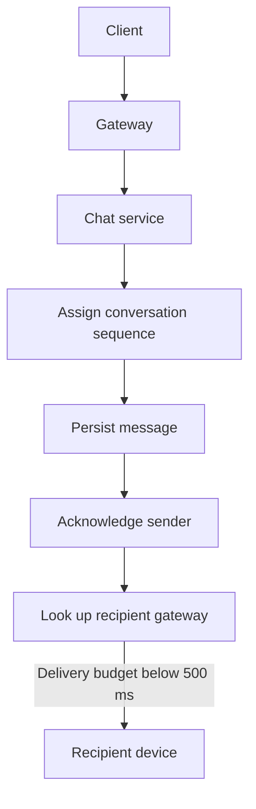
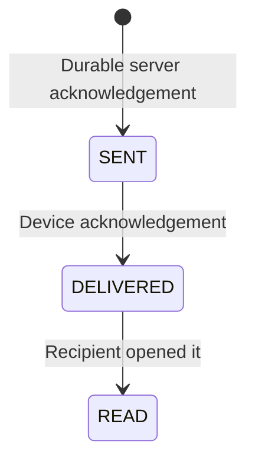

Design a messaging system: one-to-one and group conversations, real-time delivery,
message history, delivery receipts and presence. The interesting parts are not the
messages — they are connection management, ordering, and the counters.

> [!WHY] A gateway deploy drops thousands of live sockets, and clients reconnect together while users are still sending messages. Whether the system recovers depends on durable ordering and a reconnect path that does not mistake push delivery for history.

> [!GOALS]
>
> - Estimate gateway count and connection memory from concurrency
> - Order messages with a per-conversation sequence
> - Recover an offline client's gap from durable history
> - Compute unread counts without scanning every message

## Requirements and scale

```text
  FUNCTIONAL      send · receive in real time · history ·
                  read receipts · online presence · groups
  OUT OF SCOPE    voice, video, end-to-end encryption
                  (mention it as a design constraint)

  NON-FUNCTIONAL
    delivery < 500 ms
    messages must NOT be lost
    ordered WITHIN a conversation
    history durable and searchable
```

```text
  50M DAU, 40 messages each
    2B messages/day ≈ 23,000/s · peak ~100,000/s
    storage: 2B × 300 B = 600 GB/day ≈ 220 TB/year (×3 = 660 TB)
    → wide-column, partitioned by conversation
```

## Connections

```text
  clients hold a persistent connection to a GATEWAY.

    WEBSOCKET     bidirectional; the default for chat
    SSE           server→client only; simpler, needs a
                  separate POST channel for sending
    LONG POLL     the fallback where WebSocket is blocked
```

```text
  50M concurrent connections
    at ~10 KB of kernel and application state each
    = 500 GB of memory
    → ~50,000 connections per gateway → 1,000 gateways

  the gateway layer is STATEFUL, which is the awkward part:
    a user's connection lives on ONE gateway, and a message
    for them must reach THAT gateway.
```

```text
  the SESSION REGISTRY solves it

    user_id → gateway_id, in Redis with a TTL

    send:  look up the recipient's gateway,
           forward the message to it,
           it writes to the socket
```

That registry is the piece that makes a stateful connection tier workable, and its
failure mode — a stale entry pointing at a dead gateway — is handled by TTL plus
the gateway re-registering on connect.

## Sending a message

```text
  1. client → gateway → CHAT SERVICE
  2. assign a message id and a per-conversation SEQUENCE
     number
  3. PERSIST it (this is the durability point)
  4. ack the sender
  5. look up recipients' gateways; forward
  6. for offline recipients, enqueue a push notification
```



```text
  the ordering guarantee

    order within a CONVERSATION, not globally.

    → partition by conversation_id
    → a monotonic sequence per conversation, assigned by the
      partition owner
    → clients sort by sequence, not by timestamp
```

Sorting by timestamp is the mistake: two clients' clocks disagree, and the
distributed-clocks material applies directly. A server-assigned per-conversation
sequence is unambiguous and cheap.

## Delivery guarantees

```text
  the three states a message can be in

    SENT       the server has it (durable)
    DELIVERED  it reached the recipient's device
    READ       the recipient opened it

  → each is a separate acknowledgement travelling back
```



```text
  and the reliability mechanism

    a client stores the last sequence number it has.
    on reconnect: "give me everything after N".

    → the server never has to guarantee push delivery;
      the client PULLS the gap.

  this is the design that makes flaky mobile networks
  tolerable, and it turns delivery from a push problem into
  a cursor problem.
```

## Storage

```text
  partition key    conversation_id
  clustering       sequence DESC

  → "the last 50 messages in this conversation" is one
    partition, one contiguous read
  → which is exactly what a wide-column store is for
```

```text
  the access patterns
    recent messages in a conversation   → the above
    a user's conversation list          → a separate table,
                                          keyed by user, sorted
                                          by last activity
    search                              → a derived index, fed
                                          by CDC
```

## Group messages

```text
  SMALL GROUPS (< ~500)
    fan out on write to each member's delivery path
    → the same trade as the feeds case

  LARGE GROUPS / CHANNELS (thousands)
    do NOT fan out. members PULL from the conversation
    partition on connect and on notification.
    → the celebrity problem again, in a different costume
```

## The unread count

The part that is harder than the messages:

```text
  a naive count:
    SELECT count(*) WHERE conversation = ? AND seq > last_read

  → per conversation, per user, on every app open
  → for a user with 200 conversations, that is 200 queries
    every time the app foregrounds
```

```text
  the answer: maintain it INCREMENTALLY

    per (user, conversation): last_read_seq
    per conversation:          latest_seq
    unread = latest_seq − last_read_seq
```

```text
  → an O(1) subtraction, and both numbers are already
    maintained for other reasons.

  the total badge count is the sum across conversations,
  which is cheap for hundreds of conversations and can be
  cached per user.
```

**This is the design's neatest move**, and it generalises: an expensive count is
frequently the difference of two cheap monotonic counters.

## Presence

```text
  presence is HIGH-VOLUME and LOW-VALUE, which shapes the
  design entirely.

  □  the gateway knows who is connected — presence is a
     side effect of the connection
  □  store it in Redis with a short TTL, refreshed by
     heartbeat
  □  do NOT fan out every presence change to every contact —
     a user with 500 contacts toggling online generates 500
     events
  □  instead: SUBSCRIBE to presence only for the
     conversations currently on screen
  □  and coarsen it: "online / recently active / offline"
     rather than a precise timestamp
```

The subscribe-to-what-is-visible rule is what makes presence affordable, and it is
the same principle as the awareness channel in the collaborative-editing chapter:
ephemeral, lossy, scoped to what the user can see.

## Components

```text
  clients ═══ WebSocket ═══ [gateway fleet, stateful]
                                   │
                        [session registry: user → gateway]
                                   │
                            [chat service]
                             ├─▶ message store (wide-column,
                             │    partitioned by conversation)
                             ├─▶ conversation list store
                             ├─▶ presence (Redis, TTL)
                             ├─▶ push notification queue
                             └─▶ CDC ──▶ search index
```

## Failure modes

```text
  □  GATEWAY DIES → its connections drop; clients reconnect
     elsewhere and pull the gap by sequence number
  □  a rolling deploy of 1,000 gateways reconnects 50M
     clients → stagger it, and have clients back off with
     JITTER
  □  MESSAGE ORDER on retry — the sequence number, assigned
     server-side, makes retries idempotent
  □  DUPLICATE SEND from a client → a client-generated
     message id deduplicates it
  □  offline for a week → the pull-the-gap path must be
     bounded and paginated
```

The reconnection storm is the failure specific to this design: a stateful
connection tier makes every deploy a mass-reconnection event, and it must be
staggered deliberately.

> [!PITFALL] Do not acknowledge a message before persistence or order it by client timestamps. Persist first, then use the partition owner's per-conversation sequence; clocks cannot supply that ordering guarantee.

> [!INTERVIEW] What happens during a rolling deploy of 1,000 gateways? Trace reconnect, registry refresh and gap recovery, then explain why staggering the deploy and jittering client backoff avoid a 50M-client reconnection storm.

> [!CHECK] How many gateways does the stated 50M-connection workload need?
>
> 50,000,000 connections / 50,000 per gateway = 1,000 gateways. At roughly 10 KB each, the connections also account for about 500 GB across the fleet.

> [!CHECK] How does the unread design avoid 200 count queries on app open?
>
> Maintain latest_seq per conversation and last_read_seq per user and conversation. Subtract unread = latest_seq − last_read_seq for each, then sum the differences for the badge instead of scanning messages.

> [!CHECK] How does a reconnecting client recover messages missed while offline?
>
> It retains its last received sequence N and requests everything after N. The server serves the ordered gap from durable history, with pagination bounding a long absence; push delivery itself need not be guaranteed.

## What to take away

1. The connection tier is stateful, and a session registry mapping user to gateway
   is what makes it workable.
2. Order within a conversation using a server-assigned sequence number, never a
   timestamp — client clocks disagree.
3. Clients storing their last sequence number and pulling the gap on reconnect turns
   delivery from a push guarantee into a cursor problem.
4. Partition messages by conversation with a descending sequence clustering key —
   the hot query is then one contiguous read.
5. Unread counts are the difference of two monotonic counters, not a count query;
   an expensive count is frequently a subtraction in disguise.
6. Presence is high-volume and low-value: keep it ephemeral, coarse, and subscribed
   only for what is on screen.

Next: object storage and content delivery.

## Exercises

> [!EXERCISE recall] Explain why a chat service needs a durable message sequence even if it pushes each new message over a socket.
>
> **Solution:** A socket is a delivery path, not durable history: a client may disconnect and miss pushes. Persist the message and assign its order before acknowledging it; on reconnect, the client requests the ordered history after its last sequence. This also avoids relying on unsynchronised client clocks for conversation order.

> [!EXERCISE apply] A service expects 8 million simultaneous connections and plans for 40,000 connections per gateway. Each connection uses about 2 KB of gateway memory. Calculate the gateway count and fleet connection memory. A client reconnects with last received sequence 317 while the conversation's latest sequence is 321; specify the gap it should request and how an unread badge can be computed if that user's last-read sequence is 300.
>
> **Hint:** Divide concurrency by per-gateway capacity, multiply connections by memory, and use sequence subtraction for the badge.
>
> **Solution:** 8,000,000 ÷ 40,000 = **200 gateways**. Connection memory is 8,000,000 × 2 KB = 16,000,000 KB, about **16 GB** across the fleet. The reconnect asks for sequences **318 through 321** from durable history. With latest sequence 321 and last-read sequence 300, the unread count is 321 − 300 = **21**; the client can sum this per conversation without querying every message.

> [!EXERCISE stretch] A product wants a group conversation with 2 million members and delivery receipts for every member. Propose a design that keeps message acceptance fast, bounds fan-out, and still lets a member recover after an outage. Explain what a weaker answer misses.
>
> **Solution:** Persist one ordered conversation event and acknowledge it, then expand delivery asynchronously through partitioned recipient queues with rate limits and checkpoints. Store per-member delivery/read cursors compactly or aggregate receipts when the product only needs counts; do not make the send transaction wait for 2 million socket writes. On reconnect, serve the missing ordered range from history. A weaker answer broadcasts synchronously and treats a successful socket write as durable delivery; it misses backpressure, retries and offline recovery.
