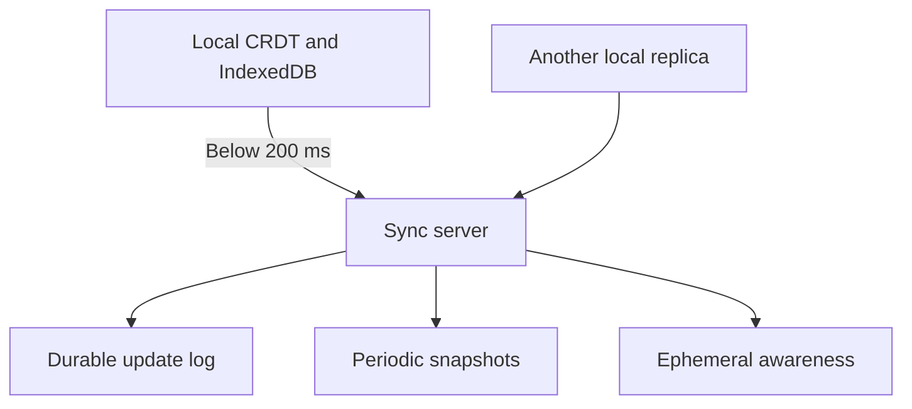
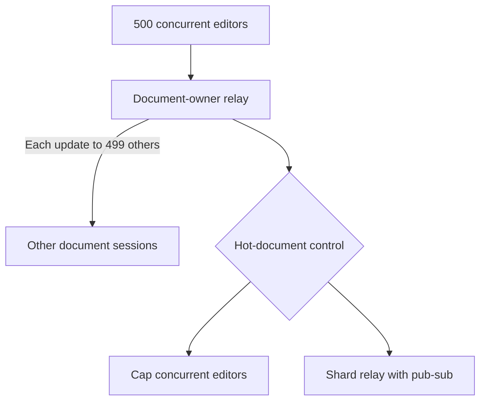

Design a collaborative editor: several people editing the same document
simultaneously, with cursors, offline support, history and permissions. The
convergence problem has a known answer; the system around it is where the design
work is.

## Requirements and scale

```text
  FUNCTIONAL   concurrent editing · presence and cursors ·
               offline · history · comments · permissions
  NON-FUNCTIONAL
    keystrokes apply LOCALLY, instantly
    remote edits visible in < 200 ms
    no lost edits, ever
    documents survive forever
```

```text
  10M documents, 100k concurrent editing sessions
    a keystroke burst is ~10 edits/second per active editor
    → ~1M operations/second at peak

  → but each operation is tiny, and most sessions are idle
```

## The convergence choice

```text
  the requirement that forces everything:

    a keystroke must apply LOCALLY before the network knows
    about it.

  → concurrent conflicting edits are GUARANTEED
  → so a lock, a leader, or a round trip per keystroke are
    all ruled out
```

```text
  OT                                CRDT
  transform incoming ops against    give each character an
  concurrent ones; integer indices  immutable identity
  needs a central server in         works peer-to-peer
    practice (TP2)
  compact operations                more metadata
  correctness is a research         correctness is a proof
    problem
```

```text
  → CRDT for a new system. use a mature library (Yjs,
    Automerge, Loro); do not implement a sequence CRDT.
```

The reasoning is the collaborative-editing topic's: OT's TP2 condition is
genuinely hard and several published algorithms were wrong, while a CRDT's merge
either has the required algebraic properties or does not.

## The architecture

```text
  ┌──── client ────┐            ┌──── client ────┐
  │ local CRDT     │            │ local CRDT     │
  │ replica        │            │ replica        │
  │ IndexedDB      │            │                │
  └───────┬────────┘            └───────┬────────┘
          │                             │
          └──── WebSocket ──── [sync server] ────┘
                                    │
                        ┌───────────┼───────────┐
                        ▼           ▼           ▼
                    [update log] [snapshots] [awareness]
                     (durable)   (periodic)  (ephemeral)
```



```text
  the sync server RELAYS and PERSISTS. it does not arbitrate.

  → which is what makes offline work, and it means the
    server needs no document logic — so it never has to be
    upgraded in lockstep with clients
```

## Persistence

```text
  UPDATE LOG      every operation, appended, durable
  SNAPSHOTS       the merged state, periodically

  loading a document:
    read the latest snapshot + the tail of the log
    → not a replay of 100,000 updates, which is a
      multi-second load
```

```text
  snapshot on
    □  an update count (every N operations)
    □  a time interval
    □  the last editor disconnecting

  and retain enough log to serve clients that are behind.
```

This is the same snapshot-plus-tail design as consensus log compaction and
event-sourced aggregates, and for the same reason.

## Presence and cursors

```text
  AWARENESS is NOT document state.

    ephemeral · last-write-wins · TTL · not persisted
    → a separate channel, not the CRDT
```

```text
  because a cursor moves on every keystroke, and the CRDT
  retains its whole history — putting cursors in the
  document would add an operation per keypress per user,
  forever.
```

```text
  and cursor positions must be CRDT-RELATIVE positions, not
  integer offsets — otherwise a remote insert moves
  everyone's cursor to the wrong place.
```

That is the index problem from the beginning of the topic, reappearing in the
place people least expect it.

## Permissions

```text
  a CRDT converges by construction. it has NO concept of
  an unauthorised edit.

  → a malicious client can generate any update and it will
    merge.
```

```text
  → enforce at the SYNC SERVER: validate each update
    against the document's permissions before relaying or
    persisting it.

  which gives up the "dumb relay" property — the server must
  now understand enough of the document to check.
```

```text
  and fine-grained permissions ("Alice may edit section 3")
  are genuinely hard, because a section is a range of
  identities that others are concurrently editing.

  → most products settle for document-level roles (view,
    comment, edit), and that is a reasonable engineering
    answer rather than a compromise.
```

## Scaling the sync layer

```text
  a document's editors must all connect to a server that
  can relay between them.

    → route by DOCUMENT ID, so all of a document's sessions
      land on one server
    → a session registry maps document → server, as in the
      chat case
    → most documents have 1–3 concurrent editors, so this
      shards well
```

```text
  the hot document

    a company all-hands doc with 500 concurrent editors.
    → one server carries all of them
    → and every update fans out to 499 others
    → cap concurrent editors, or shard the relay with a
      pub/sub layer between servers
```



## Offline

```text
  □  the client persists its replica locally (IndexedDB)
  □  edits queue while disconnected
  □  on reconnect, exchange state vectors and sync the
     difference — not the whole document
  □  merge is automatic and convergent
```

```text
  the PRODUCT question the technology quietly answers for
  you:

    what does a user see after editing offline for two
    weeks?

    the CRDT will merge it silently and convergently. whether
    that is the right experience is a decision, and if you
    do not make it, the library has made it.
```

## History and comments

```text
  HISTORY     the update log IS the history
              → time travel, attribution, named versions,
                diffs all fall out
              → but there are no BRANCHES: a CRDT converges
                continuously, which is the opposite of git

  COMMENTS    anchored to CRDT positions, so they follow the
              text as it moves
              → and a comment whose anchor text is deleted
                needs a defined behaviour (orphan it, or
                resolve it)
```

> [!PITFALL] A convergent CRDT also merges unauthorised updates. Validate permissions at the sync server before relaying or persisting; convergence alone does not enforce document roles.

> [!INTERVIEW] What should a user see after two weeks of offline edits? Separate the CRDT's automatic convergent merge from the product decision about presenting surprising changes and history.

> [!CHECK] Why does local-first editing rule out a network round trip per keystroke?
>
> The keystroke must apply instantly before the network knows about it. Concurrent edits are therefore unavoidable, so the replicas need a convergent merge rather than a lock or leader approval on each local edit.

> [!CHECK] What fan-out does one update create in a document with 500 editors?
>
> The relay forwards it to the other 500 − 1 = 499 editors. One server bears that fan-out for the hot document, motivating a concurrency cap or pub/sub between relay shards.

> [!CHECK] Why keep awareness outside the persisted document?
>
> Cursor changes occur on every keystroke. Putting them in the CRDT would retain an extra operation per keypress per user forever; a separate last-write-wins, TTL-based awareness channel can discard that ephemeral state.

## What to take away

1. Local-first editing rules out locks, leaders and per-keystroke round trips, which
   is what forces a convergent data type.
2. Use a CRDT and a mature library; the sync server relays and persists rather than
   arbitrating, which is what makes offline work.
3. Load from a snapshot plus a log tail, not by replaying the whole history.
4. Awareness is ephemeral and belongs on a separate channel, and cursors must be
   CRDT-relative positions rather than offsets.
5. A CRDT has no concept of an unauthorised edit — permissions are enforced at the
   sync server, and fine-grained ranges are genuinely hard.
6. Route by document id and cap concurrent editors; and decide deliberately what a
   user sees after a long offline period, because the library decides otherwise.

That completes the Systems Design track. Every case here draws on **Distributed
Systems** for its mechanisms, **Backend Engineering** for its interfaces, and
**ML Systems** where a model is involved.
