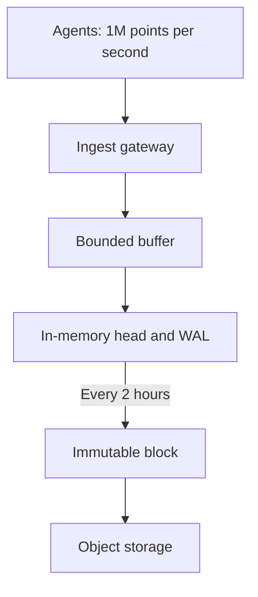

Design a monitoring system: ingest metrics from thousands of services, store them,
and serve dashboards and alerts. The write volume is enormous and predictable; the
thing that actually kills these systems is cardinality.

## Requirements and scale

```text
  FUNCTIONAL   ingest · query with aggregation · alert ·
               dashboard · retention tiers
  NON-FUNCTIONAL
    write-heavy, append-only
    queries scan large ranges and aggregate
    recent data queried far more than old
    cost-efficient at scale
```

```text
  10,000 hosts × 1,000 metrics × every 10 s
    = 1M data points/second
    at 16 B per point = 16 MB/s = ~1.4 TB/day raw

  → compression and downsampling are not optional
```

## The data model

```text
  a SERIES is identified by a metric name plus labels:

    http_requests_total{service="api", method="GET",
                        status="200", host="web-01"}

  a POINT is (timestamp, value).
```

```text
  THE CARDINALITY PROBLEM

    the number of SERIES = the product of every label's
    distinct values.

      service (50) × method (5) × status (10) × host (10,000)
      = 25,000,000 series

    add one label with high cardinality:

      × user_id (1,000,000)
      = 25,000,000,000,000 series

  → the system dies. not slowly — it falls over.
```

```chart
type: bar
scale: log
unit: series
title: A high-cardinality label multiplies series
caption: The chapter's cardinality products; logarithmic scale.
---
Bounded labels: 25000000
With user_id: 25000000000000
```

> [!KEY] **Never put an unbounded value in a label.** User ids, request ids, session ids,
> full URLs, email addresses — each turns a metrics system into an outage. This is
> the single most important operational fact about time-series databases, and it is
> learned the hard way with striking regularity.

```text
  the rule
    labels are for values with BOUNDED, SMALL cardinality
    high-cardinality data belongs in LOGS or TRACES, which
    are indexed differently
```

## Storage

```text
  the properties that shape the design
    □  append-only, roughly time-ordered
    □  queries are RANGE scans over one or a few series
    □  values are highly compressible
    □  old data is queried far less than new
```

```text
  COLUMNAR + DELTA-OF-DELTA compression

    timestamps at a regular interval compress to almost
    nothing (the delta of the delta is zero)
    values change slowly → XOR compression

  → the Gorilla paper's result: ~16 bytes per point down to
    ~1.4 bytes
  → a 10× storage reduction from encoding alone
```

```chart
type: bar
scale: linear
unit: B
title: Encoding reduces bytes per point
caption: Approximate per-point sizes quoted in this section.
---
Raw point: 16
Compressed point: 1.4
```

```text
  and the partitioning that follows

    by TIME (blocks of hours or days) — so old blocks can be
    downsampled, moved to cheap storage, or deleted whole
    by SERIES — so a single-series range scan is contiguous
```

## Downsampling and retention

```text
  raw       10 s resolution   kept  7 days
  5-minute  aggregated        kept 30 days
  1-hour    aggregated        kept  1 year
  1-day     aggregated        kept  5 years
```

```text
  → each tier is roughly 30× smaller than the one above
  → and the query layer picks the tier from the requested
    range: a one-year dashboard reads the hourly rollup,
    not a year of 10-second points
```

```text
  the detail that matters: store the AGGREGATES you will
  need, not just the mean.

    min, max, sum, count, and quantile sketches

  because a mean of means is wrong, and a p99 of p99s is
  meaningless — as the tail-latency chapter established.
```

Percentiles must be computed from mergeable sketches (t-digest, DDSketch) rather
than by averaging pre-computed percentiles. Storing only the mean makes the most
important question unanswerable later.

## Ingestion

```text
  agents ──▶ [ingest gateway] ──▶ [buffer / queue]
                                        │
                                  [write path]
                                        │
                                  [in-memory head block]
                                        │ every 2h
                                        ▼
                                  [persisted block] ──▶ object
                                                        storage
```



```text
  □  BATCH at the agent — one request per scrape interval,
     not per metric
  □  the head block absorbs writes in memory with a
     write-ahead log for durability
  □  blocks are IMMUTABLE once written, which makes them
     cacheable and cheap to move to object storage
  □  and back-pressure: reject rather than accept unbounded
     ingest, per the admission-control chapter
```

## Querying

```text
  a query names a metric, a label matcher, a time range and
  an aggregation.

    rate(http_requests_total{service="api"}[5m])

  execution
    1. resolve the label matcher to a set of SERIES
       ← an inverted index over labels
    2. read those series over the range
    3. apply the function
    4. aggregate across series
```

```text
  the cost driver is step 1 and 2's series count.

    a query matching 10 series is instant.
    a query matching 1,000,000 series is an outage.

  → limit the series a single query may touch, and reject
    beyond it — the same admission-control argument
```

## Alerting

```text
  □  evaluate rules on a schedule against recent data
  □  a FOR duration prevents flapping: "above threshold for
     5 minutes", not "above threshold"
  □  DEDUPLICATE and GROUP related alerts, or one incident
     pages twenty times
  □  route by severity and ownership
  □  SILENCES for known maintenance
```

```text
  and alert on SYMPTOMS, not causes:

    ✓ "checkout error rate above 1%"
    ✗ "CPU above 80%"

  because high CPU may be fine, and the symptom is what a
  user experiences.
```

> [!PITFALL] Do not put user IDs, request IDs or full URLs in metric labels. Each label multiplies the series count; move unbounded detail to logs or traces and bound the series a query may touch.

> [!INTERVIEW] A one-year dashboard is slow. Explain choosing the hourly rollup rather than raw 10-second points, then name the aggregates and sketches needed to keep later combinations meaningful.

> [!CHECK] What does adding the user_id label do to the example series count?
>
> 50 services × 5 methods × 10 statuses × 10,000 hosts = 25M series. Multiply by 1M user IDs to get 25 trillion series, explaining why a single unbounded label can overwhelm the system.

> [!CHECK] What raw ingest volume follows from the host example?
>
> 10,000 hosts × 1,000 metrics / 10 s = 1M points/s. At 16 bytes each, that is 16 MB/s and roughly 1.4 TB/day, before compression or downsampling.

> [!CHECK] Why can you not combine hourly p99 values into a daily p99?
>
> Percentiles do not retain the underlying distribution, so a p99 of p99s is meaningless. Store mergeable quantile sketches; also retain min, max, sum and count so aggregates can be recombined correctly.

## What to take away

1. Cardinality — the product of label value counts — is what kills these systems;
   never put an unbounded value in a label.
2. High-cardinality data belongs in logs or traces, which are indexed differently.
3. Delta-of-delta timestamp encoding and XOR value compression give roughly a 10×
   storage reduction before any downsampling.
4. Partition by time so old blocks can be downsampled or dropped whole, and by
   series so range scans are contiguous.
5. Store min, max, sum, count and quantile sketches — a mean of means is wrong and a
   p99 of p99s is meaningless.
6. Limit the series a query may touch, and alert on symptoms rather than causes.

Next: collaborative editing.
