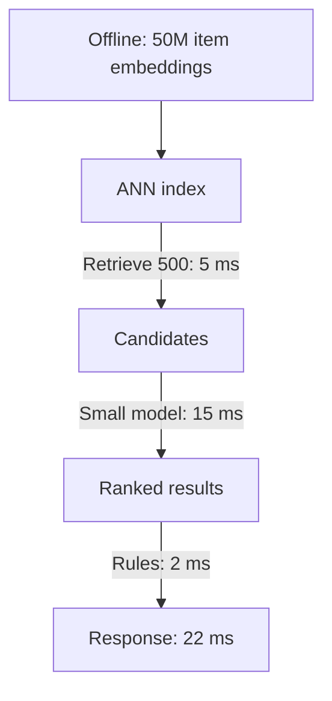
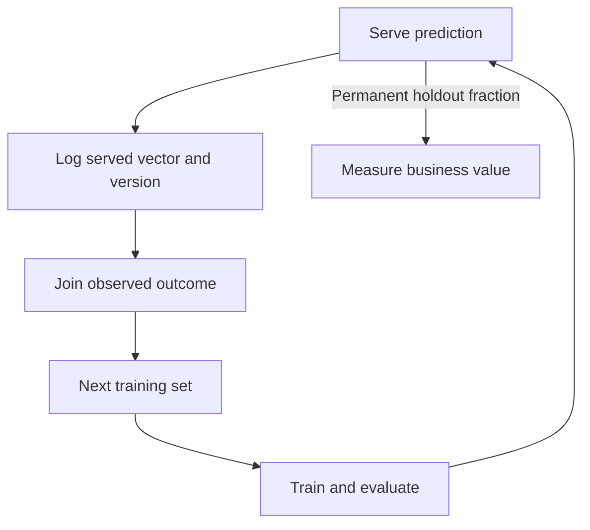

Design a product feature that depends on a model — a recommendation surface, a
fraud check, a content classifier. The interesting design questions are almost
entirely about the system around the model: where it sits relative to the request,
what happens when it is wrong, and how it improves.

## The framing questions, first

```text
  □  what DECISION does the prediction change?
  □  what happens when it is WRONG, in each direction?
  □  what is the latency budget?
  □  what happens when the model is UNAVAILABLE?
  □  how will we know, in production, whether it helps?
```

```text
  the last two are the ones that determine whether the
  feature survives, and they are the ones design
  conversations skip.
```

## Where the model sits

```text
  BATCH        score everything nightly; the request reads a
               lookup
               → no latency budget, no availability
                 requirement, no autoscaling
               → and the score is up to a day stale

  STREAMING    score on an event; store the result

  ONLINE       score during the request
               → fresh, uses request-time features
               → and the model's latency and availability are
                 now the product's
```

```text
  ASK WHETHER BATCH WILL DO. it removes most of the
  engineering, and it satisfies more requirements than
  designs assume.

  the deciding question: does the prediction depend on
  information that only exists at request time?
```

## The hybrid that usually wins

```text
  precompute the expensive part; combine cheaply online.

    OFFLINE   embeddings, candidate sets, heavy features
    ONLINE    a light model over precomputed pieces plus
              request context
```

```text
  a recommendation surface, concretely

    nightly    item embeddings for 50M items → ANN index
    online     retrieve 500 candidates        ~5 ms
               rank with a small model        ~15 ms
               apply business rules            ~2 ms
                                              ──────
                                               22 ms
```



The two-stage funnel is the same structure as search, RAG and recommendation —
cheap retrieval over everything, expensive scoring over a few hundred.

## The feature path

```text
  the latency bottleneck is usually FEATURE FETCHING, not
  inference.

    validate                    1 ms
    fetch features (batched)   30 ms   ← the big one
    transform                   3 ms
    predict                    15 ms
    post-process                2 ms
```

```chart
type: bar
scale: linear
unit: ms
title: Request latency breakdown
caption: Feature fetching is the largest stated stage.
---
Validate: 1
Feature fetch: 30
Transform: 3
Predict: 15
Post-process: 2
```

```text
  □  batch the feature lookup — one multi-get, not N
  □  precompute what can be precomputed
  □  and use ONE definition for training and serving, or you
     have training/serving skew (the defining ML production
     failure)
```

## Degradation

```text
  the model is a DEGRADABLE dependency, not a critical one —
  unless the product is the model.

    model unavailable
      ✗ fail the request
      ✓ serve a cached prediction
      ✓ fall back to a rules engine or popularity ranking
      ✓ hide the personalised section
```

```text
  and it must NOT be in the caller's readiness probe —
  otherwise a nice-to-have model failing removes the
  instance from the pool.
```

```text
  the threshold should be RUNTIME CONFIGURATION.

  a shifted score distribution is fixed by moving the
  threshold in minutes; retraining takes a day.
```

## The feedback loop

```text
  the design must CLOSE THE LOOP, or the model decays and
  nobody knows.

  serve ──▶ log (input vector, prediction, model version)
        ──▶ observe the outcome
        ──▶ join them later
        ──▶ next training set
```



```text
  □  log the FEATURE VECTOR as served, not recomputed
  □  log the model VERSION on every prediction
  □  log the PROPENSITY if there is any randomisation —
     it cannot be recovered later
  □  and hold out a small fraction of traffic PERMANENTLY,
     so "does this help" stays measurable
```

The permanent holdout is the piece that turns a model from an asset defended by
offline metrics into one whose contribution is measured continuously.

## Exploration

```text
  a model trained on its own output learns its own biases.

    a recommender only sees engagement with what it showed.
    → items it never shows never get engagement → never get
      shown

  → reserve a small fraction of impressions for
    exploration, and treat it as a cost of doing business
```

## Monitoring

```text
  INFRASTRUCTURE   latency, errors, saturation
  DATA             feature distributions, null rates,
                   variance collapse
  PREDICTIONS      output distribution — the fastest signal,
                   and it needs no labels
  PERFORMANCE      accuracy and the business metric, when
                   labels arrive
```

```text
  the ML-specific alarms
    □  a feature's null rate jumps
    □  a feature's variance collapses to zero
    □  the prediction distribution shifts
    □  the fallback path activates frequently
```

## Components

```text
  request
    │
  [API] ──▶ [feature store: online] ──┐
    │                                  │
    ├──▶ [model service] ◀─────────────┘
    │         │
    │         └─ registry version, canary-deployed
    │
    ├──▶ [fallback: rules / popularity]
    │
    └──▶ [prediction log] ──▶ join with outcomes
                          ──▶ training set
                          ──▶ [training pipeline]
                          ──▶ [evaluation gate]
                          ──▶ [registry]
```

> [!PITFALL] Putting a degradable model in the readiness probe turns a model outage into an application outage. Keep the fallback usable and monitor when it activates; cached predictions or rules can preserve the product path.

> [!INTERVIEW] When would batch scoring fail to meet the feature's needs? Identify information available only at request time, then explain which expensive work can still be precomputed in a hybrid.

> [!CHECK] What is the online latency of the recommendation funnel example?
>
> Retrieval takes about 5 ms, ranking about 15 ms and business rules about 2 ms. Add 5 + 15 + 2 = 22 ms, with embeddings for 50M items already computed offline.

> [!CHECK] Which request stage should you investigate first in the feature-path example?
>
> Feature fetching takes 30 ms, versus 15 ms for prediction. The full path is 1 + 30 + 3 + 15 + 2 = 51 ms; batching the lookup targets its largest component before optimising inference.

> [!CHECK] Why log the served feature vector rather than recomputing it for training?
>
> Recomputation can use different values or definitions from those seen by the model. Logging the actual vector and model version preserves the prediction context; joining the later outcome then produces a faithful training example.

## What to take away

1. Ask what decision the prediction changes, what happens when it is wrong, and how
   you will know in production whether it helps — before any architecture.
2. Ask whether batch scoring will do; it removes the latency budget, the
   availability requirement and most of the monitoring.
3. The hybrid — precompute offline, combine cheaply online — is the dominant
   pattern, and it is the same retrieve-then-rank funnel as search and RAG.
4. Feature fetching, not inference, is usually the latency bottleneck, and one
   shared feature definition is what prevents training/serving skew.
5. Treat the model as degradable: cached prediction, rules fallback, hidden
   section — and keep it out of the readiness probe, with the threshold as runtime
   config.
6. Close the loop by logging the served feature vector, model version and
   propensity, and keep a permanent holdout so the model's value stays measurable.

Next: notifications and fan-out.
