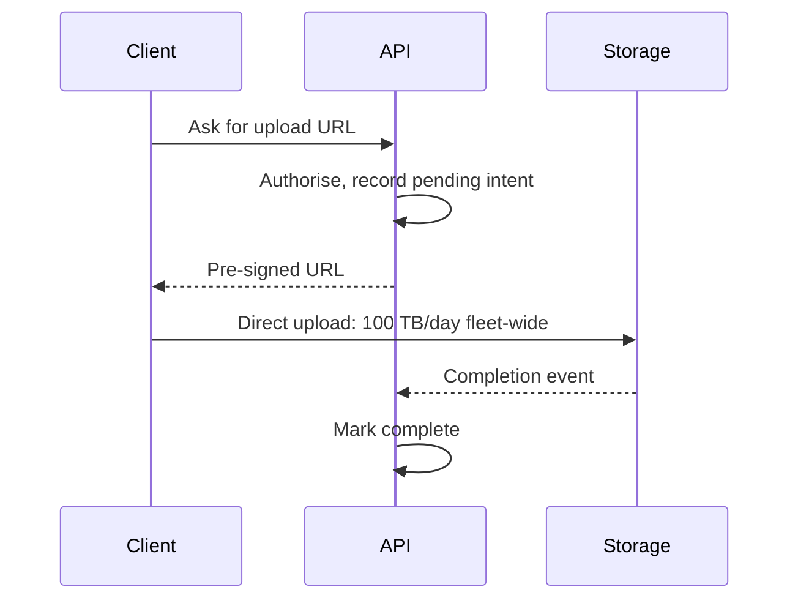
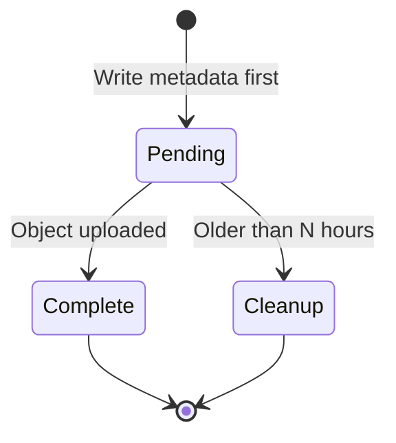

Design a system for storing and serving user files: uploads, downloads,
deduplication, and global delivery. The central insight is that your application
servers should handle almost none of the bytes.

## Requirements and scale

```text
  FUNCTIONAL     upload · download · delete · share ·
                 (optionally) versioning
  NON-FUNCTIONAL durability above all · global low-latency
                 reads · large files · cost efficiency
```

```text
  100M users, 10 GB average
    = 1 EB of stored data
  uploads: 50M files/day at 2 MB = 100 TB/day
  downloads: 10× reads → 1 PB/day egress
    → at $0.08/GB that is ~$80M/month WITHOUT a CDN
```

That last number is the design's dominant constraint, and it arrives from the
estimation before any component is drawn.

## The upload path

```text
  ✗  client → your server → object storage

     your servers carry 100 TB/day, need the memory to buffer
     it, and become the bottleneck and the cost centre.

  ✓  client → object storage DIRECTLY, via a signed URL

     1. client asks your API for an upload URL
     2. API authorises, records intent, returns a PRE-SIGNED
        URL scoped to one key, one method, a short expiry
     3. client PUTs the bytes straight to storage
     4. storage fires an event, or the client confirms
     5. your API marks the upload complete
```



```text
  → your servers see kilobytes of metadata, not terabytes of
    content.
```

**This is the single most important decision in the design**, and it generalises:
whenever bytes can flow between the client and a storage service without
traversing your application, they should.

```text
  large files: MULTIPART upload

    split into 5–100 MB parts, upload in parallel, retry
    individual parts, then complete.

    ✓ resumable — a failure retries one part, not 5 GB
    ✓ parallel — much faster on a good connection
    ✗ orphaned parts if never completed → a lifecycle rule
      to abort incomplete uploads after N days
```

## Metadata

```text
  the FILES table is the system of record for what exists;
  object storage holds the bytes.

    file_id · owner · name · size · content_type
    · storage_key · checksum · created_at · deleted_at
    · version
```

```text
  the consistency problem, from the transactions topic

    the row and the object are two systems.
    a crash between them leaves an orphan in one.

  → write the row FIRST as "pending", upload, then mark
    "complete"
  → a reconciliation job finds pending rows older than N
    hours and objects with no row, and cleans both
```



The reconciliation job is not optional here — it is the mechanism that keeps two
stores consistent when no transaction can span them, exactly as the distributed
transactions chapter argued.

## Deduplication

```text
  hash the content; store each distinct blob once.

    storage_key = sha256(content)

  → many files, one blob, a reference count
  → typical saving: 20–50% in a consumer product, far more
    in a backup product
```

```text
  the complications
    □  DELETION needs the reference count — deleting one
       file must not remove a blob another references
    □  it leaks information: an attacker who can observe
       whether an upload deduplicated learns whether a
       specific file already exists
       → dedup per-account, or accept the leak knowingly
    □  hashing costs CPU on the client or the server
```

Content-addressed storage also gives immutability for free: a blob's key is its
content, so it can be cached forever with no invalidation.

## The download path

```text
  ✗  client → your server → object storage → client
  ✓  client → CDN → (miss) → object storage
```

```text
  private content still avoids your servers:

    1. client asks your API for a download URL
    2. API checks authorisation
    3. API returns a SIGNED CDN URL with a short expiry
    4. client fetches from the CDN edge
```

```text
  the CDN economics, which are the point

    1 PB/day of egress
      direct from object storage:  ~$80M/month
      via a CDN at a 95% hit rate: ~$10–20M/month

  → and the latency improvement is a separate, additional
    benefit
```

```chart
type: bar
scale: linear
unit: $/month
title: Monthly egress cost
caption: Chapter estimates for 1 PB/day and 95% CDN hits.
---
Direct storage: 80000000
CDN: 10000000-20000000
```

```text
  cache control
    immutable content (hashed keys)   max-age=31536000, immutable
    mutable content                   short max-age + ETag
    private content                   signed URLs, short expiry,
                                      and NOT cached publicly
```

> [!KEY] **Content-addressed keys and immutable caching go together.** If the key is the
> hash, the content can never change, so the cache never needs invalidating — which
> removes the hardest part of CDN operation.

## Durability

```text
  □  ERASURE CODING rather than replication: 1.5× storage
     overhead for the durability that 3× replication gives
  □  spread across failure domains — racks, then zones,
     then regions
  □  CHECKSUM on write and verify on read; scrub in the
     background for bit rot
  □  and versioning plus soft delete, because the most
     common data loss is a user or a bug deleting something
```

The last point is the same one the replication chapter made: replication protects
against hardware, not against a mistaken `DELETE`. Object versioning and a
retention window are what protect against the failure that actually happens.

## Cost management

```text
  STORAGE TIERS
    hot        frequently accessed
    infrequent cheaper storage, retrieval fee
    archive    very cheap, hours to restore

  → lifecycle rules move objects automatically by age or
    access pattern
```

```text
  the cost levers, in order
    1. the CDN (egress is usually the largest line)
    2. deduplication
    3. lifecycle tiering
    4. compression, where the content is compressible
    5. deleting what nobody accesses
```

> [!PITFALL] A successful metadata insert does not prove the object exists, and an uploaded object does not prove a complete row exists. Use pending-then-complete plus reconciliation to clean both kinds of orphan.

> [!INTERVIEW] Does content deduplication reveal whether another user has a file? Explain the observable existence leak, the reference count needed for deletion and why per-account deduplication changes the boundary.

> [!CHECK] Why does a signed upload URL matter at the stated upload volume?
>
> 50M files/day × 2 MB = 100 TB/day. Direct upload sends those bytes from clients to storage; the application handles authorisation and metadata rather than carrying that 100 TB.

> [!CHECK] How do hashed keys remove cache invalidation for a blob?
>
> The key is sha256(content). Changing the content changes the key, so a blob under an existing key is immutable and may be cached forever; a new version is a different object.

> [!CHECK] Why are versioning and soft delete still necessary with replicated or erasure-coded storage?
>
> Redundancy preserves bytes through hardware failures but also preserves a mistaken deletion. Versioning and a retention window retain the previous object so user or application deletions can be reversed.

## What to take away

1. Signed URLs let clients upload and download directly, so your servers carry
   metadata rather than terabytes — the single most important decision here.
2. Multipart upload makes large uploads resumable and parallel, and needs a
   lifecycle rule to abort orphaned parts.
3. The metadata row and the object are two systems; write pending-then-complete and
   run a reconciliation job, because no transaction spans them.
4. Content-addressed keys give deduplication and immutable caching together, and
   dedup leaks existence information unless scoped per account.
5. A CDN is the dominant cost lever when egress dominates, and it improves latency
   as a side effect.
6. Erasure coding gives replication-grade durability at 1.5× overhead — but
   versioning and soft delete are what protect against the deletion that actually
   happens.

Next: rate limiting and distributed counters.
