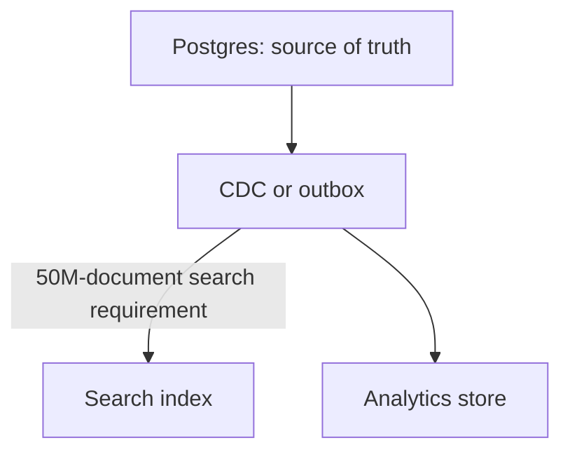

"Which database?" is the question with the most consequential answer and the most
folklore attached. The decision follows from access patterns, consistency
requirements and scale — and the honest default is more boring than most designs
assume.

> [!WHY] A design review adds a graph store, document store and search engine before anyone can say which query the existing database cannot serve. Every store adds a consistency boundary and an operational system that someone must back up.

> [!GOALS]
>
> - Map access patterns and consistency needs to storage engines
> - Compare a specialised engine with the Postgres default
> - Explain the operational cost of polyglot persistence
> - Order indexing, caching, replicas and vertical scaling before partitioning

## Start with Postgres

```text
  a single well-tuned Postgres instance handles

    20k–50k simple queries/second
    10+ TB of data
    ACID transactions
    JSON documents (JSONB, with indexes)
    full-text search
    geospatial (PostGIS)
    time-series (with partitioning, or TimescaleDB)
    vectors (pgvector)
    queues (SKIP LOCKED)
    pub/sub (LISTEN/NOTIFY)
```

> [!KEY] **The default answer is Postgres, and you should be able to say why you are
> leaving it.** A great many designs introduce four specialised stores for a
> workload one relational database would serve, and each additional store is
> operational surface, another consistency boundary and another thing to back up.

```text
  the honest framing for a design conversation:

    "Postgres handles this until roughly X. Here's the
     specific thing that breaks at that point, and here's
     what I'd move."
```

## The categories

```text
  RELATIONAL         Postgres, MySQL
    → transactions, joins, flexible queries, strong
      consistency
    → the default

  KEY-VALUE          Redis, DynamoDB, Memcached
    → simple access by key, very high throughput, low latency
    → caching, sessions, counters, rate limits

  DOCUMENT           MongoDB, DynamoDB, Firestore
    → nested records queried as a unit; flexible schema
    → catalogues, user profiles, content

  WIDE-COLUMN        Cassandra, ScyllaDB, HBase, Bigtable
    → enormous write volume, time-ordered rows per key
    → time series, event logs, messages

  SEARCH             Elasticsearch, OpenSearch
    → full-text, faceting, relevance ranking
    → NOT a system of record

  ANALYTICAL         ClickHouse, Snowflake, BigQuery, DuckDB
    → columnar; aggregations over huge scans
    → analytics, dashboards

  GRAPH              Neo4j, and graph layers on relational
    → multi-hop relationship traversal

  TIME-SERIES        TimescaleDB, InfluxDB, Prometheus
    → high-cardinality metrics, downsampling, retention

  VECTOR             pgvector, Pinecone, Qdrant, Milvus
    → similarity search over embeddings

  OBJECT             S3, GCS
    → files, media, backups, data-lake storage
```

## The decision procedure

```text
  1. what are the ACCESS PATTERNS?
       by key? by range? by relationship? full-text?
       aggregation over millions of rows?

  2. what must be TRANSACTIONAL?
       and what genuinely can be eventually consistent?

  3. what is the SCALE?
       data volume, write rate, read rate, growth

  4. what LATENCY does each path need?

  5. what does the team already RUN?
       ← weighted more heavily than most designs admit
```

```text
  step 5 is not a cop-out.

    a store the team operates well beats a theoretically
    better one they do not. the operational cost of a new
    datastore — backups, failover, monitoring, upgrades,
    on-call expertise — is real and permanent.
```

## Matching patterns to engines

```text
  ACCESS PATTERN                    ENGINE
  ──────────────                    ──────
  by primary key, high volume       key-value / wide-column
  complex ad-hoc queries            relational
  full-text with ranking            search
  aggregations over huge scans      columnar analytical
  time-ordered by entity            wide-column, time-series
  multi-hop relationships           graph (or recursive SQL)
  similarity over embeddings        vector
  large binary files                object storage
  ephemeral, sub-millisecond        in-memory KV
```

```text
  and the anti-patterns

  ✗  a queue on Cassandra
       → delete-heavy; tombstones accumulate and destroy
         read performance (the leaderless chapter)
  ✗  Elasticsearch as a system of record
       → no transactions; it is a derived index
  ✗  a relational store for high-volume append-only events
       → wide-column or a log fits far better
  ✗  MongoDB because "schemas are hard"
       → the schema exists whether or not the database
         enforces it; you have moved it into the application
  ✗  a graph database for one-hop relationships
       → a join does that
```

## Polyglot persistence, and its cost

```text
  using several stores, each for what it is good at.

    Postgres      the system of record
    Redis         cache and sessions
    Elasticsearch search index
    S3            media
    ClickHouse    analytics
```



```text
  the cost people underestimate

    □  every derived store must be KEPT IN SYNC — which is
       the CDC or outbox problem, permanently
    □  consistency boundaries between stores
    □  N sets of backups, monitoring, failover, upgrades
    □  N sets of expertise on the team
    □  debugging spans them
```

**Adopt a new store when a specific requirement forces it, and say which
requirement.** "We add Elasticsearch because we need typo-tolerant full-text
ranking across 50M documents, which Postgres full-text does not do well at that
scale" is a decision. Adding it because search is a category is not.

## The single-store scaling path

Before adding a second store, the ordered options for the first:

```text
  1. INDEX the query           the most common actual answer
  2. CACHE                     read:write ratios make this
                               very effective
  3. READ REPLICAS             scales reads, not writes
  4. VERTICAL SCALING          a bigger machine; a credit-card
                               transaction versus a quarter of
                               engineering
  5. PARTITION / SHARD         the point of no return
  6. a DIFFERENT ENGINE
```

Steps 1–4 are reversible and cheap; step 5 is neither. That asymmetry is why the
ordering matters, and it is the same argument the partitioning chapter made.

## Defending the choice

```text
  a strong answer names the ALTERNATIVE and why it lost.

  "I'd use Cassandra for the message store. The access
   pattern is 'all messages in a conversation, newest
   first', which is exactly a partition key plus a
   clustering column. Write volume is 50k/second, which
   is beyond a single Postgres primary, and we don't need
   cross-conversation transactions.

   The alternative is partitioned Postgres, which keeps
   transactions and a familiar operational model — but we'd
   be building the partitioning Cassandra gives us, and
   we'd still need a separate strategy for multi-region
   writes."
```

That structure — choice, reason, alternative, what the alternative would have
bought — is what distinguishes a designed decision from a recited preference.

> [!PITFALL] A derived search index is not the system of record. Adding it creates a permanent CDC or outbox path, another consistency boundary and another operational system to maintain.

> [!INTERVIEW] Defend Cassandra for the chapter's 50k-write/s message workload against partitioned Postgres. Include the partition-plus-clustering access pattern and what retaining Postgres would buy operationally.

> [!CHECK] Which two keys make recent conversation messages a natural wide-column query?
>
> Use the conversation as the partition key and message order as the clustering column. All messages for one conversation are colocated and ordered, so newest-first history is a range within one partition.

> [!CHECK] Why does a one-hop relationship not by itself justify a graph database?
>
> A relational join already answers one-hop relationships. Multi-hop traversal is the distinguishing graph access pattern; without it, adding a graph store adds operating and synchronisation costs without the stated need.

> [!CHECK] Which four steps should precede partitioning in the single-store scaling path?
>
> Index the query, cache, add read replicas, then scale vertically. These four moves are reversible and cheap; partitioning follows because cross-partition operations and rebalancing impose a lasting cost.

## What to take away

1. Default to Postgres and be able to state the specific thing that breaks before
   leaving it — it covers documents, search, geospatial, time-series and vectors
   adequately at moderate scale.
2. Choose from access patterns, transactional requirements, scale and latency — and
   weight what the team already operates well.
3. Every derived store is a permanent sync problem plus another set of backups,
   monitoring and expertise.
4. Exhaust indexing, caching, replicas and vertical scaling before partitioning;
   the first four are reversible and the fifth is not.
5. Know the anti-patterns: queues on Cassandra, search as a system of record,
   schemaless as an escape from schema design.
6. Defend the choice by naming the alternative and what it would have bought.

Next: the patterns for scaling whatever you chose.

## Exercises

> [!EXERCISE recall] Name four inputs to a datastore decision and explain why “this is a search feature” is not enough to justify a separate search engine.
>
> **Solution:** Start from access patterns, transactional/consistency requirements, scale and latency. A feature name does not identify the query that fails. Postgres already covers many moderate-scale search needs; a dedicated search engine is justified by a concrete need such as typo-tolerant relevance ranking across a corpus too large or demanding for the current path.

> [!EXERCISE apply] A device-event service appends 70,000 events/s, queries recent events by device in time order, and does not need cross-device transactions. Compare the workload with the chapter's 20k–50k simple-query/s Postgres range, choose a suitable store and describe the key layout. Name one store that should remain the source of truth for customer billing.
>
> **Hint:** Match high-volume, time-ordered rows per key to the access pattern.
>
> **Solution:** 70,000 appends/s exceeds the stated single-instance range of 20k–50k simple queries/s, and the reads are time-ordered by device. A wide-column store such as Cassandra/Scylla can partition by device and cluster by event time, making recent per-device ranges local to a partition. Keep customer billing in a relational, transactional system of record; do not use the event store as a queue or billing ledger merely because it accepts writes quickly.

> [!EXERCISE stretch] A product needs relational orders, typo-tolerant search over 80 million catalogue items, and analytical dashboards over event history. Propose a minimal store set, state the data flow, and explain what a weaker answer misses.
>
> **Solution:** Keep orders and catalogue source data in Postgres, add a derived search index only for the specific typo-tolerant ranking requirement, and send events to a columnar analytical store for large scans and dashboards. Use an outbox or CDC path from the source of truth and monitor freshness. A weaker answer selects one database per noun; it misses that each extra store adds synchronization, recovery and backup work, while Postgres can serve many needs until a concrete constraint breaks it.
