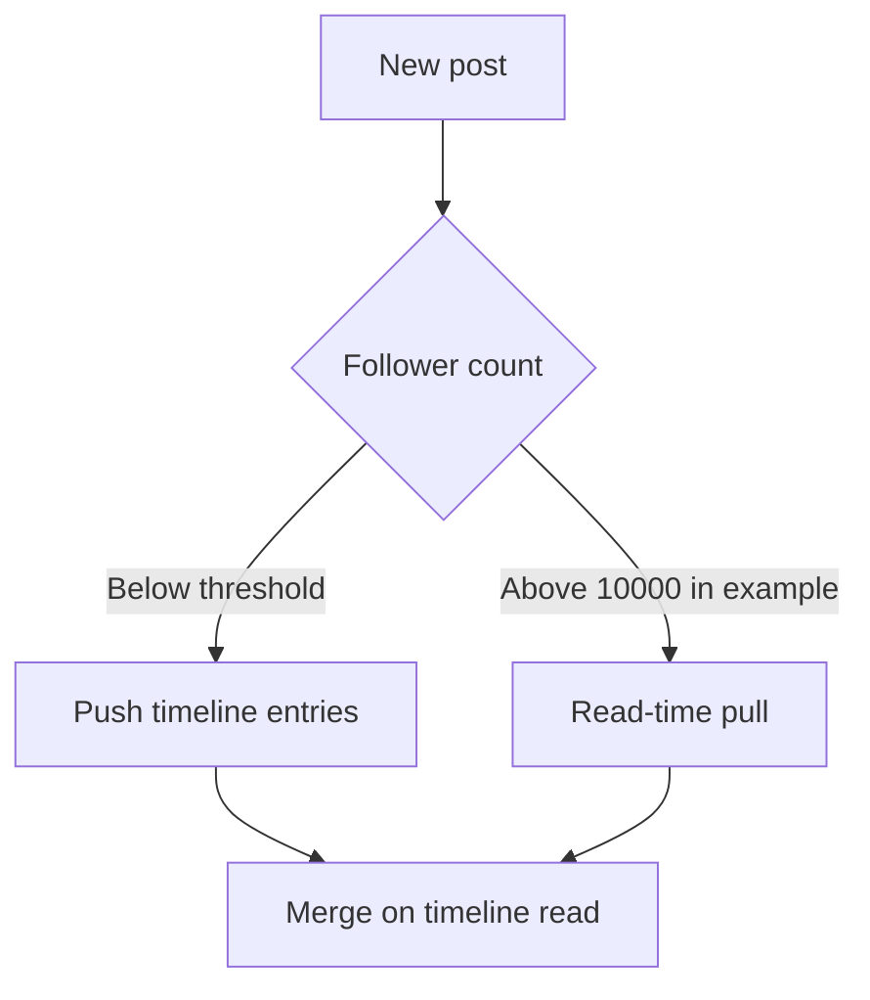

Every interesting design decision is a trade. The skill is not knowing which
option is better — usually neither is — but naming precisely what each one costs
and matching that to what the product needs.

> [!WHY] A timeline is a second behind in one region, while a balance screen must not show money that was never committed. “Make it strongly consistent” or “make it fast” is not a design decision until the product cost is stated per operation.

> [!GOALS]
>
> - Choose consistency guarantees separately for each operation
> - Calculate fan-out and read/write costs from a stated threshold
> - Explain the cost of batching, freshness and coordination
> - State a staleness bound and the user experience it permits

## The trade-offs that recur

```text
  CONSISTENCY   ↔  AVAILABILITY      (during a partition)
  CONSISTENCY   ↔  LATENCY           (all the time — PACELC)
  READ COST     ↔  WRITE COST
  STORAGE       ↔  COMPUTE
  LATENCY       ↔  THROUGHPUT
  SIMPLICITY    ↔  SCALABILITY
  COST          ↔  PERFORMANCE
  FRESHNESS     ↔  EFFICIENCY
```

**The second line is the one paid on every request**, as the PACELC chapter
established, and it is the one most design conversations skip in favour of the
first.

## Consistency, per operation

```text
  the short list that genuinely needs linearizability

    □  uniqueness (usernames, seat allocation)
    □  locks and leader election
    □  compare-and-set
    □  balances and any invariant across concurrent writes
    □  cross-channel communication (a queue that outruns
       replication)

  everything else: eventual, with a stated bound.
```

```text
  and the middle ground that users actually notice

    read-your-writes      you see your own action
    monotonic reads       time does not go backwards
    causal               a reply never precedes its parent

  → together these make a system FEEL consistent at a
    fraction of the cost of making it consistent.
```

That is the practical conclusion from the consistency track: pick eventual
globally and honour the session guarantees rigorously, and the vast majority of
products are correct as far as any user can tell.

## Read cost versus write cost

The trade that shapes most consumer architectures:

```text
  FAN-OUT ON WRITE                 FAN-OUT ON READ
  push to every follower's         assemble at read time from
  timeline at post time            the people you follow

  write: O(followers)              write: O(1)
  read:  O(1)                      read:  O(following)

  → good when reads ≫ writes       → good for celebrities and
    (most users)                     inactive users
```

```text
  the hybrid, which is what real systems do

    normal accounts   → fan-out on write
    accounts above N followers → fan-out on read
    a reader merges their pushed timeline with a pull from
    the few large accounts they follow

  the threshold is a tuning parameter, typically in the
  thousands to tens of thousands.
```



> [!KEY] **Say the threshold and why.** "Above 10,000 followers, a single post is 10,000
> writes, which at our posting rate is more write volume than the timeline store can
> absorb — so those go on the read path" is a designed decision.

## Storage versus compute

```text
  PRECOMPUTE                       COMPUTE ON DEMAND
  materialised views               query at read time
  denormalised copies

  ✓ fast reads                     ✓ always fresh
  ✓ predictable latency            ✓ no storage cost
  ✗ storage cost                   ✗ slow, and load scales
  ✗ staleness                        with reads
  ✗ invalidation complexity
```

```text
  the deciding question: what is the READ:WRITE ratio, and
  how stale may the answer be?

    a follower count, read 1000× per write   → precompute
    a report run once a month                → compute
```

## Latency versus throughput

```text
  BATCHING trades one for the other, explicitly.

    batch size 1     lowest latency, worst throughput
    batch size 128   high throughput, added queueing latency

  → and the right point depends on whether a human is
    waiting.
```

The same trade appears as `linger.ms` in a message producer, as batch size in
model serving, and as group commit in a database. Recognising it as one trade
rather than three settings is worth doing.

## Freshness versus efficiency

```text
  how stale may this be?

    0            linearizable read; a quorum round trip
    < 1 s        streaming update
    < 1 min      cache with a short TTL
    < 1 hour     periodic recomputation
    < 1 day      nightly batch
    unbounded    on-demand, cached forever
```

```text
  each step down is roughly an order of magnitude cheaper.

  → so the question "how fresh does this need to be?" is
    worth asking about every derived value, and the honest
    answer is usually less fresh than the default.
```

## Making a trade-off argument

```text
  the structure that works

    1. name the CHOICE
    2. give the NUMBER that motivates it
    3. name what it COSTS
    4. name the ALTERNATIVE and what it would have bought
    5. say what would CHANGE your mind
```

```text
  "I'd make the timeline eventually consistent with a
   one-second bound. Reads are 100:1 against writes, so
   serving from a cache is what makes the QPS affordable —
   a linearizable read would need a quorum round trip on
   every one.

   The cost is that a user might not see a post they just
   made. I'd fix that specifically with read-your-writes:
   the writer's own timeline is served from the primary
   for a few seconds after posting.

   If this were a trading feed rather than a social one,
   I'd reverse it — there, a second of staleness is a
   correctness problem rather than a cosmetic one."
```

The fifth element is what most distinguishes a designed decision from a memorised
one: knowing which requirement would flip your answer demonstrates that you
reasoned to it rather than recalled it.

## The failure modes

```text
  ✗  presenting a choice as obviously correct
  ✗  choosing consistency everywhere "to be safe" — it is
     expensive and usually unnecessary
  ✗  choosing eventual everywhere without noticing which
     operations need more
  ✗  not saying what was given up
  ✗  a trade-off with no number behind it
```

> [!PITFALL] Choosing strong consistency everywhere charges every read for coordination; choosing eventual consistency everywhere breaks operations such as balance checks and compare-and-set. Choose per operation, and state the staleness bound.

> [!INTERVIEW] What product requirement would reverse the one-second timeline decision? Contrast a social timeline with a trading feed, then say why read-your-writes repairs the social writer's experience.

> [!CHECK] At the example threshold, how much fan-out does one post create for 10,000 followers?
>
> Fan-out on write creates one timeline entry per follower: 1 × 10,000 = 10,000 writes. The threshold moves such accounts to read-time assembly when the posting rate exceeds the timeline store's capacity.

> [!CHECK] Why precompute a follower count read 1,000 times per write?
>
> One write can update a materialised count that serves 1,000 reads. This exchanges storage and acceptable staleness for avoiding the same computation on every read; a monthly report has the opposite access pattern.

> [!CHECK] What does changing batch size from 1 to 128 buy and cost?
>
> It groups 128 items rather than sending each alone, improving throughput through batching. Items wait for the batch, so queueing latency rises; the chapter gives sizes, not a measured 128× speedup.

## What to take away

1. The consistency/latency trade is paid on every request, and it is the one design
   conversations skip in favour of the partition case.
2. Only a short list of operations needs linearizability; session guarantees make a
   system feel consistent at a fraction of the cost.
3. Fan-out on write versus read is the read-cost/write-cost trade, and real systems
   are hybrids with a stated threshold.
4. Precompute when reads dominate and staleness is tolerable; the freshness ladder
   is roughly an order of magnitude per step.
5. Batching trades latency for throughput, and it is one trade appearing as three
   different settings.
6. Argue a trade-off as choice, number, cost, alternative, and what would change
   your mind — the last is what shows you reasoned rather than recalled.

Next: the first case study.

## Exercises

> [!EXERCISE recall] Why should a design state its consistency guarantee per operation rather than choose one global setting for the whole system?
>
> **Solution:** Operations have different failure costs. A social timeline may tolerate a bounded stale read if read-your-writes repairs the posting user's experience, while a balance check or compare-and-set may require coordination to protect correctness. A global choice either pays coordination on operations that do not need it or permits stale results where the product cannot tolerate them.

> [!EXERCISE apply] A social product publishes 3,200 posts/s. Ordinary posts reach 90 followers, but one creator has 7.5 million followers. Calculate ordinary timeline fan-out writes/s and writes for one creator post. Recommend where to put the creator's post and state an acceptable freshness repair for its author.
>
> **Hint:** Multiply post rate by ordinary followers; fan-out for one creator post is its follower count.
>
> **Solution:** Ordinary fan-out is 3,200 × 90 = **288,000 writes/s**. One creator post creates **7,500,000 writes**, equal to 7,500,000 ÷ 288,000 ≈ **26 seconds** of ordinary fan-out. Since 7.5 million is above the chapter's 10,000-follower threshold, keep ordinary posts on fan-out-on-write and assemble this creator's post at read time. The author can receive read-your-writes or a direct post overlay so a short bounded timeline delay does not hide their own post.

> [!EXERCISE stretch] A portfolio screen can tolerate a 2-second stale market quote but must never display an uncommitted trade balance. Propose separate read paths and explain what a weaker global consistency answer misses.
>
> **Solution:** Serve market quotes from a cache or replicated feed with an explicit freshness timestamp and a 2-second staleness bound. Read the trade balance from the committed ledger/materialised balance under the guarantee required by that transaction. A weaker answer forces strong coordination for both paths or eventual consistency for both; it misses that users value latency differently for a quote and correctness differently for money.
