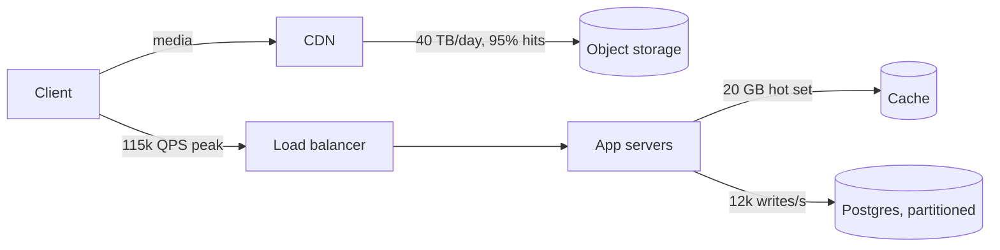

# Curriculum reader redesign — handoff (Codex)

Make a chapter at `/curriculum/[topicId]/[lessonId]` read like a designed
textbook rather than a markdown dump, then give chapters a small vocabulary of
visualizations. **Approved mockup:**
https://claude.ai/artifact/6pp4BDPEpVZzMYGAnKUGte — the real "Back-of-envelope
estimation" chapter rendered the target way. When this brief and the mockup
disagree, this brief wins (it records decisions made after the mockup, e.g.
bold-led paragraphs are NOT callouts — see A6).

Read `docs/handoff/curriculum.md` first. Its five traps all still apply; trap 5
(AppShell owns the `<h1>`) matters most here.

**Ownership.** Codex builds all of it: components, the pure helpers, their unit
tests, the E2E specs. Claude owns this contract. If a contract below looks wrong
mid-build, flag it — don't patch around it.

**Four PRs, in order.** Each is independently shippable and leaves `main` green.

| PR  | What                                                                                  | New deps  |
| --- | ------------------------------------------------------------------------------------- | --------- |
| A   | Reader redesign — every existing chapter, no content change                           | none      |
| B   | Callouts, check-yourself, `chart` blocks, `widget` blocks + the estimation calculator | none      |
| C   | `mermaid` blocks                                                                      | `mermaid` |
| D   | Systems Design content pass (18 chapters)                                             | none      |

---

## Ground rules (all PRs)

- **Other `Markdown` consumers must not change.** Design Drills, Knowledge Base
  etc. render through `src/components/ui/Markdown.tsx` too. Extend the wrapper
  with ONE optional prop, `components?: Partial<Components>` (react-markdown's
  type), shallow-merged over the defaults. The curriculum passes its overrides;
  nobody else passes anything, so their output is byte-identical.
- **Still no raw HTML from content.** No `rehype-raw`. Every block below is
  plain data parsed by a pure function and rendered by a React component that
  builds elements, never `innerHTML` — with the single exception of Mermaid's
  sanitized SVG output (PR C, see C3).
- In `Markdown.tsx`, pass `rehypeHighlight` the option
  `{ plainText: ["text", "chart", "mermaid", "widget"] }` so it never tries to
  highlight or auto-detect those fences.
- **Accessible names of existing controls stay exactly as they are.**
  `tests/ui/curriculum.spec.ts` finds the chapter title as
  `heading level 2 "Hash tables"`, a section as `heading level 2 "Collisions"`,
  the buttons as `"Mark as read"` → `"Read"`, and the next link by its title.
  That spec must pass **unmodified** after PR A. Concretely: decorations
  (section numbers, `#` anchors, ✓ glyphs) are `aria-hidden` or outside the
  heading/button, and icons are lucide with `aria-hidden`.
- Colours only from existing tokens. No literal hex in components.
- Respect `prefers-reduced-motion` (progress bar and smooth scroll).

---

## PR A — reader redesign

### A1. Track hue

The chapter takes its **track's** hue instead of the global indigo (Systems
Design is teal, Distributed is violet, …: `Track.hue` in `curriculumCatalog.ts`).
On the reader's root element set three custom properties:

```
--track:         hueVar(hue)
--track-surface: hueSurfaceVar(hue)
--track-border:  hueBorderVar(hue)   ← add this to src/components/moduleHues.ts,
                                       same shape as hueSurfaceVar ("accent" →
                                       var(--accent-border)), with a unit test
```

Everything "accented" in the reader uses `--track*`: the eyebrow chip, section
numbers, figure labels, arrows, TOC active state, progress bar, recap numerals,
primary button.

### A2. Fonts

Add **Source Serif 4** via `next/font/google` (opsz axis, weights 400/600, italic
400), exposed as `--font-reading`, loaded in the lesson route
(`app/curriculum/[topicId]/[lessonId]/page.tsx`) and applied to the reader
wrapper — not to `app/layout.tsx`, so no other page pays for it.

| Role                        | Face                                  |
| --------------------------- | ------------------------------------- |
| Chapter prose (p, li)       | Source Serif 4, 18px / 1.65, max 68ch |
| Title, section headings, UI | Geist (already loaded), weight 650    |
| Figures, labels, eyebrow    | Geist Mono (already loaded)           |

Body text colour `--body`, headings `--foreground`.

### A3. Layout

- Grid: reading column (`max-w-[740px]`) + a 220px right rail for the TOC at
  `lg`/≥1060px; single column below, where the TOC becomes a
  `<details>` "In this chapter" under the header.
- Keep the `min-w-0` discipline (trap 4). Figures and tables scroll inside
  themselves; the page never scrolls sideways at 390px —
  `tests/ui/responsive.spec.ts` already covers this route; keep it green.
- Drop the `Panel` wrapper around the prose — the page is the surface now.

### A4. Header

Top to bottom:

1. Breadcrumb (unchanged behaviour).
2. Eyebrow row, mono uppercase 12px: track **chip** (track hue, dot + label),
   `Topic N of M`, the tier (`Foundational`/`Core`/`Advanced`), `{minutes} min`.
3. Title — still the page's `<h2>` (trap 5), styled
   `clamp(34px, 5.4vw, 52px)`, tight tracking, `text-wrap: balance`.
4. `summary` as a lead paragraph, serif 21px.
5. Two cards: **Builds on** (this topic's prereqs) and **Unlocks** (topics
   whose prereqs include this one). Up to 3 each, same-track first; a
   cross-track entry shows its track label. A prereq topic that is fully read
   shows `✓ read` in `--success`. Omit a card whose list is empty.

New pure helper, in `curriculumCatalog.ts` (or a sibling file), unit-tested:

```ts
export interface TopicNeighbours {
  position: { index: number; total: number }; // 1-based within its track
  buildsOn: Topic[]; // prereqs, same-track first, max 3
  unlocks: Topic[]; // dependants, same-track first, max 3
}
export function topicNeighbours(topicId: TopicId): TopicNeighbours;
```

`systems-design.estimation` → position `{2, 18}`, buildsOn
`[systems-design.method]`, unlocks starts with `systems-design.storage-choice`.

"Fully read" uses the existing `topicState(...).progress === 1`, so the route
passes the `CurriculumIndex` it already loads down to the reader (metadata only —
never bodies).

### A5. Body structure — three pure helpers

All in `src/modules/curriculum/chapterStructure.ts`, all unit-tested. All of
them must ignore lines inside fenced blocks (a `## ` inside a ```text fence is
not a heading).

```ts
// Splits off the closing recap. 337 of 339 chapters have exactly this heading.
// `takeaways` is the section's body WITHOUT its heading, up to the next "## "
// or EOF; `main` is everything else, unchanged. No heading → takeaways null.
export function splitTakeaways(body: string): {
  main: string;
  takeaways: string | null;
};

// The h2s of `main`, in order, for the TOC and section numbering.
export interface OutlineEntry {
  id: string;
  text: string;
  number: number;
  line: number;
}
export function chapterOutline(markdown: string): OutlineEntry[];

// Heading text → id: inline markdown stripped (**, `, [x](y) → x),
// lowercased, non-alphanumerics → "-", trimmed of "-". Duplicates get "-2", "-3".
export function slugifyHeading(text: string, taken: Set<string>): string;
```

`line` is the heading's 1-based line in the string passed in. The `h2` override
finds its entry by `node.position.start.line` — the same source string feeds
both, so the number and id can never drift from the TOC. (Don't count renders
with a mutable counter; StrictMode double-renders.)

### A6. Element treatments

| Markdown                                      | Renders as                                                                                                                                                                                                                                                                                                         |
| --------------------------------------------- | ------------------------------------------------------------------------------------------------------------------------------------------------------------------------------------------------------------------------------------------------------------------------------------------------------------------ |
| First paragraph of `main`                     | Lead paragraph, serif 19px, drop cap in `--track` (Geist 650, ~3.4em, floated).                                                                                                                                                                                                                                    |
| `## Heading`                                  | `<h2 id>` 27px Geist 650. Before it, `aria-hidden` mono number `01`, `02`… in `--track`. After it, a hover/focus-revealed `#` link to `#id` placed **outside** the heading element (or `aria-hidden` with the link labelled separately) so the heading's accessible name is exactly its text. `scroll-margin-top`. |
| ` ```text ` fence                             | **Figure** — see A7.                                                                                                                                                                                                                                                                                               |
| Any other fenced code                         | Code block with a bar: language label left, Copy button right. Highlighting unchanged.                                                                                                                                                                                                                             |
| Blockquote whose content is **entirely bold** | **Key rule** callout: `--track-surface` fill, `--track-border` border, mono label "Key rule". (These are the stated invariants, e.g. Raft's term rule.)                                                                                                                                                            |
| Any other blockquote (no `[!KIND]`)           | Quotation: serif italic, `--track-border` left rule.                                                                                                                                                                                                                                                               |
| Tables                                        | `--surface` background; header cells mono 11px uppercase `--muted`; row rules only (no vertical borders); `tabular-nums`; wrapped in `overflow-x-auto`.                                                                                                                                                            |
| Paragraph starting with `**bold**`            | **Unchanged.** 792 paragraphs do this as a run-in heading; turning them all into callouts would make callouts meaningless. PR D converts the few that deserve it to `> [!KEY]`.                                                                                                                                    |
| The `takeaways` section                       | **Recap card** below the body: `--surface`, `--border`, 14px radius, heading "What to take away" (still an h2, still in the TOC and numbered), list items with circular mono numerals in `--track-surface`/`--track`. Render it through the same `Markdown` with the same overrides.                               |

### A7. Text figures — `figureLines.ts`

Every ` ```text ` fence (3,405 of them) becomes a figure:

- Frame: `--border`, 12px radius. A bar on top: `FIG n` (mono, `--track`,
  semibold), the caption, and a Copy button (copies the **original** text, not
  the decorated one). Body: faint graph paper (22px grid of `--border` at low
  contrast — define `--grid` locally from `color-mix(in oklab, var(--border) 55%, transparent)`),
  `overflow-x-auto`, mono 13.5px / 1.7.
- **Numbering is a CSS counter** (`counter-reset` on the article,
  `counter-increment` on each figure, `content: counter(fig)` in the bar), so
  no JS counts.

Pure parser in `src/modules/curriculum/figureLines.ts`:

```ts
export type SegmentKind =
  "text" | "label" | "dim" | "arrow" | "flag" | "cross" | "box";
export interface Segment {
  kind: SegmentKind;
  text: string;
}
export interface ParsedFigure {
  title: string | null; // see rule 2
  lines: Segment[][]; // after dedent; rendered as <span>s, never innerHTML
}
export function parseFigure(raw: string): ParsedFigure;
```

Rules, applied in this order:

1. **Dedent**: strip trailing whitespace from the block, then remove the
   smallest common leading-space count across non-blank lines.
2. **Title**: if the first line starts with a lowercase letter, contains no run
   of 3+ spaces (i.e. it isn't a table row), and the second line is blank, it is
   the title (one trailing `:` removed) and both lines are dropped. Otherwise
   `title` is null and the caption falls back to the enclosing section heading's
   text (the renderer passes it in).
3. **Label line**: a whole line matching
   `^(\s*)(\d+\.\s+)?([A-Z][A-Z0-9-]{2,}(?: [A-Z0-9-]{2,})*)(\s*\(.*\))?\s*$`
   → `[text(indent)] [dim(number)] label(CAPS) [dim(parenthetical)]`.
   Matches `TIME`, `LATENCY (from the distributed track)`, `1. QPS`,
   `4. MEMORY (for a cache)`. Does **not** match `L1 cache`, `CAPACITY x` with
   a lowercase word, or `□  ROUND AGGRESSIVELY — …`.
4. Otherwise, within the line:
   - a leading `✗` (after indent) → `cross`;
   - a leading `□` or `✓` → `box`;
   - from `←` to end of line → `flag` (rendered as a small `--hue-amber` pill);
   - from `→` to end of line → `arrow` (`--track`, weight 500);
   - everything else `text`. `flag` wins over `arrow` if both somehow appear.

Unit tests must include, verbatim from
`content/curriculum/systems-design.estimation/01-back-of-envelope.md`:
the numbers block (four labels), `= 20M × 2 MB = 40 TB/day  ← DOMINATES`
(one flag segment), the "the conclusions that fall out…" block (title
extracted, `□` boxes and `→` arrows), and the `✗` mistakes block. Plus: a block
whose first line is lowercase but whose second line is NOT blank keeps
`title: null`; an all-blank block doesn't throw.

### A8. TOC, progress, time left — one client component

- Right rail: "In this chapter" (mono 11px label), the outline as links,
  left rule; active entry gets `--track` text and a 2px `--track` left border.
  Active = the last heading whose top is above ~140px from the viewport top
  (IntersectionObserver or a passive scroll listener with rAF).
- A 3px `--track` progress bar fixed to the top of the reading area, width =
  scroll progress through the article.
- Under the TOC: `"{n} min left"` = `round(minutes × (1 − progress))`, and
  "You're at the end" at 0. Hidden when `minutes` is null.

### A9. Finish card (replaces the current two buttons)

After the recap: a card with "Finished this chapter?" / "Mark it read to fill
in its node on the {track} map." and the two existing buttons
(**same accessible names**: "Mark as read" ↔ "Read", "Revisit later" ↔
"Flagged to revisit"). Primary button filled `--track`. When done: card turns
`--success-surface`/`--success-border`, heading "Chapter complete", and a line
`{Track}: {x} of {y} topics read` from `trackState`. Same store calls as today;
no store or repository change.

Previous/next nav below it stays as is, restyled to the mockup.

### A10. Tests for PR A

- Unit: `figureLines.test.ts`, `chapterStructure.test.ts`, `topicNeighbours`,
  `hueBorderVar`.
- E2E (`tests/ui/curriculum.spec.ts`, new cases; existing cases untouched):
  open the estimation chapter →
  figure count equals the number of ```text fences in the file (read it in the
  test, don't hard-code); the TOC has one link per `##` outside fences and
  clicking "A worked example" scrolls its heading into view; the recap card
  contains 6 list items; the Copy button on figure 1 exists; "Mark as read" →
  "Read" still works and the card shows "Chapter complete".
- `npm run lint`, `typecheck`, `test:ui` green.

---

## PR B — callouts, check-yourself, charts, widgets

### B1. Callouts (blockquote with a marker)

A blockquote whose first paragraph's text starts with `[!KIND]` (on its own line
or followed by text on the same line). The marker is stripped from the rendered
text. Unknown kinds render as a plain quotation.

| Marker         | Label            | Colours                                          |
| -------------- | ---------------- | ------------------------------------------------ |
| `[!KEY]`       | Key point        | `--track-surface` / `--track-border` / `--track` |
| `[!PITFALL]`   | Pitfall          | `--hue-amber-*`                                  |
| `[!INTERVIEW]` | In the interview | `--hue-violet-*`                                 |
| `[!CHECK]`     | Check yourself   | see B2                                           |

GFM does not parse `[!KEY]` (no link definition), so it arrives as literal text;
detect it on the hast node, not with a regex over the whole body.

### B2. Check yourself

```markdown
> [!CHECK] A service gets 50M DAU, 10 requests each per day, at a 4× peak.
> Roughly what peak QPS do you plan for?
>
> 50M × 10 = 500M a day ÷ 10⁵ s ≈ 5,000 QPS average; × 4 ≈ **20,000 QPS**.
```

First paragraph = question, everything after = answer. Render as `<details>`:
summary shows "Check yourself" (mono label) + the question; the answer is
revealed on open. Native `<details>` — keyboard and screen reader behaviour for
free.

### B3. `chart` blocks — `chartBlock.ts`

```chart
type: bar
scale: log
unit: ns
title: The latency ladder, log scale
caption: Each gridline is 1,000× slower than the one before.
---
L1 cache: 1
main memory: 100
SSD read: 100000
same-DC round trip: 500000
disk seek: 5000000
cross-region: 100000000
```

Grammar — header, a line that is exactly `---`, then rows:

- Header keys: `type` (required; only `bar` exists), `scale` (`linear` default
  | `log`), `unit` (optional), `title` (optional; falls back to the section
  heading like text figures), `caption` (optional), `highlight` (optional; a
  row label drawn in `--hue-amber`).
- Rows: `label: value`, split on the **last** `": "`. Value is a number
  (`/^-?\d+(\.\d+)?(e\d+)?$/`, no thousands separators) or a range `low-high`
  of two such numbers (`10000-20000`). 1–12 rows. Log scale requires all
  values > 0.

```ts
export interface ChartRow {
  label: string;
  low: number;
  high: number;
} // single value: low === high
export interface ChartSpec {
  type: "bar";
  scale: "linear" | "log";
  unit: string | null;
  title: string | null;
  caption: string | null;
  highlight: string | null;
  rows: ChartRow[];
}
export function parseChartBlock(
  src: string,
): { ok: true; spec: ChartSpec } | { ok: false; error: string };
export function formatChartValue(v: number, unit: string | null): string;
```

`formatChartValue`: unit `ns` auto-scales (`1 ns`, `100 µs`, `0.5 ms`, `5 ms`,
`1 s`); unit `B` auto-scales bytes (decimal, `KB`…`PB`); a unit starting with
`$` → compact currency (`$96k`, `$1.2M`) with the rest of the unit (e.g.
`/month`) shown once in the axis title, not per bar; anything else → compact
number + space + unit. A range formats as `$10–20k` (shared suffix) or
`10–20 ms`.

`ChartBlock.tsx` (inside the figure frame, bar label `CHART`):

- Horizontal bars, single series in `--track`, `highlight` row in
  `--hue-amber`. Range rows: solid to `low`, `--track-border` from `low` to
  `high`. Bars anchored at the baseline, 4px rounded data end, 2px gap.
- Label column left (text tokens, never the bar colour); value label at the
  bar end in `--foreground`; recessive gridlines in `--border`; ticks at
  powers of 1,000 for `ns` log charts (1 ns / 1 µs / 1 ms / 1 s), at powers of 10
  for other log charts, at 5 "nice" steps for linear.
- No legend (one series — the title names it).
- Hover AND keyboard focus on each row (the row is focusable) shows a tooltip:
  the label, formatted value, and for log charts "N× the first row".
- `role="img"` with an `aria-label` listing every row, plus a visually hidden
  `<table>` of the same data.
- SVG with a `viewBox`, `min-width: 560px`, inside the figure's
  `overflow-x-auto`.
- Parse failure: render the raw block as a text figure with a visible
  `Chart error: {error}` line in `--danger`. The content gate (B5) stops this
  shipping.

### B4. `widget` blocks — named interactives

````markdown
```widget
estimation-calculator
```
````

The fence body is one id. `src/modules/curriculum/widgets/registry.ts` maps ids
to `next/dynamic` components; an unknown id renders a `Widget not found: {id}`
notice in `--danger`. Widgets live in code because they ARE code — markdown
never carries logic.

**First widget: `estimation-calculator`** (from the mockup). Math in a pure,
unit-tested `estimate.ts`:

```ts
export interface EstimateInput {
  dau: number;
  postsPerUser: number;
  feedOpensPerUser: number;
  peakMultiplier: number;
  mediaShare: number; // 0..1
}
export interface EstimateResult {
  peakWritesPerSec: number;
  peakReadsPerSec: number;
  textStoragePerYearBytes: number; // posts × 500 B × 365 × 3 replication
  mediaPerDayBytes: number; // posts × mediaShare × 2 MB
  verdicts: { id: "partition" | "cache" | "cdn" | "egress"; on: boolean }[];
}
export function estimate(input: EstimateInput): EstimateResult;
```

- writes = `dau × posts ÷ 86,400 × peak`; reads = `dau × opens ÷ 86,400 × peak`.
- Verdicts: `partition` when peak writes > 10,000; `cache` when peak reads >
  50,000; `cdn` when media/day > 1 TB; `egress` when `media/day × 30 × $0.08/GB`
  > $50,000/month. Copy for each is in the mockup.
- **Test with the chapter's own numbers**: 100M DAU, 2 posts, 20 opens, 5×, 10%
  → ≈11,574 writes/s, ≈115,741 reads/s, ≈110 TB/year, 40 TB/day, all four
  verdicts on. And one input where all four are off.

UI per the mockup: five range inputs (DAU on a log slider 1M–1B), four stat
tiles, the verdict list (`→` in `--track` when on, `○` muted when off).
Every input has a `<label for>`.

### B5. Content gates (unit tests over `content/curriculum/**`)

Same file-walking shape as `contentWidth.test.ts`:

- every ` ```chart ` block parses (`ok: true`);
- every ` ```widget ` id exists in the registry;
- every `[!CHECK]` callout has an answer paragraph;
- no blockquote uses an unknown `[!KIND]`.

These are the review for generated content — nobody will eyeball 339 chapters.

### B6. Seed the estimation chapter

So B has real E2E targets, add to
`content/curriculum/systems-design.estimation/01-back-of-envelope.md`
(exactly the mockup's content, no other prose change):

- the latency `chart` after the numbers block;
- the egress `chart` after the egress text figure (`highlight: direct from
object storage`, rows `direct from object storage: 96000` and
  `through a CDN, 95% hits: 10000-20000`, `unit: $/month`);
- the `estimation-calculator` widget after the worked example's conclusions
  block, with a one-sentence lead-in;
- convert "**That last block is the point of the exercise.** …" into a
  `> [!KEY]` callout;
- one `[!PITFALL]` and two `[!CHECK]`s from the mockup, before "What to take
  away".

E2E: the two charts render an `svg` with `role="img"`; focusing a latency bar
shows its tooltip; the calculator shows the default stats, and dropping DAU to
1M turns the "partition" verdict off; a check-yourself expands to reveal its
answer.

---

## PR C — Mermaid

### C1. Dependency

`mermaid` (current major, v11) — approved 2026-10-08 in `CLAUDE.md` /
`AGENTS.md`. **Import it dynamically inside an effect** (`await
import("mermaid")`): it touches `window`/`document` at module scope, the same
class of SSR crash the Reader hit with pdfjs (`docs/handoff/reader.md`). It also
weighs hundreds of KB, and dynamic import means only chapters that contain a
diagram ever load it.

### C2. Config

```ts
mermaid.initialize({
  startOnLoad: false,
  securityLevel: "strict",
  theme: "base",
  flowchart: { htmlLabels: false, curve: "basis" },
  themeVariables: /* resolved values, see below */,
});
```

`themeVariables` need real colour strings, not `var(...)`: read
`getComputedStyle(root)` for `--surface`, `--foreground`, `--border`,
`--muted`, `--track`, `--track-surface`, and the Geist font family. Re-render
when the theme flips (a `MutationObserver` on `<html>`'s `class`, which is where
`dark` lives). Render ids from `useId()` with the colons stripped.

### C3. Rendering

`mermaid.render(id, source)` returns an SVG string; insert it with
`dangerouslySetInnerHTML`. **This is the one sanctioned exception** to the
no-raw-HTML rule, scoped exactly as highlight.js's is: the input is a
repository file (not user or DB text), `securityLevel: "strict"` runs
mermaid's own DOMPurify pass, and `htmlLabels: false` keeps labels as SVG
text. Don't extend the exception to anything else.

Frame: the figure frame with bar label `DIAGRAM`, `title`/caption from the
section heading. While loading: the source as a text figure (so there's never
an empty box and no layout jump is worse than the source). On a parse error:
keep that text figure and add `Diagram error` in `--danger`, plus a
`data-mermaid-error` attribute for E2E.

### C4. Seed + test

Add the architecture flowchart from the mockup to the estimation chapter after
the bandwidth/cache part of the worked example. E2E: the chapter renders an
`svg` inside the diagram figure, no element has `data-mermaid-error`, and it
still renders after toggling dark mode.

### C5. Docs

Replace the "What actually renders" table in
`docs/curriculum-authoring-prompt.md` with the new vocabulary (text figures,
`chart`, `mermaid` flowchart/sequence/state, `widget` by id, the four callout
kinds), and the prompt's "Mermaid is NOT rendered" rule with the guidance in
PR D's prompt. Update `content/curriculum/README.md`'s "Raw HTML is not
rendered" paragraph to list the blocks.

---

## PR D — Systems Design content pass

Augment, don't rewrite: the 18 `content/curriculum/systems-design.*` chapters
keep their prose and text figures. One topic per request, with this prompt
(plus the chapter file pasted under it):

````text
Below is a finished textbook chapter in markdown. ADD visual and active-recall
blocks to it. Do not rewrite, reorder or delete any existing prose, heading or
fenced block, except where an instruction below says to convert one.

Add, where each genuinely helps (not as decoration):

1. `mermaid` diagrams — 1 to 3. Use them for architectures, request flows
   (sequenceDiagram) and state machines (stateDiagram-v2). Keep an existing
   ```text figure when it carries numbers or a table; add the mermaid diagram
   next to it, not instead of it. Put the key quantity on edges or in node
   labels ("12k writes/s"). flowchart LR, at most ~10 nodes, labels short.
2. `chart` blocks — 0 to 2, only where the chapter already states numbers that
   compare (a latency ladder, a cost comparison, a capacity budget). Grammar:
     ```chart
     type: bar
     scale: linear | log
     unit: ns | B | $/month | <anything>
     title: <optional>
     caption: <optional, one sentence>
     highlight: <optional row label>
     ---
     <label>: <number or low-high>
     ```
   Numbers are plain digits (1e8 allowed), no commas. 1–12 rows. Use only
   numbers the chapter itself states.
3. Callouts:
     > [!KEY] — at most 3. Convert the chapter's strongest "**Bold sentence.**"
       run-in paragraphs (the ones that state the lesson), keep the wording.
     > [!PITFALL] — 1 or 2 named failure modes the chapter discusses.
     > [!INTERVIEW] — 1: what to say out loud, or the follow-up you'll get.
4. Exactly 3 `> [!CHECK]` questions, just before "## What to take away".
   First paragraph is the question; after a blank `>` line, the answer, with
   working shown. Answerable from the chapter alone.

Do NOT add `widget` blocks (those are code). Every fenced line ≤ 76 columns.
Return the complete updated file.
````

Then for each file: `npm run test:ui -- content` (the B5 gates + the 80-column
width gate) and open the chapter once in dev — Mermaid syntax errors are only
caught by rendering (C4's E2E covers the estimation chapter only). One commit
per topic or one for the track; the content gates are the merge gate.

Candidate widgets surfaced during D go in a list at the bottom of this file
for a later PR, not into the content.

---

## Done when

- A, B, C merged with lint/typecheck/unit/E2E green; the existing curriculum
  and responsive specs unmodified and passing.
- All 18 Systems Design chapters augmented and passing the content gates.
- This file's status line below updated, and `docs/handoff/curriculum.md`'s
  "Adding material" section points here.

**Status:** PR B approved 2026-10-15 (review below). Next: PR C, starting with the PR B chart follow-ups.

---

## PR A review — 2026-10-09 (Claude)

Lint, typecheck, unit (1,443) and the existing curriculum + responsive E2E
(23) all pass, and the page looks right in broad strokes. **Not mergeable yet**:
the bugs below were confirmed in a real browser, and several A-items are
missing. Fix in this order.

### Bugs

1. **Every untitled figure is captioned "Common mistakes".** `Figure` gets
   `outline.at(-1)` — the chapter's LAST heading. Use the enclosing section: the
   last outline entry whose `line` is below the `pre` node's
   `position.start.line`.
2. **Progress bar and "min left" run about twice as fast** — the bar is full at
   the halfway point. `scrollY - rect.top` counts the scroll twice (`rect.top`
   is already viewport-relative). Use
   `clamp(-rect.top / (rect.height - innerHeight), 0, 1)`.
3. **Every scroll event re-renders the whole reader**, including two full
   ReactMarkdown parses of the chapter. Move the progress state into its own
   small client component (bar + "min left") so the article never re-renders on
   scroll.
4. **Blank lines inside figures collapse.** An empty line renders as a
   zero-height `div`, so `TIME` / `LATENCY` / `SIZES` run together with no gap.
   Give an empty line its full line height (e.g. render a non-breaking space).
5. **`□` / `✗` lines skip the arrow and flag rules.**
   `□  media dominates storage → object storage + CDN` loses its arrow. The
   leading-glyph rule applies first, then the `←`/`→` rules to the rest of the
   line (A7). Add that exact chapter line as a test case.
6. **Primary button is `text-white` on `--track`.** Dark-mode hue tokens are
   the bright 400 shades, so white on teal-400 is about 1.8:1 and fails AA. Use
   `text-canvas` (light text in light mode, dark text in dark mode), and no
   literal colours.
7. **The drop cap leaks.** `[&_p:first-child]` matches every first-child
   paragraph in the subtree: blockquotes, loose list items, the recap. Scope it
   to the main body's direct first paragraph only.
8. **The `#` anchor is labelled `[object Object]`** when a heading has inline
   markup (`String(children)`). Use `entry.text`.
9. **Copy has no failure path, and "Copied" never resets.** Catch the
   clipboard rejection and fall back to selecting the figure text; reset the
   label after about 1.5 s.

### Missing from the spec

- **A7:** figure numbers (`FIG 1`, `FIG 2`…) via a CSS counter. The bar shows a
  bare "FIG".
- **A8:** TOC active state (scroll-spy) and the mobile `<details>` "In this
  chapter". Below `lg` there is currently no TOC at all.
- **A6:** the **Key rule** callout for all-bold blockquotes, and the language
  bar + Copy button on non-`text` code blocks.
- **A6:** the recap card's numbered circles; "What to take away" must also
  appear in the TOC and be numbered like the other sections.
- **A4:** `✓ read` on fully read "Builds on" topics, and make both cards'
  entries links to the topic.
- **A10:** none of the new E2E cases were added.

### Code shape

`LessonReader.tsx` has been collapsed into a handful of very long lines. Split
it into `ChapterHeader`, `Figure`, `ChapterToc`, `ReadingProgress` and
`FinishCard` files, and run Prettier on every touched file (lint-staged only
formats at commit time). `Markdown.tsx`, `figureLines.ts` and the catalog
addition need the same.

## PR A re-review — 2026-10-15 (Claude)

**Approved.** Lint, typecheck, unit and the full E2E suite (155) pass. Every
bug and missing item from the first review was confirmed fixed in a real
browser: captions follow their section, the progress bar reads 50% at the
midpoint, figures are numbered and keep their blank lines, `□ … →` lines keep
the arrow, the TOC tracks the active section and appears at 390px, the recap
is numbered and in the TOC, and "Mark as read" is legible in dark mode. Key
rule boxes render on `distributed.consensus/03-raft-election-and-log`.

Non-blocking, fold into PR B:

- Add an E2E case for the Key rule box (the Raft chapter above has two).
- `ChapterHeader`'s `/curriculum?topic=` fallback link is dead: the map
  doesn't read that param. Every topic has chapters today, so it can't be
  reached; drop it or link to `/curriculum`.

## Appendix — B6 seed content (exact)

The mockup link is private to the Lead Architect's account, so the exact text
B6 seeds lives here. Insert into
`content/curriculum/systems-design.estimation/01-back-of-envelope.md` at the
marked places. Change no other prose.

**1. After the first `text` figure under "## The numbers to memorise":**

````markdown
```chart
type: bar
scale: log
unit: ns
title: The latency ladder, log scale
caption: Each gridline is 1,000× slower than the one before.
---
L1 cache: 1
main memory: 100
SSD read: 100000
same-DC round trip: 500000
disk seek: 5000000
cross-region: 100000000
```
````

**2. Replace the paragraph that starts "\*\*That last block is the point of the
exercise.\*\*"** (the wording is unchanged; it becomes a callout), then add the
widget straight after it:

```markdown
> [!KEY] **That last block is the point of the exercise.** The arithmetic is
> worthless unless it produces architectural conclusions, and here four numbers
> ruled out a single-database design and ruled in a CDN, a cache and
> partitioning.

Run the same estimate yourself: drag a slider and watch which conclusions flip.
```

````markdown
```widget
estimation-calculator
```
````

**3. After the "the egress line is the one that catches people" figure under
"## Cost, roughly":**

````markdown
```chart
type: bar
unit: $/month
title: Monthly egress for 40 TB/day of media
caption: The second, independent argument for the CDN.
highlight: direct from object storage
---
direct from object storage: 96000
through a CDN, 95% hits: 10000-20000
```
````

**4. After the "## Common mistakes" figure, before "## What to take away":**

```markdown
> [!PITFALL] Designing for the average. 2,300 writes/s looks easy until the 5×
> evening peak puts you at 12,000, past what one Postgres primary handles.

> [!INTERVIEW] Say each assumption out loud before you multiply by it. The
> interviewer will correct a bad assumption, but can't correct one they never
> heard.

> [!CHECK] A service gets 50M DAU, 10 requests each per day, at a 4× peak.
> Roughly what peak QPS do you plan for?
>
> 50M × 10 = 500M requests a day. Divide by 10⁵ seconds: about 5,000 QPS on
> average. Multiply by 4 for the peak: about **20,000 QPS**.

> [!CHECK] Why does media, not post text, decide the storage architecture in
> the worked example?
>
> Text is 100 GB a day; images are 40 TB a day, 400× more. That volume belongs
> in object storage behind a CDN, which also fixes the egress bill.
```

### `estimation-calculator` copy

| Element                         | Text                                                                                                                                                                                                   |
| ------------------------------- | ------------------------------------------------------------------------------------------------------------------------------------------------------------------------------------------------------ |
| Frame bar label / title         | `INTERACTIVE` / Run the estimate yourself                                                                                                                                                              |
| Caption                         | Starts at the chapter's numbers. Drag a slider and watch which architectural conclusions flip.                                                                                                         |
| Inputs (label → range, default) | Daily active users → 1M–1B log slider, 100M · Posts per user per day → 0.5–10 step 0.5, 2 · Feed opens per user per day → 1–50, 20 · Peak ÷ average → 2–10×, 5× · Posts with a 2 MB image → 0–50%, 10% |
| Stat tiles                      | Peak writes (`12k/s`) · Peak reads (`120k QPS`) · Text storage / year, ×3 (`110 TB`) · Media / day (`40 TB`)                                                                                           |
| Verdict `partition`             | Writes exceed one Postgres primary → partition, or a different store                                                                                                                                   |
| Verdict `cache`                 | Reads dominate → caching is the main lever                                                                                                                                                             |
| Verdict `cdn`                   | Media dominates storage → object storage + CDN                                                                                                                                                         |
| Verdict `egress`                | Egress would pass $50k/month → the CDN pays for itself                                                                                                                                                 |

Stat values use two significant figures with k/M/B suffixes, and decimal bytes
(`GB`, `TB`, `PB`). An "on" verdict shows `→` in `--track` with
`--foreground` text; an "off" one shows `○` in `--muted` with muted text.

## PR B review — 2026-10-15 (Claude)

**Approved.** Lint, typecheck, unit (1,547) and the full E2E suite pass.
`prep-tracker.spec.ts:200` failed once in the full run, then passed 40 of 40 in
isolation: a pre-existing timing flake, not PR B. Confirmed in a real browser:
both charts, the focus tooltip, the calculator at the chapter's numbers, all
four callout kinds, check-yourself expanding, Key rule on the Raft chapter, and
no page-level horizontal scroll at 390px. The contracts match B3/B4 exactly and
the chapter diff is exactly the appendix.

Fix at the start of PR C (none blocks merging B):

1. **Chart text is too small.** The SVG's viewBox is 740 wide, but the column
   renders it at about 600px, so the 11px labels land near 9px. Most of the
   right side of the viewBox is also unused (the plot stops at x≈586). Size the
   viewBox to the content column (about 620) so it renders close to 1:1, keep
   rendered text at least 12px, and give bars real gaps (the mockup used a
   20px bar in a 34px row).
2. **Drop the axis title when the unit already formats the ticks** (`ns`,
   `B`). The lone "ns" under the latency chart is noise. Keep it for `$/…`
   and free-form units.
3. **A focused chart row shows two rings** (the browser's focus outline plus
   the `--track` stroke). Keep only the `--track` stroke.
4. **Check yourself:** the disclosure triangle sits on its own line above the
   label. Put it inline with "Check yourself".

## Appendix — C4 seed content (exact)

Insert into `content/curriculum/systems-design.estimation/01-back-of-envelope.md`
directly after the worked example's first `text` figure (the one titled "a
social app: 100M DAU") and before the "the conclusions that fall out" figure.
Change no other prose.

````markdown
Drawn as a system, those numbers imply this architecture:


````

The frame's title falls back to the section heading ("A worked example"),
like every other figure.
